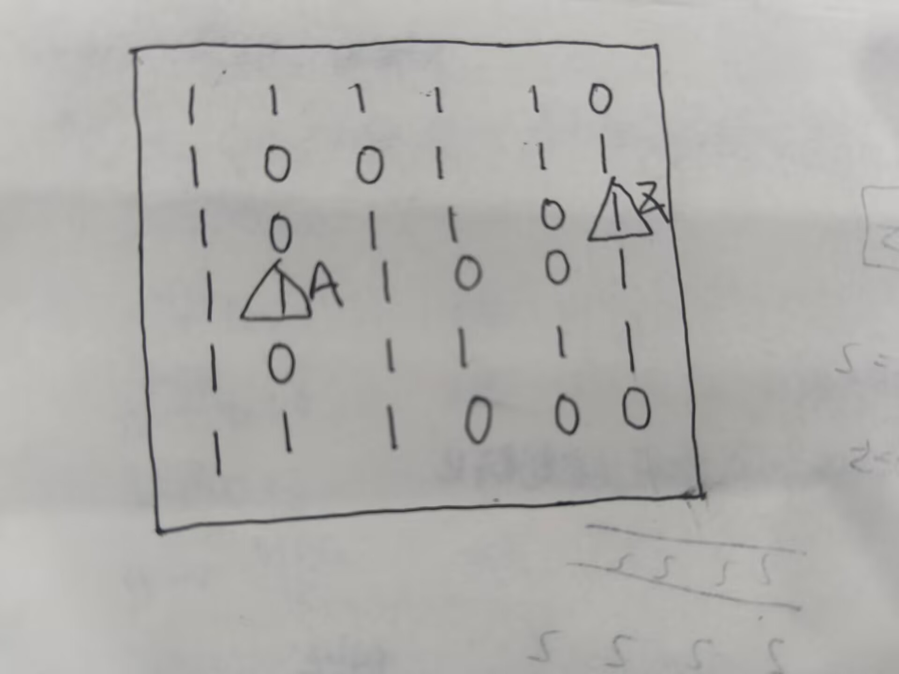
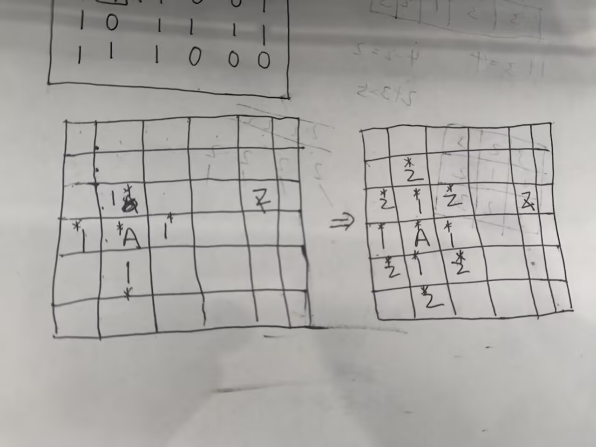

<h1 style="\\\*\\\*font-weight:bold; color:#222;\\\*\\\*">广度优先搜索：</h1>
<p>说明一下广搜的原理：</br>
广搜就是利用队列来一层一层的扩展，每次扩展一层，直到扩展到目标节点。<br>
我们比如说有这样的一个图：（其中0为障碍物，1为可走路径）
```
1 1 1 1 1 0
1 0 0 1 1 1 
1 0 1 1 0 1 
1 1 1 0 0 1
1 0 1 1 1 1
1 1 1 0 0 0 
```
我们找一点A到点Z的最短距离
<br>
如图：
<div style="text-align:center;">
</div>

我们就可以，标记为A为已访问，然后A(距离为0的)入队，记录A的坐标后A出队后检查A的邻接点，将未访问的（距离为1的）邻接点入队，标记为已访问。后出队。就这样一层一层的扩展，直到扩展到目标节点Z。扩展的层数就是最短距离。

这里我在用一张图片让你明白广搜的原理：
<div style="text-align:center;">
</div>
</p>


如果说深搜是一条路走到黑，那么广搜就是一层一层地走。<br>
广搜一般用于最少步数，最短距离，最少操作次数等问题。<br>
广搜的是现实需要queue（队列）的。<br>
我们先看一下广搜的实现：

```cpp linenums="1" title="广度优先搜索.cpp"
void bfs(int start,vector<vector<int>> &graph){
    queue<int> q;
    vector<bool>visited(graph.size(),false);
    vector<int>result;
    q.push(start);
    visited[start]=true;
    while(!q.empty()){
        int node=q.front();
        q.pop();
        for(auto neighbor:graph[node]){
            if(!visited[neighbor]){
               q.push(neighbor);
                visited[neighbor]=true;
            }
        }
    }
    for(int node:result){
        cout<<node<<" ";
    }
}
```

<p>我们可以先看一些广搜的模板：</p>
<p>图的可达性问题：</p>
<p>适用于：无权图、迷宫最短路、可达性判断等。</p>

```cpp linenums="1" title="图的可达性问题.cpp"
void bfs(int start) {
    queue<int> q;
    bool vis[N] = {};

    vis[start] = true;
    q.push(start);

    while (!q.empty()) {
        int u = q.front();
        q.pop();

        // 处理当前点 u
        // ...

        for (int v : g[u]) {      // 遍历 u 的所有邻接点
            if (!vis[v]) {
                vis[v] = true;    // 入队时标记，防止重复入队
                q.push(v);
            }
        }
    }
}
```
<p>关键点：
1.入队时标记 vis，不要出队时才标记，否则会重复入队；
2.队列是先进先出，保证按层扩展；
3.vis 数组大小按点数开。</p>

<p>带步数的广搜（最短路）：</p>
<p>适用于：无权图、迷宫最短路、最短路径问题等。</p>

```cpp linenums="1" title="带步数的广搜.cpp"
void bfs(int start) {
    queue<int> q;
    vector<int> dist(N, -1);

    dist[start] = 0;
    q.push(start);

    while (!q.empty()) {
        int u = q.front();
        q.pop();

        for (int v : g[u]) {
            if (dist[v] == -1) {
                dist[v] = dist[u] + 1;
                q.push(v);
            }
        }
    }
}
```
<p>dist[v] 就是 start 到 v 的最短步数，-1 表示不可达。</p>

<p>网格BFS模板：</p>
<p>是用于：二维网格、上下左右移动。</p>

```cpp linenums="1" title="网格BFS.cpp"
int n, m;
char grid[N][N];
bool vis[N][N];

int dx[4] = {-1, 1, 0, 0};
int dy[4] = {0, 0, -1, 1};

void bfs(int sx, int sy) {
    queue<pair<int,int>> q;
    vis[sx][sy] = true;
    q.push({sx, sy});

    while (!q.empty()) {
        auto [x, y] = q.front();
        q.pop();

        for (int dir = 0; dir < 4; dir++) {
            int nx = x + dx[dir];
            int ny = y + dy[dir];

            if (nx < 0 || nx >= n || ny < 0 || ny >= m) continue; // 越界
            if (vis[nx][ny]) continue;                            // 已访问
            if (grid[nx][ny] == '#') continue;                    // 障碍

            vis[nx][ny] = true;
            q.push({nx, ny});
        }
    }
}
```
<p>多源BFS模板：</p>
<p>适用于：多个起点同时扩散，求最近源点距离。</p>

```cpp linenums="1" title="多源BFS.cpp"
void bfs() {
    queue<int> q;
    vector<int> dist(N, -1);

    for (int s : sources) {   // 所有起点先入队
        dist[s] = 0;
        q.push(s);
    }

    while (!q.empty()) {
        int u = q.front();
        q.pop();

        for (int v : g[u]) {
            if (dist[v] == -1) {
                dist[v] = dist[u] + 1;
                q.push(v);
            }
        }
    }
}
```
<p>单源可达BFS模板：</p>

```cpp linenums="1" title="单源可达BFS.cpp"
int cnt[10];

for (int d = 0; d < 10; d++) {
    bool vis[10] = {};
    queue<int> q;

    vis[d] = true;
    q.push(d);

    while (!q.empty()) {
        int u = q.front();
        q.pop();

        for (int v : g[u]) {
            if (!vis[v]) {
                vis[v] = true;
                q.push(v);
            }
        }
    }

    for (int i = 0; i < 10; i++) {
        if (vis[i]) cnt[d]++;
    }
}
```
bfs的特点是逐层扩散，从源头点到目标点扩散了几层，最短路就是多少。

bfs可以使用的特征是： 任意两个节点之间的相互距离相同（无向图）

bfs开始时，可以是单个源头、也可以是多个源头。

bfs频繁使用队列，形式可以是单点弹出或者整层弹出。

bfs进行时，需要标记访问过的节点，防止重复入队。


<h2>奇怪的电梯：</h2>
现在有一个奇怪的电梯，它只能向上或向下移动。而且第i层楼上有一个数字k，现在给你两个数字a和b，要求你从a楼出发，到b楼，输出最少需要按多少次按钮。<br>

```cpp title="奇怪的电梯.cpp（BFS）"
#include <bits/stdc++.h>
using namespace std;
const int N = 205;
int n , a , b;
int k[N];
int dis[N];
bool vis[N];
int main(){
	ios::sync_with_stdio(0);
	cin.tie(0);
	cin >> n >> a >> b ;
	for (int i = 1 ; i <= n ;i++){
		cin >> k[i];
	}
	queue<int> q;
	q.push(a);
	vis[a] = 1;
	dis[a] = 0;
	while (!q.empty()){
		int u = q.front();
		q.pop();
		if (u==b){
			cout << dis[u];
			return 0;
		}
		int up = u + k[u];
		int down = u - k[u];
		if(up <= n && !vis[up]){
			vis[up] = 1;
			dis[up] = dis[u] + 1;
			q.push(up);
		}
		if (down >= 1 && !vis[down]){
			vis[down] = 1;
			dis[down] = dis[u] + 1;
			q.push(down);
		}
	}
	cout << -1 ;
	return 0;
}
```

<h2>变形出发：</h2>
现在给你一个大小为n方形棋盘，棋盘上我们可以放置一些机甲，如果机甲相邻他们可以合体变成更强大的机甲。现在你需要计算出棋盘上一共有多少个机甲。
如果没有机甲，输出“完蛋了”，其他情况输出“(机甲数量)Autobots,roll out!”<s>(汽车人出发)</s>
<div style="text-align:center;">
</div>

```cpp title="变形出发.cpp（DFS）"
#include<bits/stdc++.h>
using namespace std;
const int N = 1005;
int R, C;
char v[N][N];
bool vis[N][N];
int dx[4] = {0, 0, -1, 1};
int dy[4] = {1, -1, 0, 0};

void dfs(int x, int y){
    vis[x][y] = true;                      
    for (int d = 0; d < 4; d++){
        int nx = x + dx[d];
        int ny = y + dy[d];
        if (nx >= 0 && nx < R && ny >= 0 && ny < C
            && !vis[nx][ny] && v[nx][ny] == '#'){   
            dfs(nx, ny);
        }
    }
}

int main(){
    ios::sync_with_stdio(0);
    cin.tie(0);

    cin >> R >> C;
    for (int i = 0; i < R; i++){
        string s; cin >> s;
        for (int j = 0; j < C; j++) v[i][j] = s[j];
    }

    for (int i = 0; i + 1 < R; i++){
        for (int j = 0; j + 1 < C; j++){
            int cnt = (v[i][j] == '#') + (v[i][j+1] == '#')
                    + (v[i+1][j] == '#') + (v[i+1][j+1] == '#');
            if (cnt == 3){
                cout << "完蛋了\n";
                return 0;                  
            }
        }
    }

    int res = 0;
    for (int i = 0; i < R; i++){
        for (int j = 0; j < C; j++){
            if (v[i][j] == '#' && !vis[i][j]){
                res++;                     
                dfs(i, j);                 
            }
        }
    }

    cout << res << " Autobots,roll out!\n";
    return 0;
}
```
