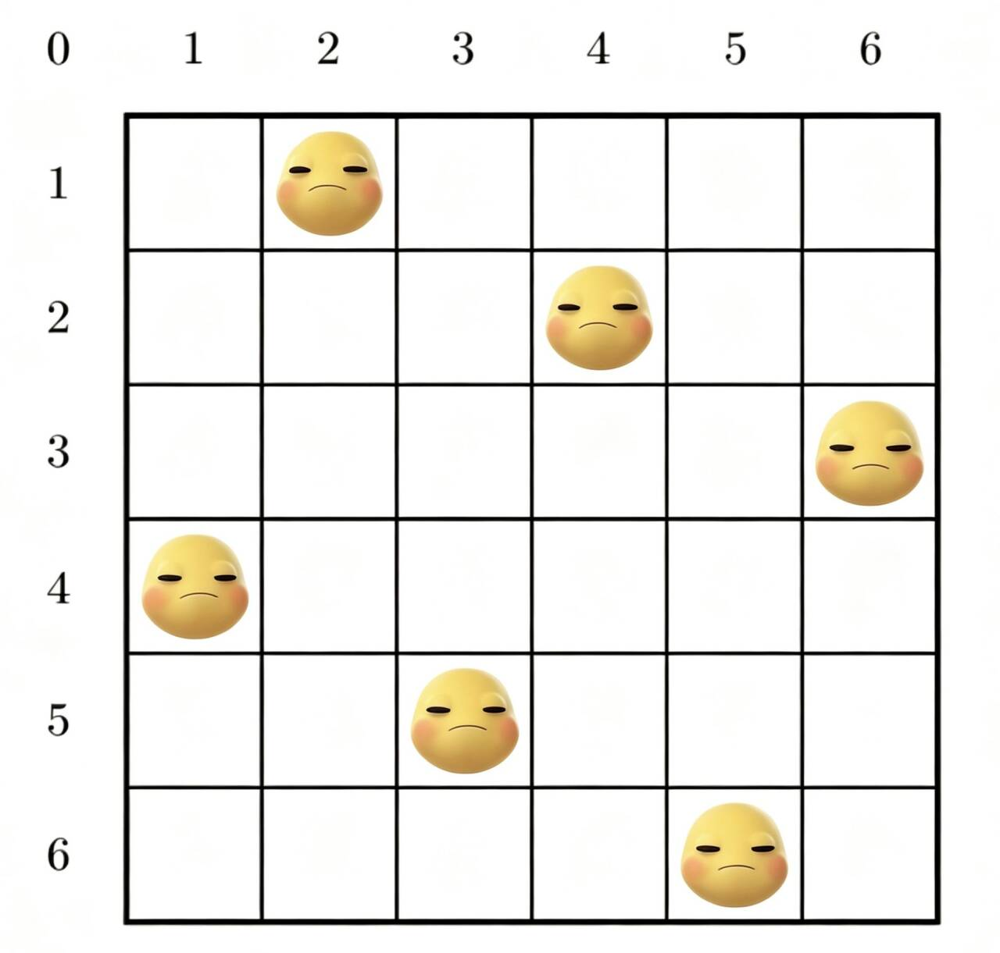

<h1>深度优先搜索：</h1>

深度优先搜索就是：“一条路走到黑，走不通再回头”。

从起始点出发，沿着某条路径一直往深处走，直到走不动了，就回溯到上一个分叉点，换一条路继续走，直到所有能到达的节点都被访问过。

下面我们看一下他的基础模板：

```cpp linenums="1" title="dfs.cpp"
void dfs(int node,vector<vector<int>>&graph,vector<bool>&visited){//node表示当前正在访问的节点
  cout<<node<<" ";//访问当前节点
  visited[node]=true;//标记当前节点已访问
  for(auto neighbor:graph[node]){//遍历当前节点的所有相邻节点
    if(visited[neighbor])continue;//如果相邻节点被访问过，跳过。
      dfs(neighbor,graph,visited);//递归调用dfs函数，访问这个相邻节点
  }
    
}
```
由于树是无环图，所以我们在dfs函数中不需要回溯。

我们优化一下

```cpp linenums="1" title="dfs.cpp"
void dfs_tree(int node,int parent,vector<vector<int>>&graph){
  cout<<node<<" ";
  for(auto neighbor:graph[node]){
    if(neighbor==parent)continue;
    dfs_tree(neighbor,node,graph);
  }
}
```
<p>上面的是我在看树的dfs里学到的说实话对于新手还是比较难的。<br>
我们还是来看一下简单一点的模板吧。</p>

<div class="code-toggle-wrapper">
    <div class="code-header">
        <div class="left-bar"></div>
        <div class="status-icon">
            <svg viewBox="0 0 24 24"><polyline points="20 6 9 17 4 12"></polyline></svg>
        </div>
        <div class="code-title">
            <span class="text-green">C++</span>
            <span class="text-blue">AC</span>
            <span class="text-green">代码</span>
        </div>
        <div class="arrow-icon">
            <svg viewBox="0 0 24 24"><polygon points="8,5 19,12 8,19"></polygon></svg>
        </div>
    </div>
    <div class="code-body">
        <pre><code>

void dfs(状态) {
    if (到达终点) {
        输出/记录答案;
        return;
    }
    for (所有可能的选择) {
        if (选择合法) {
            做出选择;      // 标记
            dfs(下一个状态); // 递归深入
            撤销选择;      // 回溯
        }
    }
}

</code></pre>
    </div>
</div>

我们来几道简单题：

<h2>全排列：</h2>

本题给你一个数n，要求你输出1~n的全排列。

1<=n<=9 如：n=3 则全排列为：
1 2 3
1 3 2
2 1 3
2 3 1
3 1 2
3 2 1

<div class="code-toggle-wrapper">
    <div class="code-header">
        <div class="left-bar"></div>
        <div class="status-icon">
            <svg viewBox="0 0 24 24"><polyline points="20 6 9 17 4 12"></polyline></svg>
        </div>
        <div class="code-title">
            <span class="text-green">C++</span>
            <span class="text-blue">AC</span>
            <span class="text-green">代码</span>
        </div>
        <div class="arrow-icon">
            <svg viewBox="0 0 24 24"><polygon points="8,5 19,12 8,19"></polygon></svg>
        </div>
    </div>
    <div class="code-body">
        <pre><code>

#include&ltbits/stdc++.h&gt;
using namespace std;
int n;
int a[10];
bool used[10];
void dfs(int step){
  if(step>=n+1){
    for(int i=1;i<=n;i++)cout<<a[i];
    cout<<endl;
    return;
  }
  for(int i=1;i<=n;i++){
    if(!used[i]){
      used[i]=true;
      a[step]=i;
      dfs(step+1);
      used[i]=false;
    }
  }

}
int main(){
  cin>>n;
  dfs(1);
  return 0;
}
</code></pre>
    </div>
</div>

我们在来一题练习一下dfs的模板：<br>
<h2>组合数的输出：</h2>
组合就是从n个数中取出m个数，不考虑顺序。且（n>=m）<br>
我们可以简单地将n个元素理解为自然数1~n。从中任取m个数。<br>
现在要求你输出所有可能的组合数。
<p>例如：n=5，r=3，则所有可能的组合数为：
123，124，125，134，135，145，234，235，245，345。
</p>

```cpp linenums="1" title="组合数.cpp"
#include<bits/stdc++.h>
using namespace std;
int n , m ;
int a[25];
void dfs(int step , int start){
	if(step == m+1){
		for (int i= 1; i<= m ;i++){
			cout << a[i];			
		
		}
		cout << endl;
		return;
	}
	for (int i = start ; i <= n ; i++){
		a[step] = i;
		dfs(step + 1,i + 1);
	}
}
int main(){
	cin >> n >> m;
	dfs(1,1);
	return 0;	
}
```

<p>好的本喵来喵喵几句：<br>
我们写dfs的时候可以注意到大部分都是这样的模板：<br>
如果当前数字大于了n，说明当前路径已经走完了，我们可以输出当前路径。<br>
循环是枚举当前路径上的数字，如果当前数字没有被使用过，我们就把它放到当前路径上，递归调用dfs
函数，访问这个相邻节点。最后我们回溯，把当前数字上的数字标记为未被使用过。<br>
</p>

我们再来一题：
<h2>走迷宫：</h2>
<p>好的本喵来喵喵几句：<br>
给你一个n*m的迷宫，0表示空地，1表示障碍。<br>
要求你从(1,1)出发，走到(n,m)，如果可以走到(n,m)，则输出"Yes"。<br>
如果不能走到(n,m)，则输出"No"。<br>
</p>

```cpp linenums="1" title="走迷宫.cpp"
#include<bits/stdc++.h>
using namespace std;
int n,m;
int dx[4]={0,0,-1,1};
int dy[4]={1,-1,0,0};
vector<vector<int>> maze;
vector<vector<bool>> visited;

void dfs(int x,int y){
  if(x==n && y==m){
    cout<<"Yes"<<endl;
    exit(0);
  }
  visited[x][y]=true;
  for(int i=0;i<4;i++){
    int nx=x+dx[i];
    int ny=y+dy[i];
  
     if(nx>=1 && nx<=n && ny>=1 && ny<=m && maze[nx][ny]==0 && !visited[nx][ny]){
      dfs(nx,ny);  
     }
  }
}
int main(){
  cin>>n>>m;
  maze.resize(n+1,vector<int>(m+1));
  visited.resize(n+1,vector<bool>(m+1));
  for(int i=1;i<=n;i++){
    for(int j=1;j<=m;j++){
      cin>>maze[i][j];
    }
  }
  visited[1][1]=true;
  dfs(1,1);
  cout<<"No"<<endl;
  return 0;
}

```
因为这道题只要求输出有无路径，所以我们在dfs函数中不需要回溯。

但是如果是问我们有多少种走法，那么我们就需要回溯。

我们来看一下回溯迷宫：

<h2>回溯迷宫：</h2>
给你一个n*m的迷宫，0表示空地，1表示障碍。

要求你从(1,1)出发，走到(n,m)，输出有多少种走法。
```cpp linenums="1" title="回溯迷宫.cpp"
#include<bits/stdc++.h>
using namespace std;
int n,m;
int dx[4]={0,0,-1,1};
int dy[4]={1,-1,0,0};
vector<vector<int>> maze;
vector<vector<bool>> visited;
int total=0; // 总方案数;
void dfs(int x,int y){
  if(x==n && y==m){
  total++;
  return;
  }
  visited[x][y]=true;
  for(int i=0;i<4;i++){
    int nx=x+dx[i];
    int ny=y+dy[i];
    if(nx>=1 && nx<=n && ny>=1 && ny<=m && maze[nx][ny]==0 && !visited[nx][ny]){
      dfs(nx,ny);
      visited[nx][ny]=false;
    }
  }
}
int main(){
  cin>>n>>m;
  maze.resize(n+1,vector<int>(m+1));
  visited.resize(n+1,vector<bool>(m+1));
  for(int i=1;i<=n;i++){
    for(int j=1;j<=m;j++){
      cin>>maze[i][j];
    }
  }
  dfs(1,1);
  cout<<total<<endl;
  return 0;
}

```
我们在来一题相似的题：https://www.luogu.com.cn/problem/P1162
<!DOCTYPE html>
<html lang="zh-CN">
<head>
<meta charset="UTF-8">
<meta name="viewport" content="width=device-width, initial-scale=1.0">
<title>闭合区域染色</title>
<style>
  :root{
    --bg:#f6f8fa;
    --card:#ffffff;
    --text:#24292f;
    --muted:#57606a;
    --accent:#2563eb;
    --border:#d0d7de;
    --code-bg:#f6f8fa;
    --tip:#ddf4ff;
    --tip-border:#54aeff;
  }
  *{box-sizing:border-box;}
  body{
    margin:0;
    padding:24px 16px 64px;
    background:var(--bg);
    color:var(--text);
    font-family:-apple-system,BlinkMacSystemFont,"Segoe UI","PingFang SC","Hiragino Sans GB","Microsoft YaHei",sans-serif;
    line-height:1.75;
    font-size:16px;
  }
  .container{
    max-width:860px;
    margin:0 auto;
    background:var(--card);
    border:1px solid var(--border);
    border-radius:12px;
    padding:32px 36px 48px;
    box-shadow:0 1px 3px rgba(0,0,0,.04);
  }
  h1{
    font-size:28px;
    margin:0 0 8px;
    padding-bottom:16px;
    border-bottom:1px solid var(--border);
  }
  h2{
    font-size:20px;
    margin:32px 0 12px;
    padding-left:10px;
    border-left:4px solid var(--accent);
    line-height:1.3;
  }
  p{margin:12px 0;}
  ul{margin:12px 0;padding-left:24px;}
  li{margin:6px 0;}
  code{
    background:var(--code-bg);
    padding:2px 6px;
    border-radius:4px;
    font-family:ui-monospace,SFMono-Regular,Consolas,monospace;
    font-size:14px;
    border:1px solid var(--border);
  }
  pre{
    background:var(--code-bg);
    border:1px solid var(--border);
    border-radius:8px;
    padding:16px;
    overflow-x:auto;
    margin:12px 0;
  }
  pre code{
    background:none;
    border:none;
    padding:0;
    font-size:14px;
    line-height:1.6;
  }
  .sample-wrap{
    display:flex;
    gap:16px;
    flex-wrap:wrap;
  }
  .sample{
    flex:1 1 280px;
    min-width:0;
  }
  .sample-title{
    font-size:14px;
    color:var(--muted);
    margin-bottom:6px;
    font-weight:600;
  }
  .tip{
    background:var(--tip);
    border-left:4px solid var(--tip-border);
    padding:12px 16px;
    border-radius:6px;
    margin:16px 0;
  }
  .formula{
    text-align:center;
    font-size:17px;
    margin:16px 0;
  }
  @media(max-width:600px){
    .container{padding:20px 18px 32px;}
    h1{font-size:23px;}
    h2{font-size:18px;}
  }
</style>
</head>
<body>
<div class="container">

  <h1>闭合区域染色</h1>

  <h2>题目描述</h2>
  <p>给定一个 <code>n × n</code> 的方阵，方阵中只包含数字 <code>0</code> 和 <code>1</code>。</p>
  <p>其中，数字 <code>1</code> 构成一个闭合圈。请把闭合圈内部的所有 <code>0</code> 改成 <code>2</code>，其他数字保持不变。</p>
  <p>判断一个 <code>0</code> 是否在闭合圈内的方法：</p>
  <ul>
    <li>从该 <code>0</code> 出发，只能向上、下、左、右四个方向移动；</li>
    <li>只能经过数字 <code>0</code>；</li>
    <li>如果无论如何都无法到达方阵边界，则说明这个 <code>0</code> 在闭合圈内。</li>
  </ul>
  <p>题目保证：</p>
  <ul>
    <li>方阵中只有一个闭合圈；</li>
    <li>闭合圈内至少有一个 <code>0</code>；</li>
    <li>闭合圈内的所有 <code>0</code> 是连通的。</li>
  </ul>

  <h2>输入格式</h2>
  <p>第一行输入一个整数 <code>n</code>，表示方阵大小。</p>
  <p>接下来输入 <code>n</code> 行，每行 <code>n</code> 个整数，表示一个 <code>n × n</code> 的 <code>0/1</code> 方阵。</p>

  <h2>输出格式</h2>
  <p>输出修改后的完整方阵，共 <code>n</code> 行，每行 <code>n</code> 个整数，用空格分隔。</p>

  <h2>输入样例</h2>
  <pre><code>6
0 0 0 0 0 0
0 0 1 1 1 1
0 1 1 0 0 1
1 1 0 0 0 1
1 0 0 0 0 1
1 1 1 1 1 1</code></pre>

  <h2>输出样例</h2>
  <pre><code>0 0 0 0 0 0
0 0 1 1 1 1
0 1 1 2 2 1
1 1 2 2 2 1
1 2 2 2 2 1
1 1 1 1 1 1</code></pre>

  <h2>数据范围</h2>
  <p>对于 <code>100%</code> 的数据：</p>
  <p class="formula"><code>1 ≤ n ≤ 30</code></p>

  <div class="tip">
    <strong>提示：</strong>可以从方阵边界上的 <code>0</code> 出发，向四个方向搜索所有能够到达的 <code>0</code>，这些 <code>0</code> 都在闭合圈外。标记完成后，剩下的 <code>0</code> 就是闭合圈内部的 <code>0</code>，将它们改为 <code>2</code> 即可。
  </div>

</div>
</body>
</html>
```cpp linenums="1" title="填颜色.cpp"
#include<bits/stdc++.h>
using namespace std;

int n;
const int N = 35;
int g[N][N];
int dx[4] = {0, 0, -1, 1};
int dy[4] = {1, -1, 0, 0};
bool vis[N][N];

void dfs(int x, int y) {
    vis[x][y] = true;
    for (int i = 0; i < 4; i++) {
        int nx = x + dx[i];         
        int ny = y + dy[i];       
        if (nx < 1 || nx > n || ny < 1 || ny > n) continue;
        if (vis[nx][ny]) continue;
        if (g[nx][ny] != 0) continue;
        dfs(nx, ny);
    }
}

int main() {
    ios::sync_with_stdio(0); 
	cin.tie(0);
    cin >> n;
    for (int i = 1; i <= n; i++)        
        for (int j = 1; j <= n; j++)
            cin >> g[i][j];

    for (int i = 1; i <= n; i++) {
        if (g[i][1] == 0 && !vis[i][1]) dfs(i, 1);
        if (g[i][n] == 0 && !vis[i][n]) dfs(i, n);
    }
   
    for (int j = 1; j <= n; j++) {
        if (g[1][j] == 0 && !vis[1][j]) dfs(1, j);
        if (g[n][j] == 0 && !vis[n][j]) dfs(n, j);
    }


    for (int i = 1; i <= n; i++) {        
        for (int j = 1; j <= n; j++) {
            if (g[i][j] == 0 && !vis[i][j]) g[i][j] = 2;
            cout << g[i][j] << ' ';
        }
        cout << '\n';
    }
    return 0;
}
```

来一道题：<h1 style="\\\*\\\*font-weight:bold; color:#222;\\\*\\\*">奶娃的笑：</h1>

<div style="text-align:center;">
</div>


奶娃的笑会传染，奶娃会大笑与其处在同一行或者同一列以及同一对角线上的奶娃。
现在有n个奶娃，要求把这n个奶娃放置在n*n的网格中，每个奶娃只能放在一个网格中，不能放在同一个网格中并且奶娃不能大笑。
求有多少种放置方法。1<=n<=9

<div style="text-align:center; margin:20px 0;">
  <video autoplay loop muted playsinline style="width:320px; max-width:100%; border-radius:8px;">
    <!-- 去掉开头的斜杠，改成相对路径 -->
    <source src="../assets/shipin/naiwa.mp4" type="video/mp4">
  </video>
</div>

```cpp linenums="1" title="奶娃的笑.cpp"
#include<bits/stdc++.h>
using namespace std;
int n;
int ans[15]; // ans[i]保存第i行奶娃放在第几列
bool vis_col[15];    // 列标记
bool vis_d1[30];     // row-col+n 对角线
bool vis_d2[30];     // row+col 对角线
int total = 0;       // 总方案数

void dfs(int row){
    if(row == n+1){ // 行从1开始，1~n行全部放完
        total++;
        if(total <=3){ // 只输出前3组
            for(int i=1;i<=n;i++) cout<<ans[i]<<" ";
            cout<<endl;
        }
        return;
    }
    // 枚举当前行所有列，从左往右，保证字典序
    for(int col=1;col<=n;col++){
        int d1 = row - col + n;
        int d2 = row + col;
        if(!vis_col[col] && !vis_d1[d1] && !vis_d2[d2]){
            // 放置奶娃
            vis_col[col]=true;
            vis_d1[d1]=true;
            vis_d2[d2]=true;
            ans[row]=col;

            dfs(row+1); // 搜下一行

            // 回溯，撤销标记
            vis_col[col]=false;
            vis_d1[d1]=false;
            vis_d2[d2]=false;
        }
    }
}

int main(){
    cin>>n;
    dfs(1); // 从第1行开始放
    cout<<total<<endl;
    return 0;
}
```


我们来看一道题：

<h1 style="\\\*\\\*font-weight:bold; color:#222;\\\*\\\*">单词搜索：</h1>

给你两个数m，n，表示网格的行数和列数。给你一个单词word，表示要搜索的单词。如果word在网格中，返回true，否则返回false。

单词必须按照字母排序，通过相邻的单元格内的字母构成。其中“相邻”单元格是水平相邻或垂直相邻的单元格。
同一单元格内的字母不允许重复使用。

```cpp linenums="1" title="单词搜索.cpp"
#include<bits/stdc++.h>
using namespace std;

int dx[4]={0,0,1,-1};
int dy[4]={1,-1,0,0};
int m,n;
string word;
bool dfs(int x,int y,int index,vector<vector<char>>&board,vector<vector<bool>>&visited){
  if(board[x][y]!=word[index])return false;
  if(index==word.size()-1)return true;
  visited[x][y]=true;
  for(int i=0;i<4;i++){
    int nx=x+dx[i];
    int ny=y+dy[i];
    if(nx<0||nx>=m||ny<0||ny>=n||visited[nx][ny])continue;
    if(dfs(nx,ny,index+1,board,visited))return true;
  }
  visited[x][y]=false;
  return false;
}
int main(){
  cin>>m>>n;
  vector<vector<char>>board(m,vector<char>(n));
  for(int i=0;i<m;i++){
    for(int j=0;j<n;j++){
      cin>>board[i][j];
    }
  }
  cin>>word;
  vector<vector<bool>>visited(m,vector<bool>(n));
  bool found=false;
  for(int i=0;i<m;i++){
    for(int j=0;j<n;j++){
      if(dfs(i,j,0,board,visited)){
        found=true;
        break;
      }
    }
    if(found)break;
  }
  if(found)cout<<"true"<<endl;
  else cout<<"false"<<endl;
  return 0;
}
```