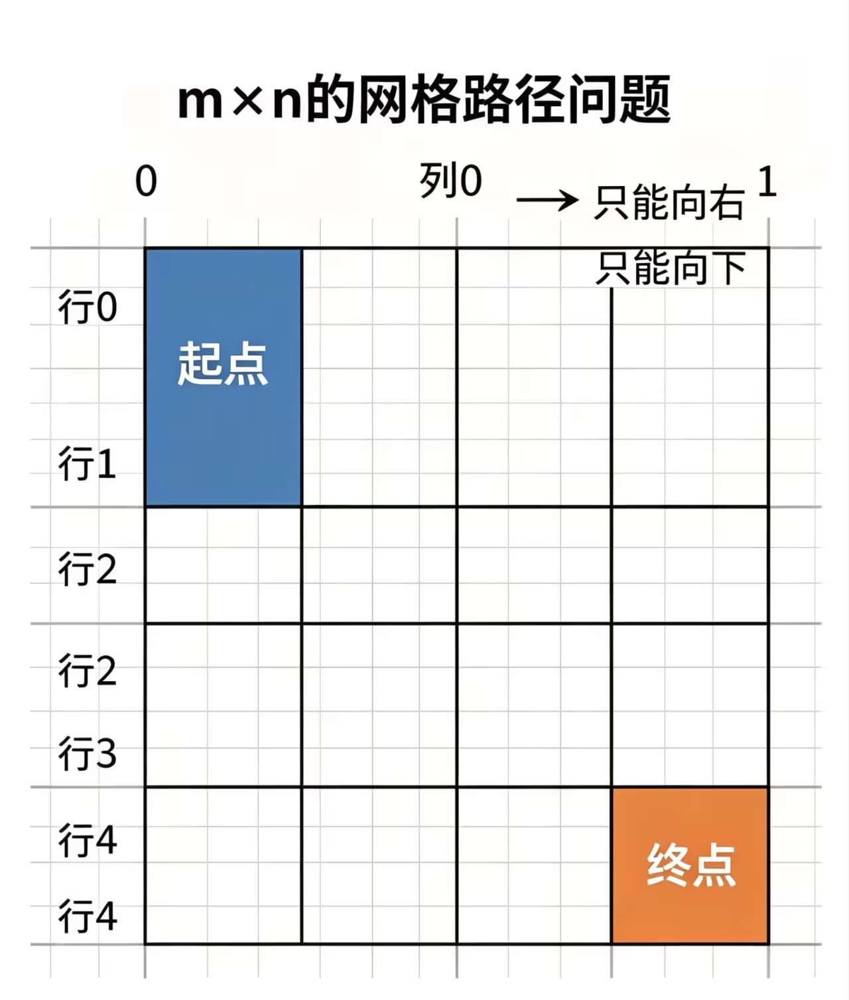
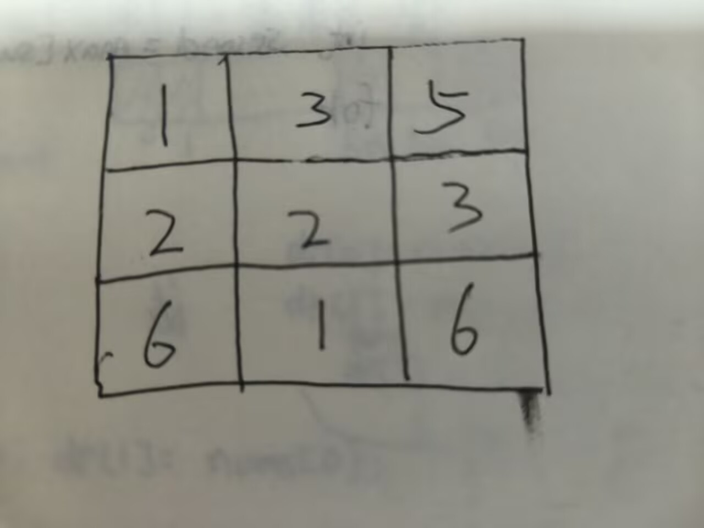
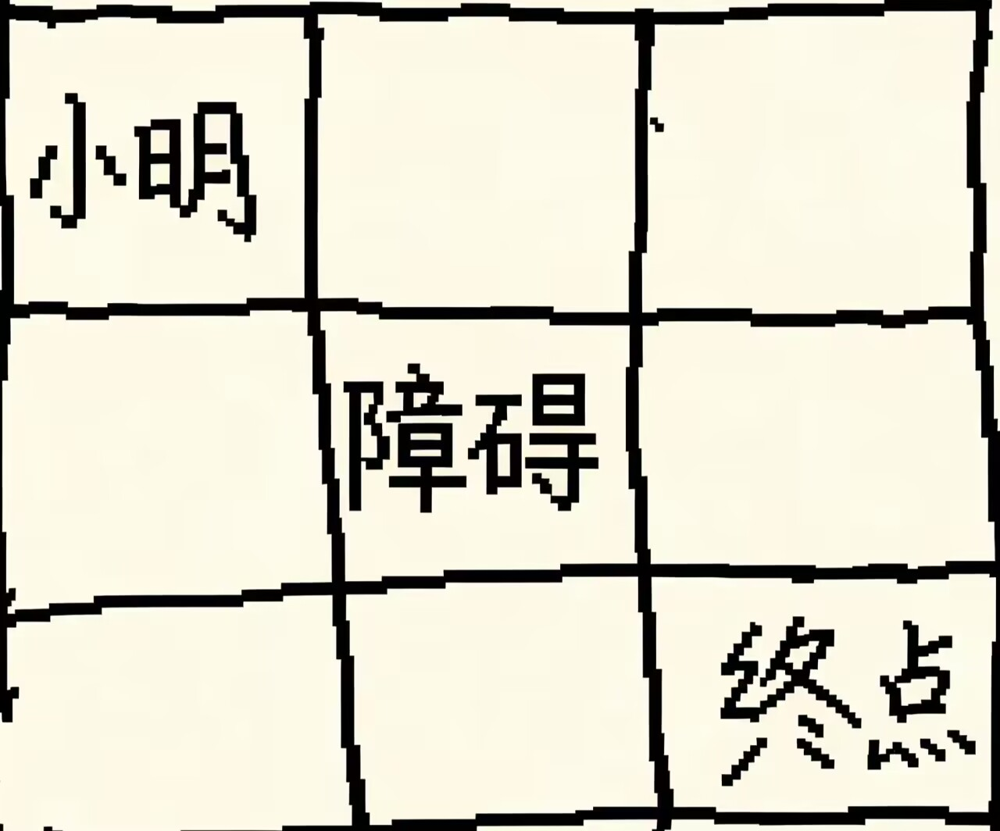
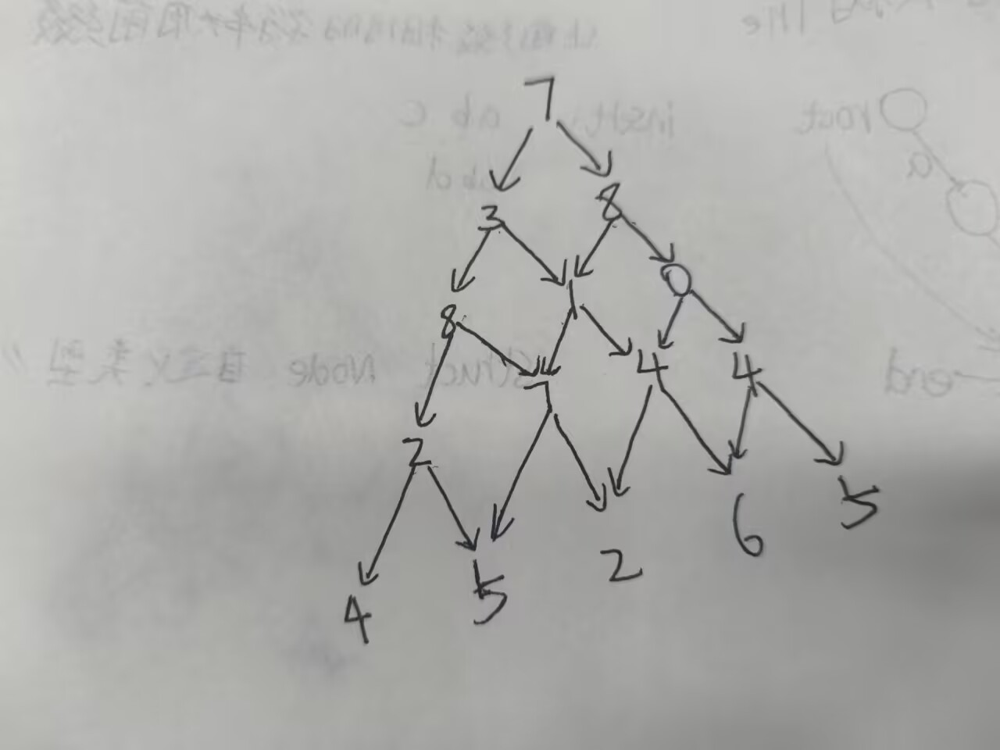

<h1 style="\\\*\\\*font-weight:bold; color:#222;\\\*\\\*">动态规划</h1>
动态规划一般是将一个问题分解成多个子问题，每个子问题的解可以独立计算，最后将所有子问题的解合并起来，得到问题的解。<br>
我个人认为动态规划的思路比较抽象，需要多练习才能掌握<br>
最经典的动态规划问题就是01背包问题，但是我是从打家劫舍问题开始了解动态规划的。

<h1 style="\\\*\\\*font-weight:bold; color:#222;\\\*\\\*">打家劫舍问题：</h1>
你现在是一个专业的小偷，计划偷窃沿街的房屋。<br>
每个房屋都藏有一定的现金，影响你偷窃的唯一因素就是相邻的房屋装有相互连通的防盗系统，<br>
如果两间相邻的房屋在同一晚上被小偷闯入，系统会自动报警。<br>
思路就是：现在有两种偷法：
```
{[ ][ ][ ][ ][ ].... [ ]  .  [ ] .  [ ]}假设一共k个房屋f(k)

  {0  1  2  3  4  ...        k-3   k-2   k-1 }
```
偷法1：<br>
偷前k-1个房屋，最后一个房屋不偷。f(k-1)
```
{[/][/][/]....[/] . [/] . [/]  [ ]}

 { 0  1  2   ...  k-4  k-3 k-2  k-1  }
```
偷法2：

偷前k-2个房屋+最后一个房屋。f(k-2)+k-1
```
{[/][/][/]....[/] . [/] . [ ] . [ /]}

 { 0  1  2 ...    k-4  k-3 k-2  k-1  }
```
或许你没看懂，那么我给你举个例子：<br>
假设k=4;<br>
偷法1：f(3)<br>
偷(2)+k(2)+k-1<br>
ff(4)=max(f(3),f(2)+k-1)<br>
那f(3)同理也是这么来的<br>
偷法1：f(2)<br>
偷法2：f(1)+k-1
f(3)=max(f(2),f(1)+k-1)<br>
而f(2)也是这么来的
偷法1：f(1)<br>
偷法2：0<br>
f(2)=max(f(1),0)=f(1)<br>
同理f(1)也是这么来的<br>
偷法1：0<br>
偷法2：0<br>
f(0)=max(0,0)=0<br>
这样你发现了这样的问题转化成多个子问题，每个子问题的解可以独立计算，最后将所有子问题的解合并起来，得到问题的解。<br>
f(k)=max(f(k-1),f(k-2)+k-1)<br>
也就是每次都在两种选法中选最大的那个；<br>
代码实现：<br>
这里我们假设一共n间房屋。
样例：<br>
输入：<br>
4<br>
1 2 3 1<br>
输出：<br>
4<br>

??? cpp "C++ AC 代码"
    ```cpp
    #include <bits/stdc++.h>
    using namespace std;
    int main(){
        int n;
        cin >> n;
        vector<int> a(n + 1, 0);
        for(int i = 1; i <= n; i++){
            cin >> a[i];
        }
        vector<int> dp(n + 1, 0);
        dp[0] = 0; // 因为没有房屋，所以金额为0
        dp[1] = a[1]; // 如果只有一个房屋，那么金额就是房屋的金额
        for(int i = 2; i <= n; i++){
            dp[i] = max(dp[i - 1], dp[i - 2] + a[i]);
        }
        cout << dp[n] << endl;
        return 0;
    }
    ```


如果你觉得你理解了，那么我们来看他的进阶版（滚动版打家劫舍问题）
<h1 style="\\\*\\\*font-weight:bold; color:#222;\\\*\\\*">滚动版打家劫舍问题：</h1>

给你一个数组，数组中每个元素表示一个房屋的金额。但是如果你选择了偷其中的一间房屋（价值为a[i]），那么你需要放弃（删除）金额数为a[i]-1和a[i]+1的房屋。问在这样的情况下，你可以偷到的最大金额是多少？

这道题我个人在看的时候也联想不到打家劫舍，因为我找不到一个子问题，所以无法将问题分解成多个子问题。后来我通过“打家劫舍是不允许元素相邻”而这道题是不允许元素大小相邻”来写的。

??? cpp "C++ AC 代码"
    ```cpp
    #include<bits/stdc++.h>
    using namespace std;
    int main(){
    int n;
    cin>>n;
    int maxn=0;
    vector<int>nums(n);
    for(int i=0;i<n;i++){
         cin>>nums[i];
         maxn=max(maxn,nums[i]);
    }
    vector<int>sum(n+1,0);
    for(auto &i:nums){
         sum[i]+=i;
    }
    vector<int>dp(maxn+1,0);
    dp[0]=sum[0];
    dp[1]=max(sum[0],sum[1]);
    for(int i=0;i<n;i++){
         dp[i]=max(dp[i-1],dp[i-2]+sum[i]);
    }
    cout<<dp[n-1]<<endl;
     return 0;
    }

    ```

好的本喵来讲解一下喵:<br>
这道题其实你把相同的数相加为一个数然后就变成了打家劫舍问题了<br>
在此之前我们先讲一下auto &i:nums;的用法。<br>
auto是c++11新增的，用于自动推导变量类型。<br>
auto &i:nums的意思就是遍历nums数组中的每个元素，将每个元素赋值给i。<br>
比如nums={2,2,3,3,4}<br>
nums[2]=2+2br>
nums[3]=3+3;<br>
nums[4]=4;<br>
这样我们就将nums里面相同的数相加为一个数。<br>
为啥要相加呢？<br>
还是例子nums={2,2,3,3,4}<br>
相同元素相加后我们得到了一个新的数组我们记作sum={4,6,4}<br>
这个时候就能看出来和前面的打家劫舍问题是一样的。<br>
maxn是为了确定dp数组的大小。dp数组的大小要大于等于nums数组的最大值。否则会数组越界。<br>
<h1 style="\\\*\\\*font-weight:bold; color:#222;\\\*\\\*">不同路径问题：</h1>

你现在位于一个m x n 网格的左上角。
你只能向下或向右移动一步。问有多少条不同的路径可以到达网格的右下角？

<div style="text-align:center;">
</div>


```cpp linenums="1" title="不同路径问题.cpp"
#include<bits/stdc++.h>
using namespace std;
int main(){
    int n,m;
    cin>>n>>m;
    vector<vector<int>> v(n,vector<int>(m));
    for(int i=0;i<n;i++){
        v[i][0]=1;
    }
    for(int i=0;i<m;i++){
        v[0][i]=1;
    }
       for(int i=1;i<n;i++){   
         for(int j=1;j<m;j++){   
            v[i][j]=v[i-1][j]+v[i][j-1];
        }
       } 
        cout<<v[n-1][m-1]<<endl;       
    return 0;
}


```
本喵来讲解一下一下喵:
因为我们只能向下或向右移动一步，因此我们的当前这一步是由上一步和左一步得到的。

因此可以写出关键的转移方程：

v[i][j]=v[i-1][j]+v[i][j-1];

初始化就是第一行和第一列都为1。因为从左上角到左上角只有1条路径。


<h1 style="\\\*\\\*font-weight:bold; color:#222;\\\*\\\*">最小路径和问题：</h1>

给定一个m x n 网格，你的任务是从网格的左上角到达网格的右下角，
并沿路径上的数字总和最小。

<div style="text-align:center;">
</div>

```cpp linenums="1" title="最小路径和.cpp"
#include<bits/stdc++.h>
using namespace std;
int main(){
    int m,n;
    cin>>m>>n;
    vector<vector<int>> grid(m+1,vector<int>(n+1,0));
    for(int i=1;i<=m;i++){
        for(int j=1;j<=n;j++){
            cin>>grid[i][j];
        }
    }  
    vector<vector<int>> dp(m+1,vector<int>(n+1,0));  
    dp[1][1]=grid[1][1];
    for(int i=2;i<=m;i++){
        dp[i][1]=dp[i-1][1]+grid[i][1];
    }
    for(int j=2;j<=n;j++){
        dp[1][j]=dp[1][j-1]+grid[1][j];
    }
    for(int i=2;i<=m;i++){
        for(int j=2;j<=n;j++){
                dp[i][j]=grid[i][j]+min(dp[i-1][j],dp[i][j-1]);
            }
        }
    
    cout<<dp[m][n]<<endl;
    return 0;
}

```
本喵来讲解一下一下喵:
因为我们只能向下或向右移动一步，因此我们的当前这一步是由上一步和左一步得到的。

因此可以写出关键的转移方程：

dp[i][j]=grid[i][j]+min(dp[i-1][j],dp[i][j-1]);

这个的意思就是当前这一步的路径和等于当前这一步的数字加上上一步和左一步的路径和的较小值。

也就是在左一步和上一步中选择较小的数然后加上当前的这一步数。

<p>下面我们介绍一下四维dp和三维dp。<br>
四维dp和三维dp的思路和二维dp和一维dp是一样的。<br>
只是在转移方程中多了一个维度。<br>
</p>
<h2>方格取数问题：</h2>
<p>设有N*N个方格，我们将其中的某些方格填入正整数，而其他的方格填入0。<br>
我们从左上角开始，每次只能向下或向右移动一步。<br>
去走后方格中的数字变为0。<br>
我们需要走两次。<br>
我们想从左上角到右下角的路径上的数字总和最大。<br>
</p>
先写一下四维dp：<br>

```cpp title="方格取数问题.cpp"
#include <bits/stdc++.h>
using namespace std;

const int N = 12; // N ≤ 9，开大一点防止越界
int n, x, y, v;
int a[N][N];
int dp[N][N][N][N]; // dp[i][j][k][l]: 第一个人走到(i,j)，第二个人走到(k,l)的最大和

int main() {
    ios::sync_with_stdio(false);
    cin.tie(0);

    cin >> n;
    // 读取输入，直到 0 0 0 结束
    while (cin >> x >> y >> v && (x || y || v)) {
        a[x][y] = v;
    }

    // 四维DP
    for (int i = 1; i <= n; i++) {
        for (int j = 1; j <= n; j++) {
            for (int k = 1; k <= n; k++) {
                for (int l = 1; l <= n; l++) {
                    // 四种来源取最大值
                    int max_prev = max({
                        dp[i-1][j][k-1][l], // 两人都向下
                        dp[i-1][j][k][l-1], // 第一个人向下，第二个人向右
                        dp[i][j-1][k-1][l], // 第一个人向右，第二个人向下
                        dp[i][j-1][k][l-1]  // 两人都向右
                    });
                    
                    // 加上当前两个格子的值
                    dp[i][j][k][l] = max_prev + a[i][j] + a[k][l];
                    
                    // 如果两人走到同一个格子，减去重复计算的一次
                    if (i == k && j == l) {
                        dp[i][j][k][l] -= a[i][j];
                    }
                }
            }
        }
    }

    cout << dp[n][n][n][n] << endl;
    return 0;
}

```
<p>这个就很好理解了我们用四维数组来存储第一个人和第二个人的路径和。<br>
其中[i]代表第一个人的横坐标，[j]代表第一个人的纵坐标，[k]代表第二个人的横坐标，[l]代表第二个人的纵坐标。<br>
我们是站在当前节点来看的因此向下就是上面的节点这个在上一题最小路径和中比较明显<br>
也就是当前格子的路径和等于当前格子的数字加上上一步和左一步的路径和的较大值。<br>
dp[i][j][k][l] = max_prev + a[i][j] + a[k][l];这个就是前面所选格子的最大值加上当前两个人格子的数字。<br>
如果两人走到同一个格子，减去重复计算的一次。<br>


下面我们优化一下四维dp将他转换为三维dp：<br>
```cpp title="方格取数问题3.cpp"
#include <bits/stdc++.h>
using namespace std;
typedef long long ll;

int main() {
    ios::sync_with_stdio(false);
    cin.tie(0);

    int n;
    cin >> n;
    vector<vector<ll>> a(n + 2, vector<ll>(n + 2, 0));
    ll x, y, v;
    while (cin >> x >> y >> v && (x || y || v)) {
        a[x][y] = v;
    }

    // dp[k][i1][i2]: 总步数k，第一个人在行i1，第二个人在行i2
    vector<vector<vector<ll>>> dp(2 * n + 2, vector<vector<ll>>(n + 2, vector<ll>(n + 2, 0)));

    for (int k = 2; k <= 2 * n; k++) {
        for (int i1 = 1; i1 <= n; i1++) {
            for (int i2 = 1; i2 <= n; i2++) {
                int j1 = k - i1;
                int j2 = k - i2;
                // 越界检查
                if (j1 < 1 || j1 > n || j2 < 1 || j2 > n) continue;

                // 四种来源的最大值
                ll max_prev = max({
                    dp[k-1][i1-1][i2-1], // 两人都向下
                    dp[k-1][i1-1][i2],   // 第一个人向下，第二个人向右
                    dp[k-1][i1][i2-1],   // 第一个人向右，第二个人向下
                    dp[k-1][i1][i2]      // 两人都向右
                });

                // 加上当前格子的值
                dp[k][i1][i2] = max_prev + a[i1][j1] + a[i2][j2];
                
                // 如果两人在同一个格子，减去重复计算的
                if (i1 == i2) {
                    dp[k][i1][i2] -= a[i1][j1];
                }
            }
        }
    }

    cout << dp[2 * n][n][n] << endl;
    return 0;
}
```
<p>这个相对于四维三维优化，空间复杂度从 O(n^4) 降到了 O(n^3)。<br>
<b>其思想是：</b>比如说第一个人我们用i1，j1表示他的坐标，第二个人我们用i2，j2表示他的坐标。<br>
第一个人和第二个人他们走的步数是一样的也就是i1+j1=i2+j2。<br>
因此我们引入一个k来表示总步数。<br>
通过k我们可以得到i1和i2。<br>
也就是i1=k-i2。<br>
j1=k-j2。<br>
这样我们就可以用三维数组来存储第一个人和第二个人的路径和。<br>
最后我们返回dp[2*n][n][n]就是答案。<br>

如果你觉得你学会了，接下来是传纸条问题。
<h2>传纸条问题：</h2>
<div>
<p>小渊和小轩是好朋友，也是同班同学，他们在一起总有谈不完的话题。一次素质拓展活动中，班上同学安排坐成一个 m 行 n 列的矩阵，<br>
而小渊和小轩被安排在矩阵对角线的两端，因此，他们就无法直接交谈了。幸运的是，他们可以通过传纸条来进行交流。<br>
纸条要经由许多同学传到对方手里。小渊坐在矩阵的左上角，坐标为 (1,1)；小轩坐在矩阵的右下角，坐标为 (m,n)。
<br>从小渊传到小轩的纸条只可以向下或者向右传递，从小轩传给小渊的纸条只可以向上或者向左传递。
<br>
在活动进行中，小渊希望给小轩传递一张纸条，同时希望小轩给他回复。<br>
班里每个同学都可以帮他们传递，但只会帮他们一次，也就是说，如果此人在小渊递给小轩纸条的时候帮忙，那么在小轩递给小渊的时候就不会再帮忙，反之亦然。<br>

还有一件事情需要注意：全班每个同学愿意帮忙的好感度有高有低（注意：小渊和小轩的好心程度没有定义，输入时用 0 表示），可以用一个 [0,100] 内的自然数来表示，数越大表示越好心。<br>
小渊和小轩希望尽可能找好心程度高的同学来帮忙传纸条，即找到来回两条传递路径，使得这两条路径上同学的好心程度之和最大。现在，请你帮助小渊和小轩找到这样的两条路径。<br></p>

<p>输入：第一行有两个用空格隔开的整数 m,n，表示班里有 m 行 n 列。<br>
接下来的 m 行是一个 m×n 的矩阵，矩阵中第 i 行第 j 列的整数表示坐在第 i 行第 j 列的学生的好心程度。每行的 n 个整数之间用空格隔开。<br>
</p>
<p>输出：输出共一行一个整数，表示来回两条路上参与传递纸条的学生的好心程度之和的最大值。<br>
</p>
</div>
<h2>不同路径问题2：</h2>

给定一个m x n 网格，小明的任务是从网格的左上角到达网格的右下角，
但是网格中有一些障碍物，你不能通过障碍物。
小明想知道有多少条不同的路径可以到达网格的右下角？

网格中1为障碍物，0为无障碍物。

<div style="text-align:center;">
</div>

```cpp linenums="1" title="不同路径问题2.cpp"
#include<bits/stdc++.h>
using namespace std;
int main(){
    int m,n;
    cin>>m>>n;
    vector<vector<int>>grid(m,vector<int>(n));
    for(int i=0;i<m;i++){
        for(int j=0;j<n;j++){
            cin>>grid[i][j];
        }
    }
    vector<vector<int>>dp(m,vector<int>(n,0));
    dp[0][0]=1;
    for(int i=1;i<m;i++){
        if(grid[i][0]==0){
            dp[i][0]=dp[i-1][0];
        }
    }
    for(int j=1;j<n;j++){
        if(grid[0][j]==0){
            dp[0][j]=dp[0][j-1];
        }
    }
    for(int i=1;i<m;i++){
        for(int j=1;j<n;j++){
           if(grid[i][j]==1){
               continue;
           }else{
            dp[i][j]=dp[i-1][j]+dp[i][j-1];
           }    
        }
    }
    cout<<dp[m-1][n-1]<<endl;
    return 0;
}
        
```
这个和不同路径问题1的区别在于，这个题目中网格中有一些障碍物，我们不能通过障碍物。
当我们遇到障碍物时，我们跳过这次循环即可。


<h2>数字金字塔问题：</h2>

<p>给你一个数字金字塔，你的任务是从顶部的数字开始，每次移动到下一行的相邻数字上，
并沿路径上的数字总和最大。</p>
<div style="text-align:center;">
</div>

这题可以正着写也可以反着写。

```cpp linenums="1" title="数字金字塔.cpp"
#include<bits/stdc++.h>
using namespace std;

int main(){
    int n;
    cin>>n;
    vector<vector<int>> grid(n,vector<int>(n));
    for(int i=0;i<n;i++){
        for(int j=0;j<=i;j++){
            cin>>grid[i][j];    
        }
    }
    for(int i=n-2;i>=0;i--){
        for(int j=0;j<=i;j++){
            grid[i][j]+=max(grid[i+1][j],grid[i+1][j+1]);
        }
    }
    cout<<grid[0][0]<<endl;
    return 0;
}

```


<h2>01背包问题问题：</h2>
<p>给你一个物品列表，每个物品有一个重量和一个价值。
你有一个背包，背包的容量为W。
你的任务是选择一些物品，使物品的重量总和不超过背包的容量，
并使物品的价值总和最大。</p>

代码实现：<br>

```cpp linenums="1" title="01背包问题.cpp"
#include<bits/stdc++.h>
using namespace std;

int main(){
    int n,W;
    cin>>n>>W;
    vector<int>weig(n);
    vector<int>value(n);
    for(int i=0;i<n;i++){
        cin>>weig[i];
    }
    for(int i=0;i<n;i++){
        cin>>value[i];
    }
    vector<int>dp(W+1,0);
    for(int i=0;i<n;i++){
        for(int j=W;j>=weig[i];j--){
            dp[j]=max(dp[j],dp[j-weig[i]]+value[i]);
        }
    }
    cout<<dp[W]<<endl;
    return 0;
}
```
这个就很符合动态规划的思想。

我们是通过转移方程来实现的。<br>
转移方程如下：<br>
dp[j]=max(dp[j],dp[j-weig[i]]+value[i]);<br>
这个的意思是当前这一步的价值等于当前这一步的价值加上上一步的价值。
上一步的价值等于当前这一步的重量加上上一步的价值。<br>

我们着重讲解一下优化空间复杂度。<br>
```cpp linenums="1" title="01背包问题优化空间复杂度.cpp"
#include <bits/stdc++.h>
using namespace std;

int main()
{
    ios::sync_with_stdio(false);
    cin.tie(nullptr);

    int n, M;
    cin >> n >> M;

    vector<int> m(n), c(n);
    for (int i = 0; i < n; i++) cin >> m[i];
    for (int i = 0; i < n; i++) cin >> c[i];

    int sumC = accumulate(c.begin(), c.end(), 0);
    const int INF = 0x3f3f3f3f;

    vector<int> dp(sumC + 1, INF);
    dp[0] = 0;

    for (int i = 0; i < n; i++) {
        for (int v = sumC; v >= c[i]; v--) {
            if (dp[v - c[i]] + m[i] <= M) {
                dp[v] = min(dp[v], dp[v - c[i]] + m[i]);
            }
        }
    }

    for (int v = sumC; v >= 0; v--) {
        if (dp[v] <= M) {
            cout << v << '\n';
            return 0;
        }
    }

    return 0;
}
```

我们再写一题和01背包问题很像的问题：<br>

  <h2>P1510 精卫填海</h2>
</head>
<body>

<h2>题目描述</h2>

<p>本题为改编题。</p>

<blockquote>
  <p>
    发鸠之山，其上多柘木。有鸟焉，其状如乌，文首，白喙，赤足，名曰精卫，其名自詨。
    是炎帝之少女，名曰女娃。女娃游于东海，溺而不返，故为精卫。
    常衔西山之木石，以堙于东海。——《山海经》
  </p>
</blockquote>

<p>精卫终于快把东海填平了！只剩下了最后的一小片区域了。同时，西山上的木石也已经不多了。精卫能把东海填平吗？</p>

<p>
  事实上，东海未填平的区域还需要至少体积为 <code>v</code> 的木石才可以填平，
  而西山上的木石还剩下 <code>n</code> 块，每块的体积和把它衔到东海需要的体力分别为
  <code>k</code> 和 <code>m</code>。精卫已经填海填了这么长时间了，她也很累了，
  她还剩下的体力为 <code>c</code>。
</p>

<h2>输入格式</h2>

<p>输入文件的第一行是三个整数：<code>v, n, c</code>。</p>
<p>从第二行到第 <code>n+1</code> 行分别为每块木石的体积和把它衔到东海需要的体力。</p>

<h2>输出格式</h2>

<p>
  输出文件只有一行，如果精卫能把东海填平，则输出她把东海填平后剩下的最大的体力，
  否则输出 <code>Impossible</code>。
</p>

<h2>输入输出样例 #1</h2>

<h3>输入 #1</h3>
<pre>
100 2 10
50 5
50 5
</pre>

<h3>输出 #1</h3>
<pre>
0
</pre>

<h2>输入输出样例 #2</h2>

<h3>输入 #2</h3>
<pre>
10 2 1
50 5
10 2
</pre>

<h3>输出 #2</h3>
<pre>
Impossible
</pre>

<h2>说明/提示</h2>

<h3>数据范围及约定</h3>

<ul>
  <li>对于 <code>20%</code> 的数据，<code>0 &lt; n ≤ 50</code>；</li>
  <li>对于 <code>50%</code> 的数据，<code>0 &lt; n ≤ 1000</code>；</li>
  <li>
    对于 <code>100%</code> 的数据，<code>0 &lt; n ≤ 10<sup>4</sup></code>，
    所有读入的数均属于 <code>[0, 10<sup>4</sup>]</code>，最后答案不大于 <code>c</code>。
  </li>
</ul>

</body>
</html>

```cpp title="精卫填海.cpp"
#include<bits/stdc++.h>
using namespace std;

#define endl "\n"
typedef long long ll;

int main(){
	ios::sync_with_stdio(0);
	cin.tie(0);
	int v, n, c;
	cin >> v >> n >> c;
	vector<int>v1(n, 0);
	vector<int> cost(n ,0);
	
	for (int i = 0; i < n; i++){		
		cin >> v1[i] >> cost[i];		 
	}
	
	vector<int>dp(c + 1, 0);
	
	for (int i = 0; i < n; i++){
		for (int j = c; j >= cost[i]; j --){
			dp[j] = max(dp[j], dp[j - cost[i]] + v1[i]);
		}
	}
	
	if (v >= dp[c]){			
		 cout << "Impossible" << endl;
		 return 0;
	 }
	 
	 for (int j = 0; j <= c; j++){
	 	if(dp[j] >= v){
	 		cout << c - j << endl;
	 		break;
		 }
	 }
	 
	return 0;
}
```

这个和01背包也就是最后加了一个判定，我感觉出的很好，能让你看看你是否学会了01背包。


<!DOCTYPE html>
<html lang="zh-CN">
<head>
<meta charset="UTF-8">
<title>SP181 SCUBADIV - Scuba diver</title>
</head>
<body>
<h1>SP181 SCUBADIV - Scuba diver</h1>

<h2>题目描述</h2>
<p>潜水员使用特殊装备进行潜水。他有一个带有两个容器的气瓶：一个装氧气，另一个装氮气。根据潜水员计划停留的水下时间及潜水深度，他需要不同量的氧气和氮气。潜水员可携带若干气瓶，每个气瓶的重量和气体容量各不相同。为完成任务，潜水员需特定数量的氧气和氮气。问你他携带的气瓶总重量最小是多少。</p>

<h2>输入格式</h2>
<p>测试用例的数量 c 位于输入的第一行，然后 c 个测试用例以空行分隔。</p>
<p>在测试用例的第一行中，有两个整数 t 和 a，用一个空格分隔，它们满足 1≤ t≤ 21 和 1≤ a ≤ 79。它们分别表示完成任务所需的氧气和氮气的体积。第二行包含一个整数n，1≤ n≤ 1000，这是可访问的柱面数。以下 n 行包含气缸的描述；第 i 行包含由单个空格分隔的三个整数t<sub>i</sub>、a<sub>i</sub> 和 w<sub>i</sub>（1 ≤ t<sub>i</sub> ≤ 21，1 ≤ a<sub>i</sub> ≤79，1 ≤ w<sub>i</sub> ≤ 800）。这些分别是：第 i 个气瓶中氧气和氮气的体积以及这个气瓶的重量。</p>

<h2>输出格式</h2>
<p>对于每个测试用例，你的程序应该输出一行，其中包含潜水员完成任务所需的最小气瓶总重量。</p>

<h2>输入输出样例 #1</h2>
<h3>输入 #1</h3>
<pre>```
1
5 60
5
3 36 120
10 25 129
5 50 250
1 45 130
4 20 119
```</pre>
<h3>输出 #1</h3>
<pre>```
249
```</pre>
</body>
</html>

```cpp title="潜水员.cpp"

#include<bits/stdc++.h>
using namespace std;

#define endl "\n"
typedef long long ll;
const int INF = 1e9;
 
int main(){
	ios::sync_with_stdio(0);
	cin.tie(0);
	int c;
	cin >> c;
	while (c --){	
		int t, a;
		cin >> t >> a;
		int n;
		cin >> n;
		vector<vector<int>>dp(t + 1, vector<int>(a + 1, INF));
		dp[0][0] = 0;
		vector<int> O(n, 0);
		vector<int> N(n, 0);
		vector<int> W(n, 0);
		for (int i = 0; i < n; i++){
			cin >> O[i] >> N[i] >> W[i];
		}
		
		for (int i = 0; i < n; i++){
			for (int x = t; x >= 0; x --){
				for (int y = a; y >= 0; y--){
					if (dp[x][y] == INF)continue;
					int nx = min(t, x + O[i]);
					int ny = min(a, y + N[i]);
					dp[nx][ny] = min(dp[nx][ny], dp[x][y] + W[i]);
				}
			}						
		}
		
	cout << dp[t][a] << endl;
	
	}
	return 0;
}

```

<!DOCTYPE html>
<html lang="zh-CN">
<head>
<meta charset="UTF-8">
<title>P1616 疯狂的采药</title>
</head>
<body>
<h2>完全背包问题：P1616 疯狂的采药</h2>
<h2>题目背景</h2>
<p>此题为纪念 LiYuxiang 而生。</p>
<h2>题目描述</h2>
<p>LiYuxiang 是个天资聪颖的孩子，他的梦想是成为世界上最伟大的医师。为此，他想拜附近最有威望的医师为师。医师为了判断他的资质，给他出了一个难题。医师把他带到一个到处都是草药的山洞里对他说：“孩子，这个山洞里有一些不同种类的草药，采每一种都需要一些时间，每一种也有它自身的价值。我会给你一段时间，在这段时间里，你可以采到一些草药。如果你是一个聪明的孩子，你应该可以让采到的草药的总价值最大。”</p>
<p>如果你是 LiYuxiang，你能完成这个任务吗？</p>
<p>此题和原题的不同点：</p>
<ol>
<li>每种草药可以无限制地疯狂采摘。</li>
<li>药的种类眼花缭乱，采药时间好长好长啊！师傅等得菊花都谢了！</li>
</ol>
<h2>输入格式</h2>
<p>输入第一行有两个整数，分别代表总共能够用来采药的时间 t 和代表山洞里的草药的数目 m。</p>
<p>第 2 到第 (m + 1) 行，每行两个整数，第 (i + 1) 行的整数 a_i, b_i 分别表示采摘第 i 种草药的时间和该草药的价值。</p>
<h2>输出格式</h2>
<p>输出一行，这一行只包含一个整数，表示在规定的时间内，可以采到的草药的最大总价值。</p>
<h2>输入输出样例 #1</h2>
<h3>输入 #1</h3>
<pre>
70 3
71 100
69 1
1 2
</pre>
<h3>输出 #1</h3>
<pre>140</pre>
</body>
</html>

```cpp title="疯狂的采药.cpp"
#include<bits/stdc++.h>
using namespace std;

#define endl "\n"
#define int long long 

signed main(){
	ios::sync_with_stdio(0);
	cin.tie(0);
	int t, m;
	cin >> t >> m;
	
	vector<int>time(m, 0);
	vector<int>value(m, 0);
	
	for (int i = 0; i < m; i++){
		cin >> time[i] >> value[i];	
	}
	
	vector<int>dp(t + 1, 0);
	
	for (int i = 0; i < m; i++){
		for (int j = time[i]; j <= t; j ++){
			dp[j] = max(dp[j], dp[j - time[i]] + value[i]);
		}
	}
	
	cout << dp[t] << endl;
	
	return 0;
}
```
完全背包和01背包的区别是完全背包可以重复取，而01背包不能重复取。
二者的不同就出现在内层循环，01背包是倒序的，而完全背包是顺序的。


<!DOCTYPE html>
<html lang="zh-CN">
<head>
<meta charset="UTF-8">
<title>P2722 [USACO3.1] 总分 Score Inflation</title>
</head>
<body>
<h1>P2722 [USACO3.1] 总分 Score Inflation</h1>
<h2>题目背景</h2>
<p>选手在我们 USACO 的竞赛中的得分越多我们越高兴。</p>
<p>我们试着设计我们的竞赛以便人们能尽可能的多得分，这需要你的帮助。</p>
<h2>题目描述</h2>
<p>我们可以从几个种类中选取竞赛的题目，这里的一个“种类”是指一个竞赛题目的集合，解决集合中的题目需要相同多的时间并且能得到相同的分数。</p>
<p>你的任务是写一个程序来告诉 USACO 的职员，应该从每一个种类中选取多少题目，使得解决题目的总耗时在竞赛规定的时间里并且总分最大。</p>
<h2>输入格式</h2>
<p>输入的第一行是用空格隔开的两个整数，分别代表竞赛时间 m 和题目类 n。</p>
<p>第 2 到第 (n + 1) 行，每行两个用空格隔开的整数，第 (i + 1) 行的整数 p_i, t_i 分别代表解决第 i 类题得到的分数和需要花费的时间。</p>
<p>既然是某一类题目，那么这一类题目可以重复选择。</p>
<h2>输出格式</h2>
<p>输出一行一个整数，代表最大的总分。</p>
<h2>输入输出样例 #1</h2>
<h3>输入 #1</h3>
<pre>
300 4
100 60
250 120
120 100
35 20
</pre>
<h3>输出 #1</h3>


```cpp title="总分.cpp Inflation.cpp"
#include<bits/stdc++.h>
using namespace std;

#define endl "\n"
typedef long long ll;

int main(){
	ios::sync_with_stdio(0);
	cin.tie(0);
	
	int m, n;
	cin >> m >> n;
	vector<int>t(n, 0);
	vector<int>p(n, 0);
	vector<int>dp(m + 1, 0);
	
	for (int i = 0; i < n; i++){
		cin >> p[i] >> t[i] ; 
	}
	
	for (int i = 0; i < n; i++){
		for (int j = t[i]; j <= m; j++){
			dp[j] = max(dp[j], dp[j - t[i]] + p[i]);
		}
	}	
	
	cout << dp[m] << endl;
	return 0;
}
```
这个就是01背包的二维版了。

<!DOCTYPE html>
<html lang="zh-CN">
<head>
<meta charset="UTF-8">
<title>P2918 [USACO08NOV] Buying Hay S</title>
</head>
<body>
<h1>P2918 [USACO08NOV] Buying Hay S</h1>
<h2>题目描述</h2>
<p>约翰的干草库存已经告罄，他打算为奶牛们采购 H(1 ≤ H ≤ 50000) 磅干草。</p>
<p>他知道 N(1 ≤ N≤ 100) 个干草公司，现在用 1 到 N 给它们编号。第 i 个公司卖的干草包重量为 P_i (1 ≤ P_i ≤ 5,000) 磅，需要的开销为 C_i (1 ≤ C_i ≤ 5,000) 美元。每个干草公司的货源都十分充足， 可以卖出无限多的干草包。</p>
<p>帮助约翰找到满足需要的最小开销，即采购到至少 H 磅干草。</p>
<h2>输入格式</h2>
<p>第 1 行：两个整数： N 与 H ，以空格分隔。</p>
<p>第 2 行至第 N+1 行：其中第 i+1 行包含两个整数： P_i 与 C_i ，以空格分隔。</p>
<h2>输出格式</h2>
<p>一个整数，表示 FJ 至少采购到 H 磅干草所需的最少花费。</p>
<h2>输入输出样例 #1</h2>
<h3>输入 #1</h3>
<pre>
2 15 
3 2 
5 3 
</pre>
<h3>输出 #1</h3>
<pre>9 </pre>
<h2>说明/提示</h2>
<p>FJ 可以在第二家公司买 3 包干草，共花费 9 美元。</p>
</body>
</html>


```cpp title="采购干草.cpp"
#include<bits/stdc++.h>
using namespace std;

#define endl "\n"
typedef long long ll;

int main(){
	ios::sync_with_stdio(0);
	cin.tie(0);
	
	int n, h;
	cin >> n >> h;
	vector<int>p(n, 0);
	vector<int>c(n, 0);
	
	for (int i = 0; i < n; i++){
		cin >> p[i] >> c[i];
	}
	vector<int>dp(h + 1, 1e8);
	dp[0] = 0;
	
	for (int i = 0; i < n; i++){
		for (int j = 0; j <= h; j++){
			if (dp[j] == 1e8)continue;
			int nj = min(h, j + p[i]);
			dp[nj] = min(dp[nj], dp[j] + c[i]);
		}
	}
	
	cout << dp[h] << endl;
	
	return 0;
}


```
<p>这道题和前面的题还是有点差别的。很推荐写一写。</p>
<p>这里我来解释一下：</p>

<p>根据题目的意思是至少H榜的干草，所以大于等于H的重量都要考虑。这时候如果我们还用dp[j]来表示就算的是小于等于H的重量。因此我们用nj来表示大于等于H的重量。所以我们引入nj（相当于把多余的部分存入nj之中）</p>

<h2>动态规划的数量问题</h2>

<!DOCTYPE html>
<html lang="zh-CN">
<head>
<meta charset="UTF-8">
<title>P1474 [USACO2.3] Money System / Cow Cash G</title>
</head>
<body>
<h1>P1474 [USACO2.3] Money System / Cow Cash G</h1>
<h2>题目描述</h2>
<p>母牛们不但创建了它们自己的政党，而且选择了建立了自己的货币系统。由于它们特殊的思考方式，它们对货币的数值感到好奇。</p>
<p>传统地，一个货币系统是由 1,5,10,20,25,50,100 的单位面值组成的。</p>
<p>母牛们想知道有多少种不同的方案来用货币系统中的货币来构造一个确定的面值。</p>
<p>举例来说，使用一个由 1,2,5,10 的单位面值组成的货币系统产生 18 面值的一些可能的方法是：18 × 1，9 × 2，8 × 2+2 × 1，3 × 5+2+1，等等。</p>
<p>写一个程序来计算有多少种方法用给定的货币系统来构造一定数量的面值。保证总数在 64 位带符号整数的范围内。</p>
<h2>输入格式</h2>
<p>第一行两个整数，代表货币系统中货币的种类数目 V（1 ≤ V ≤ 25）和要构造的面值 N（1 ≤ N ≤ 10,000）。</p>
<p>第二行 V 个整数，代表所有货币的单位面值。</p>
<h2>输出格式</h2>
<p>仅一行一个整数，代表方案数。</p>
<h2>输入输出样例 #1</h2>
<h3>输入 #1</h3>
<pre>
```
3 10
1 2 5
```
</pre>
<h3>输出 #1</h3>
<pre>
```
10
```
</pre>
<h2>说明/提示</h2>
<p>翻译来自 NOCOW。</p>
<p>USACO Training Section 2.3</p>
</body>
</html>


```cpp title="货币系统.cpp"

#include<bits/stdc++.h>
using namespace std;

#define endl "\n"
#define int long long 

signed main(){
	ios::sync_with_stdio(0);
	cin.tie(0);
	
	int v, n;
	cin >> v >> n;
	vector<int>nums(v, 0);
	vector<int>dp(n + 1, 0);
	dp[0] = 1;
	for (int i = 0; i < v; i++){
		cin >> nums[i];
	}
	for (int x : nums){
		for (int j = x; j <= n; j++){
			dp[j] += dp[j - x];
		}
	}
	cout << dp[n] << endl;
	return 0;
}
```
<p>
这个就是动态规划里求数量的题了。
我来解释一下为啥这样写：<br>
关键的还是状态转移方程：dp[j] += dp[j - x];
其实还是和之前一样dp[j]由两部分组成：<br>
1.不使用当前的货币（x）也就是dp[j]。<br>
2.使用当前的货币(x)也就是dp[j - x]。<br>


下面我们来多重背包问题：

<h2>多重背包问题：</h2>

<!DOCTYPE html>
<html lang="zh-CN">
<head>
<meta charset="UTF-8">
<title>P1776 宝物筛选</title>
</head>
<body>
<h1>P1776 宝物筛选</h1>

<h2>题目描述</h2>
<p>终于，破解了千年的难题。小 FF 找到了王室的宝物室，里面堆满了无数价值连城的宝物。</p>
<p>这下小 FF 可发财了，嘎嘎。但是这里的宝物实在是太多了，小 FF 的采集车似乎装不下那么多宝物。看来小 FF 只能含泪舍弃其中的一部分宝物了。</p>
<p>小 FF 对洞穴里的宝物进行了整理，他发现每样宝物都有一件或者多件。他粗略估算了下每样宝物的价值，之后开始了宝物筛选工作：小 FF 有一个最大载重为 $W$ 的采集车，洞穴里总共有 $n$ 种宝物，每种宝物的价值为 $v_i$，重量为 $w_i$，每种宝物有 $m_i$ 件。小 FF 希望在采集车不超载的前提下，选择一些宝物装进采集车，使得它们的价值和最大。</p>

<h2>输入格式</h2>
<p>第一行为两个整数 $n$ 和 $W$，分别表示宝物种数和采集车的最大载重。</p>
<p>接下来 $n$ 行每行三个整数 $v_i,w_i,m_i$。</p>

<h2>输出格式</h2>
<p>输出仅一个整数，表示在采集车不超载的情况下收集的宝物的最大价值。</p>

<h2>输入输出样例 #1</h2>
<h3>输入 #1</h3>
<pre>
```
4 20
3 9 3
5 9 1
9 4 2
8 1 3
```
</pre>
<h3>输出 #1</h3>
<pre>
```
47
```
</pre>

</body>
</html>

```cpp title="宝物筛选.cpp"
#include<bits/stdc++.h>
using namespace std;

#define endl "\n"
typedef long long ll;
const int M = 40005;
int dp[M];

int main(){
	ios::sync_with_stdio(0);
	cin.tie(0);

	int n, W;
	
	cin >> n >>W;
	for (int i = 1; i <= n; i++){
		int v, w, m;
		cin >> v >> w >> m;
		for (int k = 0; k < m; k++){
			for (int j = W; j >= w; j--){
				dp[j] = max(dp[j], dp[j - w] + v);
			}
		}
	}
	cout << dp[W] << endl;
	return 0;
} 
```
上面的就是将每个宝物分开每个都看为一个01背包问题。但是时间复杂度太高了，一般我们都是用二进制拆分去写多重背包问题。

```cpp title="宝物筛选优化版.cpp"

//#include<bits/stdc++.h>
//using namespace std;
//
//#define endl "\n"
//typedef long long ll;
//const int M = 40005;
//int dp[M];
//
//int main(){
//	ios::sync_with_stdio(0);
//	cin.tie(0);
//
//	int n, W;
//	
//	cin >> n >>W;
//	for (int i = 0; i < n; i++){
//		int v, w, m;
//		cin >> v >> w >> m;
//		for (int j = 0; j < m; j++){
//			for (int k = W; k >= w; k--){
//				dp[k] = max(dp[k], dp[k - w] + v);	
//			}
//		}
//	}
//	cout << dp[W] << endl;
//	return 0;
//}
#include<bits/stdc++.h>
using namespace std;
typedef long long ll;
#define endl "\n"
const int M = 40005;
int dp[M];

int main(){
	ios::sync_with_stdio(0);
	cin.tie(0);
	int n, W;
	cin >> n >> W;
	
	for (int i = 0; i < n; i++){
		int v, w, m;
		cin >> v >> w >>m;
		int k = 1;	
		
		while (m > 0){
			int t = min(k, m);
			int nv = t * v;
			int nw = t * w;
		
			for (int j = W; j >= nw; j--){
				dp[j] = max(dp[j], dp[j - nw] + nv);
			}
			m -= t;
			k *= 2;
		}
	}
	
	cout << dp[W] << endl;		
	return 0;
} 
```


最优的是队列版

```cpp title="宝物筛选队列版.cpp"
#include<bits/stdc++.h>
using namespace std;

int main()
{
    ios::sync_with_stdio(0);
    cin.tie(0);
    int n, W;
    cin >> n >> W;
    vector<int> dp(W + 1, 0);

    for(int i = 1; i <= n; i++)
    {
        int v, w, m;
        cin >> v >> w >> m;
        for(int r = 0; r < w; r++)
        {
            deque<int> q;
            for(int k = 0; r + k * w <= W; k++)
            {
                int j = r + k * w;
                // 超出数量上限，弹出队头
                while(!q.empty() && q.front() < k - m)
                    q.pop_front();
                if(!q.empty())
                {
                    dp[j] = max(dp[j], dp[r + q.front() * w] + (k - q.front()) * v);
                }
                int val = dp[j] - k * v;
                // 维护单调递减
                while(!q.empty() && dp[r + q.back() * w] - q.back() * v <= val)
                    q.pop_back();
                q.push_back(k);
            }
        }
    }
    cout << dp[W] << endl;
    return 0;
}
```

<!DOCTYPE html>
<html lang="zh-CN">
<head>
    <meta charset="UTF-8">
    <title>P1833 樱花</title>
</head>
<body>

<h1>P1833 樱花</h1>

<h2>题目背景</h2>
<p>《爱与愁的故事第四弹·plant》第一章。</p>

<h2>题目描述</h2>
<p>
    爱与愁大神后院里种了 <code>n</code> 棵樱花树，每棵都有美学值
    <code>C_i (0 &lt; C_i ≤ 200)</code>。
    爱与愁大神在每天上学前都会来赏花。
    爱与愁大神可是生物学霸，他懂得如何欣赏樱花：
    一种樱花树看一遍过，一种樱花树最多看 <code>P_i (0 ≤ P_i ≤ 100)</code> 遍，
    一种樱花树可以看无数遍。
    但是看每棵樱花树都有一定的时间 <code>T_i (0 &lt; T_i ≤ 150)</code>。
    爱与愁大神离去上学的时间只剩下一小会儿了。
    求解看哪几棵樱花树能使美学值最高且爱与愁大神能准时（或提早）去上学。
</p>

<h2>输入格式</h2>
<p>共 <code>n+1</code> 行：</p>
<p>
    第 1 行：现在时间 <code>T_s</code>（几时：几分），去上学的时间 <code>T_e</code>（几时：几分），
    爱与愁大神院子里有几棵樱花树 <code>n</code>。
    这里的 <code>T_s</code>，<code>T_e</code> 格式为：<code>hh:mm</code>，
    其中 <code>0 ≤ hh ≤ 23</code>，<code>0 ≤ mm ≤ 59</code>，
    且 <code>hh, mm, n</code> 均为非负整数。
</p>
<p>
    第 2 行到第 <code>n+1</code> 行，每行三个非负整数：
    看完第 <code>i</code> 棵树的耗费时间 <code>T_i</code>，
    第 <code>i</code> 棵树的美学值 <code>C_i</code>，
    看第 <code>i</code> 棵树的次数 <code>P_i</code>
    （<code>P_i=0</code> 表示无数次，<code>P_i</code> 是其他数字表示最多可看的次数 <code>P_i</code>）。
</p>

<h2>输出格式</h2>
<p>只有一个整数，表示最大美学值。</p>

<h2>输入输出样例</h2>

<h3>输入 #1</h3>
<pre><code>6:50 7:00 3
2 1 0
3 3 1
4 5 4</code></pre>

<h3>输出 #1</h3>
<pre><code>11</code></pre>

<h2>说明/提示</h2>
<p>
    <code>100%</code> 数据：<code>T_e - T_s ≤ 1000</code>
    （即开始时间距离结束时间不超过 1000 分钟），
    <code>n ≤ 10000</code>。
    保证 <code>T_e, T_s</code> 为同一天内的时间。
</p>
<p>
    样例解释：赏第一棵樱花树一次，赏第三棵樱花树 <code>2</code> 次。
</p>

</body>
</html>

```cpp title="樱花.cpp"
#include<bits/stdc++.h>
using namespace std;

const int N = 1e5 + 10;
int dp[N];

int main(){
    ios::sync_with_stdio(0);
    cin.tie(0);

    int h1, m1, h2, m2, n;
    char c;

    cin >> h1 >> c >> m1 >> h2 >> c >> m2 >> n;

    int start = h1 * 60 + m1;
    int end   = h2 * 60 + m2;
    int time  = end - start;

    while (n--){
        int ct, val, p;
        cin >> ct >> val >> p;

        if (p == 0){
            for (int j = ct; j <= time; j++){
                dp[j] = max(dp[j], dp[j - ct] + val);
            }
        }
        else{
            int k = 1;
            while (p > 0){
                int take = min(k, p);
                int nct = take * ct;
                int nval = take * val;

                for (int j = time; j >= nct; j--){
                    dp[j] = max(dp[j], dp[j - nct] + nval);
                }

                p -= take;
                k *= 2;
            }
        }
    }

    cout << dp[time] << endl;
    return 0;
}
```


<h2>最长上升子序列问题：</h2>   
<p>给你一个整数序列，你的任务是找到最长的上升子序列。</p>

比如说7 {3 ，1，2，1，8，5，6}<br>
最长上升子序列是{1，2，5，6}<br>
最长上升子序列的长度是4。<br>

```cpp linenums="1" title="最长上升子序列.cpp"
#include<bits/stdc++.h>
using namespace std;

int main(){
	int n;
	cin >> n;
	vector<int>nums(n);
	for (int i = 0; i < n ; i++ ){
		cin >> nums[i];
	}
	int ans = 0;
	vector<int>dp(n,0);
	for (int i = 0 ;i < n; i++ ){
		for (int j = 0; j < i ; j++){
			if (nums[i] > nums[j]){
				dp[i] = max(dp [i],dp[j]+1);
			}
		}
		ans = max(ans,dp[i]);
	}
	cout << ans <<endl;
	return 0;
} 

```


<p>这个就比较简单了但是时间复杂度比较高，是O(n^2)。</p><br>
<p>这道题的最优解法是贪心+二分：</p><br>

```cpp linenums="1" title="最长上升子序列贪心+二分.cpp"
#include<bits/stdc++.h>
using namespace std;

int main(){
	int n;
	cin >> n;
	vector<int>nums(n);
	for(int i = 0 ; i < n; i++){
		cin >> nums[i];
	}
	vector<int>tails;
	for (int x:nums)
	{
		int pos = lower_bound(tails.begin(),tails.end(),x)-tails.begin();
		if (pos == tails.end()){
			tails.push_back(x);
		}else{
			tails[pos] = x;
		}
	}
	cout << tails.size() << endl;
	return 0;
} 
```
<p>这个的时间复杂度是O(nlogn)。</p><br>
<p>这里解释一下lower_bound他是stl中的一个函数，他返回的是第一个大于等于x的元素的迭代器。返回的是地址值</p>
<p>lower_bound(开始迭代器，结束迭代器，要查找的元素)</p>
<p>如果要查找的元素不存在，他返回的是结束迭代器。</p>

<p>为啥要写-tails.begin()？</p>
<p>因为lower_bound返回的是一个迭代器，我们要将其转换为下标，所以要减去开始迭代器。</p>
<p>举个例子：</p>
<p>tails = {2,5,3,7,101,18}</p>
如果找到了2 lower_bound返回的是2的地址也就是0X1000。我们减去开始迭代器得到下标是0。
<p>遍历过程以 8<br>
10 9 2 5 3 7 101 18
<br>为例子</p>


<h2>不同的子序列问题：</h2>

<p>给你两个字符串s和t，统计并返回在s的子序列中出现t的次数。</p>
<p>举个例子：</p>
<p>s = "rabbbit", t = "rabbit"</p>
<p>返回3</p>

<p>代码实现：</p>
<p>转移方程：</p>
<p>dp[i][j] = dp[i-1][j-1] + dp[i-1][j]</p>
<p>dp[i][j] = dp[i-1][j]</p>
<p>dp[i][j] = 1</p>
<p>dp[i][j] = 0</p>

```cpp title="不同的子序列问题.cpp"

#include<bits/stdc++.h>
using namespace std;
typedef long long ll;
int main(){
	string s , t;
	cin >> s >> t;
	int m = s.length();
	int n = t.length();
	if(m < n){
		return 0;
	}
	vector<vector<ll>>dp(m + 1,vector<ll>(n + 1,0)); 
	for (int i = 0; i <= m ; i++){
		dp[i][n] = 1;
	}
	for (int i = m - 1; i >= 0 ; i--){
		char sChar = s.at(i);
		for (int j = n - 1 ; j >= 0; j--){
			char tChar = t.at(j);
			if (sChar == tChar){
				dp[i][j] = dp[i+1][j+1] + dp[i+1][j];
			}else{
				dp[i][j] = dp[i+1][j];
			}
		}
	} 
	

cout << dp[0][0] << endl;
	return 0;
}
```
<p>这里解释一下s.at(i)和t.at(j)的含义：</p>
<p>s.at(i)表示s的第i个字符</p>
<p>用.at()函数可以避免越界。</p>
<p>.at()在访问之前，会先检查一下i是否合法，如果i>=0 && i<s.length():安全放行，返回字符。</p>
<p>如果i不合法，会抛出out_of_range异常。</p>
<h2>状态机类动态规划问题：</h2>

把当前情况划分成有限个“状态”，然后规定“在某个状态下，遇到某个输入，会跳到哪个状态”。<br>
普通的动态规划是求解一个优化问题，比如求最大值、最小值、最短路径等。<br>
比如说:
```
dp[i] = 前 i 个元素的最优解
```
而状态机DP是求解一个状态机的问题，比如求解一个状态机的最优解。
```
dp[i][s] = 处理到第 i 个位置，当前处于状态 s 的最优解
```

<h2>买卖股票的最佳时机问题：</h2>

给一个数n，表示有n天的股票价格。你只能选择在某一天买入股票，然后在某一天卖出股票。设计一个算法，计算出最大利润。
如果不能获得利润，返回利润为0。

样例输入：
```
6
7 1 5 3 6 4
```
样例输出：
```
5
```
我们用一种标准的状态机DP和一种优化的状态机DP。

```cpp title="买卖股票的最佳时机状态机DP.cpp"
#include<bits/stdc++.h>
using namespace std;
typedef long long ll;
#define endl "\n"

int main(){
    ios::sync_with_stdio(0);
    cin.tie(0);

    int n;
    cin >> n;

    if (n == 0){
        cout << 0 << endl;
        return 0;
    }

    vector<int> nums(n, 0);
    for (int i = 0; i < n; i++){
        cin >> nums[i];
    }

    vector<vector<int>> dp(n, vector<int>(2, 0));

    dp[0][0] = 0;              // 第 0 天不持有
    dp[0][1] = -nums[0];       // 第 0 天持有 = 第 0 天买入

    for (int i = 1; i < n; i++){
        dp[i][0] = max(dp[i-1][0], dp[i-1][1] + nums[i]);
        dp[i][1] = max(dp[i-1][1], -nums[i]);        // 只允许一次交易
    }

    cout << dp[n-1][0] << endl;
    return 0;
}

```

这里面的我们用二维数组来表示状态机，dp[i][0]表示第i天不持有股票的最优解，dp[i][1]表示第i天持有股票的最优解。

再解释一下状态机的转移方程：
```
当前状态	               来源 1   	来源 2
不持有      dp[i][0]	一直不持有	    之前持有，今天卖出
持有        dp[i][1]	一直持有	    之前不持有，今天买入
```


```cpp title="买卖股票的最佳时机.cpp"
#include<bits/stdc++.h>
using namespace std;
#define endl '\n'
typedef long long ll;
int main(){
    vector<int>prices;
	int n;
    cin >> n;
    for (int i = 0; i < n; i++){
        cin >> prices[i];
    }
    int dp = 0;
    int dp1= -prices[0];
    for (int i = 1; i < n; i++){
        int dp = max(dp,dp1 + prices[i]);
        int dp1 = max(dp1,dp - prices[i]);
    }
    cout << dp << endl;
    return 0;
}

```
写到这里挺有感悟的，之前也是这么入门普通的动态规划问题。不知不觉已经过去了3个月了。<b>时过境迁，物是人非。</b>

下面我们写这个问题的进阶版：

<h2>买卖股票的最佳时机问题进阶版：</h2>

给你一个数n，表示有n天的股票价格。在每一天你可以决定是否买入股票、卖出股票、或者保持现状。你在任何时候最多只能有一股股票。然而你可以在同一天多次买卖该股票。但是你要确保你持有的股票数量不能超过1股。

样例输入：
```
6
7 1 5 3 6 4
```
样例输出：
```
7
```
解释：
在第 2 天（股票价格 = 1）的时候买入，在第 3 天（股票价格 = 5）的时候卖出, 这笔交易所能获得利润 = 5 - 1 = 4。
随后，在第 4 天（股票价格 = 3）的时候买入，在第 5 天（股票价格 = 6）的时候卖出, 这笔交易所能获得利润 = 6 - 3 = 3。
最大总利润为 4 + 3 = 7 。 

这道题和上面的差别就在于上面的在那么多天内只能交易一次，而在这道题中，你可以多次交易。但是你要确保你持有的股票数量不能超过1股。

```cpp title="买卖股票的最佳时机进阶版状态机DP.cpp"
#include<bits/stdc++.h>
using namespace std;
typedef long long ll;
#define endl "\n"
int main(){
	ios::sync_with_stdio(0);
	cin.tie(0);
	int n;
	cin >> n;
	vector<int>nums(n,0);
	for (int i = 0; i < n; i++){
		cin >> nums[i];
	}
	if (n == 0){
	cout << "0" <<endl;	
	return 0;
	}
	vector<vector<int>>dp(n,vector<int>(2,0));
	dp[0][0] = 0;
	dp[0][1] = -nums[0];
	for (int i = 1; i < n; i++){
		dp[i][0] = max(dp[i-1][0], dp[i-1][1] + nums[i]);
		dp[i][1] = max(dp[i-1][1], dp[i-1][0] - nums[i]); 
	}
	cout << dp[n-1][0] << endl;
	return 0;
}

```

别急这个题还有3.0版本。

<h2>买卖股票的最佳时机问题3.0版本：</h2>

给你一个数n，表示有n天的股票价格。你最多可以完成两笔交易。<b>注意：你不能同时参与多笔交易（你必须在再次购买前出售掉之前的股票）。</b>

样例输入：
```
8
3 3 5 0 0 3 1 4

```
样例输出：
```
6
```

样例解释：在第 4 天（股票价格 = 0）的时候买入，在第 6 天（股票价格 = 3）的时候卖出，这笔交易所能获得利润 = 3-0 = 3 。随后，在第 7 天（股票价格 = 1）的时候买入，在第 8 天 （股票价格 = 4）的时候卖出，这笔交易所能获得利润 = 4-1 = 3 。


```cpp title="买卖股票的最佳时机3.0版本状态机DP.cpp"
#include<bits/stdc++.h>
using namespace std;

int main(){
    ios::sync_with_stdio(0);
    cin.tie(0);

    int n;
    cin >> n;

    if (n == 0) {
        cout << 0 << endl;
        return 0;
    }

    vector<int> prices(n);
    for (int i = 0; i < n; i++) cin >> prices[i];

    // dp[i][0..3] 对应 buy1, sell1, buy2, sell2
    vector<vector<int>> dp(n, vector<int>(4, 0));

    dp[0][0] = -prices[0];   // buy1
    dp[0][1] = 0;            // sell1
    dp[0][2] = -prices[0];   // buy2（允许同一天买两次？下面解释）
    dp[0][3] = 0;            // sell2

    for (int i = 1; i < n; i++){
        dp[i][0] = max(dp[i-1][0], -prices[i]);
        dp[i][1] = max(dp[i-1][1], dp[i-1][0] + prices[i]);
        dp[i][2] = max(dp[i-1][2], dp[i-1][1] - prices[i]);
        dp[i][3] = max(dp[i-1][3], dp[i-1][2] + prices[i]);
    }

    cout << dp[n-1][3] << endl;
    return 0;
}
```


<h2>换根DP：</h2>

<p>顾名思义换根dp就是在树上换一个根节点，然后重新计算每个节点的dp值。</p>
<p>所以在学这个之前，你需要先学树上dp。</p>
