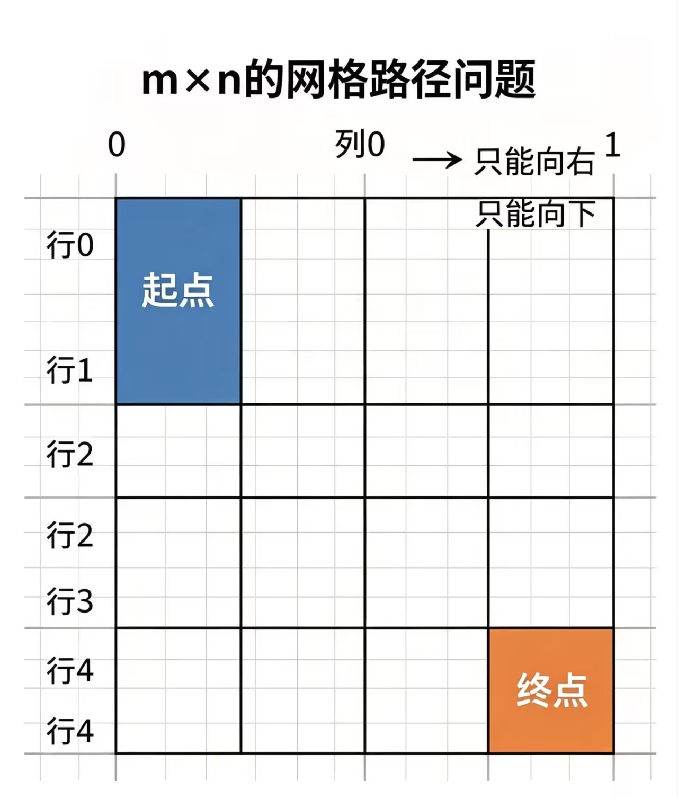
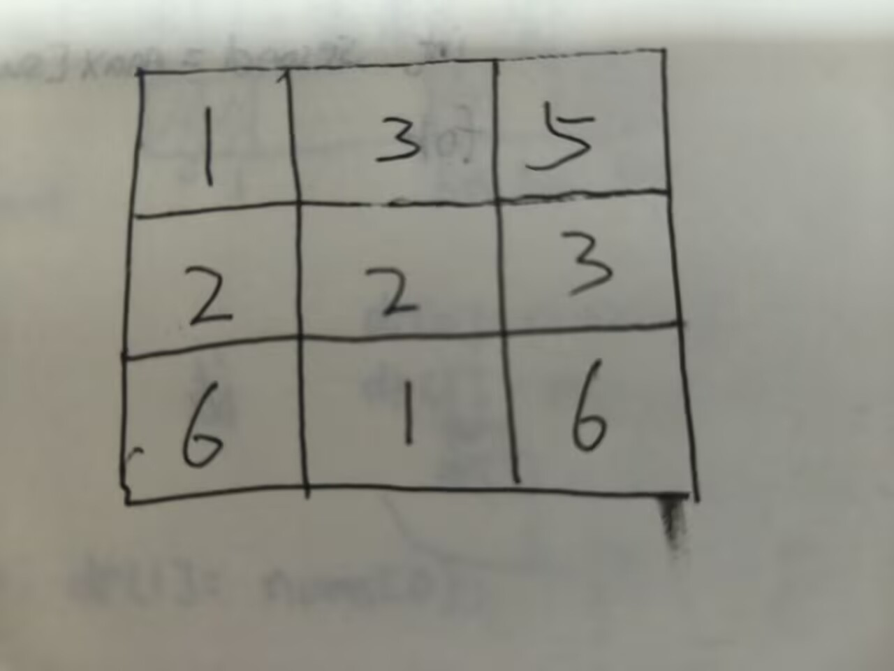
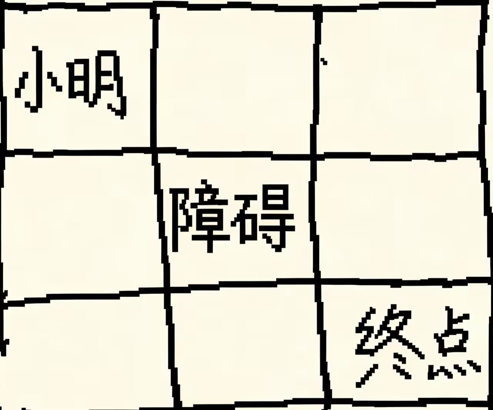
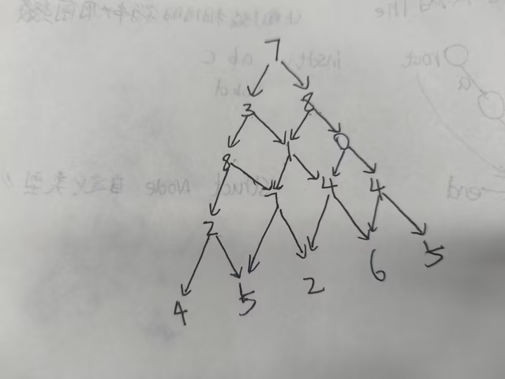

<h1 style="\\\*\\\*font-weight:bold; color:#222;\\\*\\\*">动态规划</h1>
动态规划一般是将一个问题分解成多个子问题，每个子问题的解可以独立计算，最后将所有子问题的解合并起来，得到问题的解。<br>
我个人认为动态规划的思路比较抽象，需要多练习才能掌握<br>
最经典的动态规划问题就是01背包问题，但是我是从打家劫舍问题开始了解动态规划的。

<h1 style="\\\*\\\*font-weight:bold; color:#222;\\\*\\\*">打家劫舍问题：</h1>
你现在是一个专业的小偷，计划偷窃沿街的房屋。<br>
每个房屋都藏有一定的现金，影响你偷窃的唯一因素就是相邻的房屋装有相互连通的防盗系统，<br>
如果两间相邻的房屋在同一晚上被小偷闯入，系统会自动报警。<br>
思路就是：现在有两种偷法：
```
{[ ][ ][ ][ ][ ].... [ ]  .  [ ] .  [ ]}假设一共k个房屋f(k)

  {0  1  2  3  4  ...        k-3   k-2   k-1 }
```
偷法1：<br>
偷前k-1个房屋，最后一个房屋不偷。f(k-1)
```
{[/][/][/]....[/] . [/] . [/]  [ ]}

 { 0  1  2   ...  k-4  k-3 k-2  k-1  }
```
偷法2：

偷前k-2个房屋+最后一个房屋。f(k-2)+k-1
```
{[/][/][/]....[/] . [/] . [ ] . [ /]}

 { 0  1  2 ...    k-4  k-3 k-2  k-1  }
```
或许你没看懂，那么我给你举个例子：<br>
假设k=4;<br>
偷法1：f(3)<br>
偷(2)+k(2)+k-1<br>
ff(4)=max(f(3),f(2)+k-1)<br>
那f(3)同理也是这么来的<br>
偷法1：f(2)<br>
偷法2：f(1)+k-1
f(3)=max(f(2),f(1)+k-1)<br>
而f(2)也是这么来的
偷法1：f(1)<br>
偷法2：0<br>
f(2)=max(f(1),0)=f(1)<br>
同理f(1)也是这么来的<br>
偷法1：0<br>
偷法2：0<br>
f(0)=max(0,0)=0<br>
这样你发现了这样的问题转化成多个子问题，每个子问题的解可以独立计算，最后将所有子问题的解合并起来，得到问题的解。<br>
f(k)=max(f(k-1),f(k-2)+k-1)<br>
也就是每次都在两种选法中选最大的那个；<br>
代码实现：<br>
这里我们假设一共n间房屋。
样例：<br>
输入：<br>
4<br>
1 2 3 1<br>
输出：<br>
4<br>

??? cpp "C++ AC 代码"
    ```cpp
    #include <bits/stdc++.h>
    using namespace std;
    int main(){
        int n;
        cin >> n;
        vector<int> a(n + 1, 0);
        for(int i = 1; i <= n; i++){
            cin >> a[i];
        }
        vector<int> dp(n + 1, 0);
        dp[0] = 0; // 因为没有房屋，所以金额为0
        dp[1] = a[1]; // 如果只有一个房屋，那么金额就是房屋的金额
        for(int i = 2; i <= n; i++){
            dp[i] = max(dp[i - 1], dp[i - 2] + a[i]);
        }
        cout << dp[n] << endl;
        return 0;
    }
    ```


如果你觉得你理解了，那么我们来看他的进阶版（滚动版打家劫舍问题）
<h1 style="\\\*\\\*font-weight:bold; color:#222;\\\*\\\*">滚动版打家劫舍问题：</h1>

给你一个数组，数组中每个元素表示一个房屋的金额。但是如果你选择了偷其中的一间房屋（价值为a[i]），那么你需要放弃（删除）金额数为a[i]-1和a[i]+1的房屋。问在这样的情况下，你可以偷到的最大金额是多少？

这道题我个人在看的时候也联想不到打家劫舍，因为我找不到一个子问题，所以无法将问题分解成多个子问题。后来我通过“打家劫舍是不允许元素相邻”而这道题是不允许元素大小相邻”来写的。

??? cpp "C++ AC 代码"
    ```cpp
    #include<bits/stdc++.h>
    using namespace std;
    int main(){
    int n;
    cin>>n;
    int maxn=0;
    vector<int>nums(n);
    for(int i=0;i<n;i++){
         cin>>nums[i];
         maxn=max(maxn,nums[i]);
    }
    vector<int>sum(n+1,0);
    for(auto &i:nums){
         sum[i]+=i;
    }
    vector<int>dp(maxn+1,0);
    dp[0]=sum[0];
    dp[1]=max(sum[0],sum[1]);
    for(int i=0;i<n;i++){
         dp[i]=max(dp[i-1],dp[i-2]+sum[i]);
    }
    cout<<dp[n-1]<<endl;
     return 0;
    }

    ```

好的本喵来讲解一下喵:<br>
这道题其实你把相同的数相加为一个数然后就变成了打家劫舍问题了<br>
在此之前我们先讲一下auto &i:nums;的用法。<br>
auto是c++11新增的，用于自动推导变量类型。<br>
auto &i:nums的意思就是遍历nums数组中的每个元素，将每个元素赋值给i。<br>
比如nums={2,2,3,3,4}<br>
nums[2]=2+2br>
nums[3]=3+3;<br>
nums[4]=4;<br>
这样我们就将nums里面相同的数相加为一个数。<br>
为啥要相加呢？<br>
还是例子nums={2,2,3,3,4}<br>
相同元素相加后我们得到了一个新的数组我们记作sum={4,6,4}<br>
这个时候就能看出来和前面的打家劫舍问题是一样的。<br>
maxn是为了确定dp数组的大小。dp数组的大小要大于等于nums数组的最大值。否则会数组越界。<br>
<h1 style="\\\*\\\*font-weight:bold; color:#222;\\\*\\\*">不同路径问题：</h1>

你现在位于一个m x n 网格的左上角。
你只能向下或向右移动一步。问有多少条不同的路径可以到达网格的右下角？

<div style="text-align:center;">
</div>


```cpp linenums="1" title="不同路径问题.cpp"
#include<bits/stdc++.h>
using namespace std;
int main(){
    int n,m;
    cin>>n>>m;
    vector<vector<int>> v(n,vector<int>(m));
    for(int i=0;i<n;i++){
        v[i][0]=1;
    }
    for(int i=0;i<m;i++){
        v[0][i]=1;
    }
       for(int i=1;i<n;i++){   
         for(int j=1;j<m;j++){   
            v[i][j]=v[i-1][j]+v[i][j-1];
        }
       } 
        cout<<v[n-1][m-1]<<endl;       
    return 0;
}


```
本喵来讲解一下一下喵:
因为我们只能向下或向右移动一步，因此我们的当前这一步是由上一步和左一步得到的。

因此可以写出关键的转移方程：

v[i][j]=v[i-1][j]+v[i][j-1];

初始化就是第一行和第一列都为1。因为从左上角到左上角只有1条路径。


<h1 style="\\\*\\\*font-weight:bold; color:#222;\\\*\\\*">最小路径和问题：</h1>

给定一个m x n 网格，你的任务是从网格的左上角到达网格的右下角，
并沿路径上的数字总和最小。

<div style="text-align:center;">
</div>

```cpp linenums="1" title="最小路径和.cpp"
#include<bits/stdc++.h>
using namespace std;
int main(){
    int m,n;
    cin>>m>>n;
    vector<vector<int>> grid(m+1,vector<int>(n+1,0));
    for(int i=1;i<=m;i++){
        for(int j=1;j<=n;j++){
            cin>>grid[i][j];
        }
    }  
    vector<vector<int>> dp(m+1,vector<int>(n+1,0));  
    dp[1][1]=grid[1][1];
    for(int i=2;i<=m;i++){
        dp[i][1]=dp[i-1][1]+grid[i][1];
    }
    for(int j=2;j<=n;j++){
        dp[1][j]=dp[1][j-1]+grid[1][j];
    }
    for(int i=2;i<=m;i++){
        for(int j=2;j<=n;j++){
                dp[i][j]=grid[i][j]+min(dp[i-1][j],dp[i][j-1]);
            }
        }
    
    cout<<dp[m][n]<<endl;
    return 0;
}

```
本喵来讲解一下一下喵:
因为我们只能向下或向右移动一步，因此我们的当前这一步是由上一步和左一步得到的。

因此可以写出关键的转移方程：

dp[i][j]=grid[i][j]+min(dp[i-1][j],dp[i][j-1]);

这个的意思就是当前这一步的路径和等于当前这一步的数字加上上一步和左一步的路径和的较小值。

也就是在左一步和上一步中选择较小的数然后加上当前的这一步数。

<p>下面我们介绍一下四维dp和三维dp。<br>
四维dp和三维dp的思路和二维dp和一维dp是一样的。<br>
只是在转移方程中多了一个维度。<br>
</p>
<h2>方格取数问题：</h2>
<p>设有N*N个方格，我们将其中的某些方格填入正整数，而其他的方格填入0。<br>
我们从左上角开始，每次只能向下或向右移动一步。<br>
去走后方格中的数字变为0。<br>
我们需要走两次。<br>
我们想从左上角到右下角的路径上的数字总和最大。<br>
</p>
先写一下四维dp：<br>

```cpp title="方格取数问题.cpp"
#include <bits/stdc++.h>
using namespace std;

const int N = 12; // N ≤ 9，开大一点防止越界
int n, x, y, v;
int a[N][N];
int dp[N][N][N][N]; // dp[i][j][k][l]: 第一个人走到(i,j)，第二个人走到(k,l)的最大和

int main() {
    ios::sync_with_stdio(false);
    cin.tie(0);

    cin >> n;
    // 读取输入，直到 0 0 0 结束
    while (cin >> x >> y >> v && (x || y || v)) {
        a[x][y] = v;
    }

    // 四维DP
    for (int i = 1; i <= n; i++) {
        for (int j = 1; j <= n; j++) {
            for (int k = 1; k <= n; k++) {
                for (int l = 1; l <= n; l++) {
                    // 四种来源取最大值
                    int max_prev = max({
                        dp[i-1][j][k-1][l], // 两人都向下
                        dp[i-1][j][k][l-1], // 第一个人向下，第二个人向右
                        dp[i][j-1][k-1][l], // 第一个人向右，第二个人向下
                        dp[i][j-1][k][l-1]  // 两人都向右
                    });
                    
                    // 加上当前两个格子的值
                    dp[i][j][k][l] = max_prev + a[i][j] + a[k][l];
                    
                    // 如果两人走到同一个格子，减去重复计算的一次
                    if (i == k && j == l) {
                        dp[i][j][k][l] -= a[i][j];
                    }
                }
            }
        }
    }

    cout << dp[n][n][n][n] << endl;
    return 0;
}

```
<p>这个就很好理解了我们用四维数组来存储第一个人和第二个人的路径和。<br>
其中[i]代表第一个人的横坐标，[j]代表第一个人的纵坐标，[k]代表第二个人的横坐标，[l]代表第二个人的纵坐标。<br>
我们是站在当前节点来看的因此向下就是上面的节点这个在上一题最小路径和中比较明显<br>
也就是当前格子的路径和等于当前格子的数字加上上一步和左一步的路径和的较大值。<br>
dp[i][j][k][l] = max_prev + a[i][j] + a[k][l];这个就是前面所选格子的最大值加上当前两个人格子的数字。<br>
如果两人走到同一个格子，减去重复计算的一次。<br>


下面我们优化一下四维dp将他转换为三维dp：<br>
```cpp title="方格取数问题3.cpp"
#include <bits/stdc++.h>
using namespace std;
typedef long long ll;

int main() {
    ios::sync_with_stdio(false);
    cin.tie(0);

    int n;
    cin >> n;
    vector<vector<ll>> a(n + 2, vector<ll>(n + 2, 0));
    ll x, y, v;
    while (cin >> x >> y >> v && (x || y || v)) {
        a[x][y] = v;
    }

    // dp[k][i1][i2]: 总步数k，第一个人在行i1，第二个人在行i2
    vector<vector<vector<ll>>> dp(2 * n + 2, vector<vector<ll>>(n + 2, vector<ll>(n + 2, 0)));

    for (int k = 2; k <= 2 * n; k++) {
        for (int i1 = 1; i1 <= n; i1++) {
            for (int i2 = 1; i2 <= n; i2++) {
                int j1 = k - i1;
                int j2 = k - i2;
                // 越界检查
                if (j1 < 1 || j1 > n || j2 < 1 || j2 > n) continue;

                // 四种来源的最大值
                ll max_prev = max({
                    dp[k-1][i1-1][i2-1], // 两人都向下
                    dp[k-1][i1-1][i2],   // 第一个人向下，第二个人向右
                    dp[k-1][i1][i2-1],   // 第一个人向右，第二个人向下
                    dp[k-1][i1][i2]      // 两人都向右
                });

                // 加上当前格子的值
                dp[k][i1][i2] = max_prev + a[i1][j1] + a[i2][j2];
                
                // 如果两人在同一个格子，减去重复计算的
                if (i1 == i2) {
                    dp[k][i1][i2] -= a[i1][j1];
                }
            }
        }
    }

    cout << dp[2 * n][n][n] << endl;
    return 0;
}
```
<p>这个相对于四维三维优化，空间复杂度从 O(n^4) 降到了 O(n^3)。<br>
<b>其思想是：</b>比如说第一个人我们用i1，j1表示他的坐标，第二个人我们用i2，j2表示他的坐标。<br>
第一个人和第二个人他们走的步数是一样的也就是i1+j1=i2+j2。<br>
因此我们引入一个k来表示总步数。<br>
通过k我们可以得到i1和i2。<br>
也就是i1=k-i2。<br>
j1=k-j2。<br>
这样我们就可以用三维数组来存储第一个人和第二个人的路径和。<br>
最后我们返回dp[2*n][n][n]就是答案。<br>

如果你觉得你学会了，接下来是传纸条问题。
<h2>传纸条问题：</h2>
<div>
<p>小渊和小轩是好朋友，也是同班同学，他们在一起总有谈不完的话题。一次素质拓展活动中，班上同学安排坐成一个 m 行 n 列的矩阵，<br>
而小渊和小轩被安排在矩阵对角线的两端，因此，他们就无法直接交谈了。幸运的是，他们可以通过传纸条来进行交流。<br>
纸条要经由许多同学传到对方手里。小渊坐在矩阵的左上角，坐标为 (1,1)；小轩坐在矩阵的右下角，坐标为 (m,n)。
<br>从小渊传到小轩的纸条只可以向下或者向右传递，从小轩传给小渊的纸条只可以向上或者向左传递。
<br>
在活动进行中，小渊希望给小轩传递一张纸条，同时希望小轩给他回复。<br>
班里每个同学都可以帮他们传递，但只会帮他们一次，也就是说，如果此人在小渊递给小轩纸条的时候帮忙，那么在小轩递给小渊的时候就不会再帮忙，反之亦然。<br>

还有一件事情需要注意：全班每个同学愿意帮忙的好感度有高有低（注意：小渊和小轩的好心程度没有定义，输入时用 0 表示），可以用一个 [0,100] 内的自然数来表示，数越大表示越好心。<br>
小渊和小轩希望尽可能找好心程度高的同学来帮忙传纸条，即找到来回两条传递路径，使得这两条路径上同学的好心程度之和最大。现在，请你帮助小渊和小轩找到这样的两条路径。<br></p>

<p>输入：第一行有两个用空格隔开的整数 m,n，表示班里有 m 行 n 列。<br>
接下来的 m 行是一个 m×n 的矩阵，矩阵中第 i 行第 j 列的整数表示坐在第 i 行第 j 列的学生的好心程度。每行的 n 个整数之间用空格隔开。<br>
</p>
<p>输出：输出共一行一个整数，表示来回两条路上参与传递纸条的学生的好心程度之和的最大值。<br>
</p>
</div>
<h2>不同路径问题2：</h2>

给定一个m x n 网格，小明的任务是从网格的左上角到达网格的右下角，
但是网格中有一些障碍物，你不能通过障碍物。
小明想知道有多少条不同的路径可以到达网格的右下角？

网格中1为障碍物，0为无障碍物。

<div style="text-align:center;">
</div>

```cpp linenums="1" title="不同路径问题2.cpp"
#include<bits/stdc++.h>
using namespace std;
int main(){
    int m,n;
    cin>>m>>n;
    vector<vector<int>>grid(m,vector<int>(n));
    for(int i=0;i<m;i++){
        for(int j=0;j<n;j++){
            cin>>grid[i][j];
        }
    }
    vector<vector<int>>dp(m,vector<int>(n,0));
    dp[0][0]=1;
    for(int i=1;i<m;i++){
        if(grid[i][0]==0){
            dp[i][0]=dp[i-1][0];
        }
    }
    for(int j=1;j<n;j++){
        if(grid[0][j]==0){
            dp[0][j]=dp[0][j-1];
        }
    }
    for(int i=1;i<m;i++){
        for(int j=1;j<n;j++){
           if(grid[i][j]==1){
               continue;
           }else{
            dp[i][j]=dp[i-1][j]+dp[i][j-1];
           }    
        }
    }
    cout<<dp[m-1][n-1]<<endl;
    return 0;
}
        
```
这个和不同路径问题1的区别在于，这个题目中网格中有一些障碍物，我们不能通过障碍物。
当我们遇到障碍物时，我们跳过这次循环即可。


<h2>数字金字塔问题：</h2>

<p>给你一个数字金字塔，你的任务是从顶部的数字开始，每次移动到下一行的相邻数字上，
并沿路径上的数字总和最大。</p>
<div style="text-align:center;">
</div>

这题可以正着写也可以反着写。

```cpp linenums="1" title="数字金字塔.cpp"
#include<bits/stdc++.h>
using namespace std;

int main(){
    int n;
    cin>>n;
    vector<vector<int>> grid(n,vector<int>(n));
    for(int i=0;i<n;i++){
        for(int j=0;j<=i;j++){
            cin>>grid[i][j];    
        }
    }
    for(int i=n-2;i>=0;i--){
        for(int j=0;j<=i;j++){
            grid[i][j]+=max(grid[i+1][j],grid[i+1][j+1]);
        }
    }
    cout<<grid[0][0]<<endl;
    return 0;
}

```


<h2>01背包问题问题：</h2>
<p>给你一个物品列表，每个物品有一个重量和一个价值。
你有一个背包，背包的容量为W。
你的任务是选择一些物品，使物品的重量总和不超过背包的容量，
并使物品的价值总和最大。</p>

代码实现：<br>

```cpp linenums="1" title="01背包问题.cpp"
#include<bits/stdc++.h>
using namespace std;

int main(){
    int n,W;
    cin>>n>>W;
    vector<int>weig(n);
    vector<int>value(n);
    for(int i=0;i<n;i++){
        cin>>weig[i];
    }
    for(int i=0;i<n;i++){
        cin>>value[i];
    }
    vector<int>dp(W+1,0);
    for(int i=0;i<n;i++){
        for(int j=W;j>=weig[i];j--){
            dp[j]=max(dp[j],dp[j-weig[i]]+value[i]);
        }
    }
    cout<<dp[W]<<endl;
    return 0;
}
```
这个就很符合动态规划的思想。

我们是通过转移方程来实现的。<br>
转移方程如下：<br>
dp[j]=max(dp[j],dp[j-weig[i]]+value[i]);<br>
这个的意思是当前这一步的价值等于当前这一步的价值加上上一步的价值。
上一步的价值等于当前这一步的重量加上上一步的价值。<br>

我们着重讲解一下优化空间复杂度。<br>
```cpp linenums="1" title="01背包问题优化空间复杂度.cpp"
#include <bits/stdc++.h>
using namespace std;

int main()
{
    ios::sync_with_stdio(false);
    cin.tie(nullptr);

    int n, M;
    cin >> n >> M;

    vector<int> m(n), c(n);
    for (int i = 0; i < n; i++) cin >> m[i];
    for (int i = 0; i < n; i++) cin >> c[i];

    int sumC = accumulate(c.begin(), c.end(), 0);
    const int INF = 0x3f3f3f3f;

    vector<int> dp(sumC + 1, INF);
    dp[0] = 0;

    for (int i = 0; i < n; i++) {
        for (int v = sumC; v >= c[i]; v--) {
            if (dp[v - c[i]] + m[i] <= M) {
                dp[v] = min(dp[v], dp[v - c[i]] + m[i]);
            }
        }
    }

    for (int v = sumC; v >= 0; v--) {
        if (dp[v] <= M) {
            cout << v << '\n';
            return 0;
        }
    }

    return 0;
}
```

<h2>最长上升子序列问题：</h2>   
<p>给你一个整数序列，你的任务是找到最长的上升子序列。</p>

比如说7 {3 ，1，2，1，8，5，6}<br>
最长上升子序列是{1，2，5，6}<br>
最长上升子序列的长度是4。<br>

```cpp linenums="1" title="最长上升子序列.cpp"
#include<bits/stdc++.h>
using namespace std;

int main(){
	int n;
	cin >> n;
	vector<int>nums(n);
	for (int i = 0; i < n ; i++ ){
		cin >> nums[i];
	}
	int ans = 0;
	vector<int>dp(n,0);
	for (int i = 0 ;i < n; i++ ){
		for (int j = 0; j < i ; j++){
			if (nums[i] > nums[j]){
				dp[i] = max(dp [i],dp[j]+1);
			}
		}
		ans = max(ans,dp[i]);
	}
	cout << ans <<endl;
	return 0;
} 

```
<p>这个就比较简单了但是时间复杂度比较高，是O(n^2)。</p><br>
<p>这道题的最优解法是贪心+二分：</p><br>

```cpp linenums="1" title="最长上升子序列贪心+二分.cpp"
#include<bits/stdc++.h>
using namespace std;

int main(){
	int n;
	cin >> n;
	vector<int>nums(n);
	for(int i = 0 ; i < n; i++){
		cin >> nums[i];
	}
	vector<int>tails;
	for (int x:nums)
	{
		int pos = lower_bound(tails.begin(),tails.end(),x)-tails.begin();
		if (pos == tails.end()){
			tails.push_back(x);
		}else{
			tails[pos] = x;
		}
	}
	cout << tails.size() << endl;
	return 0;
} 
```
<p>这个的时间复杂度是O(nlogn)。</p><br>
<p>这里解释一下lower_bound他是stl中的一个函数，他返回的是第一个大于等于x的元素的迭代器。返回的是地址值</p>
<p>lower_bound(开始迭代器，结束迭代器，要查找的元素)</p>
<p>如果要查找的元素不存在，他返回的是结束迭代器。</p>

<p>为啥要写-tails.begin()？</p>
<p>因为lower_bound返回的是一个迭代器，我们要将其转换为下标，所以要减去开始迭代器。</p>
<p>举个例子：</p>
<p>tails = {2,5,3,7,101,18}</p>
如果找到了2 lower_bound返回的是2的地址也就是0X1000。我们减去开始迭代器得到下标是0。
<p>遍历过程以 8<br>
10 9 2 5 3 7 101 18
<br>为例子</p>


<h2>不同的子序列问题：</h2>

<p>给你两个字符串s和t，统计并返回在s的子序列中出现t的次数。</p>
<p>举个例子：</p>
<p>s = "rabbbit", t = "rabbit"</p>
<p>返回3</p>

<p>代码实现：</p>
<p>转移方程：</p>
<p>dp[i][j] = dp[i-1][j-1] + dp[i-1][j]</p>
<p>dp[i][j] = dp[i-1][j]</p>
<p>dp[i][j] = 1</p>
<p>dp[i][j] = 0</p>

```cpp title="不同的子序列问题.cpp"

#include<bits/stdc++.h>
using namespace std;
typedef long long ll;
int main(){
	string s , t;
	cin >> s >> t;
	int m = s.length();
	int n = t.length();
	if(m < n){
		return 0;
	}
	vector<vector<ll>>dp(m + 1,vector<ll>(n + 1,0)); 
	for (int i = 0; i <= m ; i++){
		dp[i][n] = 1;
	}
	for (int i = m - 1; i >= 0 ; i--){
		char sChar = s.at(i);
		for (int j = n - 1 ; j >= 0; j--){
			char tChar = t.at(j);
			if (sChar == tChar){
				dp[i][j] = dp[i+1][j+1] + dp[i+1][j];
			}else{
				dp[i][j] = dp[i+1][j];
			}
		}
	} 
	

cout << dp[0][0] << endl;
	return 0;
}
```

<p>这里解释一下s.at(i)和t.at(j)的含义：</p>
<p>s.at(i)表示s的第i个字符</p>
<p>用.at()函数可以避免越界。</p>
<p>.at()在访问之前，会先检查一下i是否合法，如果i>=0 && i<s.length():安全放行，返回字符。</p>
<p>如果i不合法，会抛出out_of_range异常。</p
>
