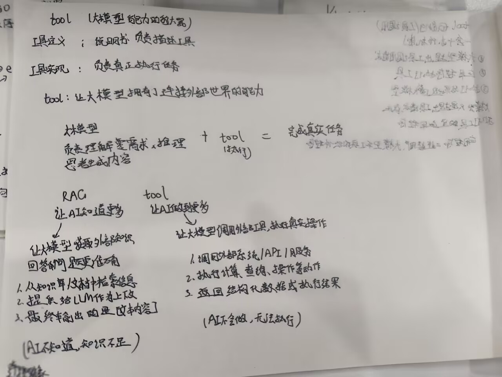

<h1>AI</h1>

AI是英文人工智能的缩写，是指计算机模拟人类智能的系统。

我一直想着编辑这一页但是我的笔记全掉了，😅。

<h2>LLM</h2>

LLM是英文Large Language Model的缩写，是指大型的语言模型。

我们可以把它理解为一个大型的神经网络，它可以生成人类语言。

<h3>LLM的工作原理</h3>

LLM的工作原理基于深度学习，它通过训练大量的文本数据来学习语言的规律。

在训练过程中，LLM会学习到语言的语法、语义和上下文关系。

当LLM接收到新的文本时，它会根据学习到的知识规律，生成符合语法和语义的文本。

这个过程被称为生成。

<h3>LLM的应用</h3>

LLM的应用非常广泛，它可以用于生成文本、翻译语言、回答问题、情感分析等自然语言处理任务。

在自然语言处理领域，LLM已经被广泛应用于文本生成、机器翻译、问答、情感分析等。

在图像和语音领域，直接处理图像分类、语音识别、语音合成的是专用的视觉模型（如ViT）和语音模型（如Whisper），不是LLM本身。能"看图说话"、统一处理文本、图像、音频的是<strong>多模态大模型</strong>，可以看作LLM的扩展形态。

<h2>AIGC</h2>

AIGC是英文Artificial Intelligence Generated Content的缩写，中文叫人工智能生成内容。

指由AI模型自动生成的各种内容，包括文本、图像、音频、视频、代码等。

<h3>AIGC的常见类型</h3>

1. 文本生成：聊天、写作、翻译、摘要，主要由LLM完成。

2. 图像生成：文生图、图生图，代表模型有Stable Diffusion、Midjourney、DALL·E等。

3. 音频生成：语音合成（TTS）、音乐生成。

4. 视频生成：文生视频、图生视频，代表有Sora等。

5. 代码生成：由代码大模型完成，如GitHub Copilot、Claude Code等。

<h3>AIGC和LLM的关系</h3>

LLM是AIGC的核心引擎之一，但AIGC的范围更大。

LLM主要负责文本类的AIGC；图像、音频、视频类的AIGC靠的是扩散模型（diffusion）、语音模型等专用模型。

现在的趋势是多模态大模型把文本、图像、音频、视频统一起来，一个模型就能生成多种内容。

<h3>AIGC的常见问题</h3>

1. 幻觉：生成的内容与事实不符。

2. 版权争议：训练数据和生成内容的版权归属问题。

3. 深度伪造（deepfake）：生成逼真的虚假图像、音频、视频，可能被滥用。

4. 内容质量参差：需要人工审核和筛选。

<h2>prompt</h2>

prompt是英文"提示"的意思，在AI语境里指用户输入给模型的那段文本，也就是你"对模型说的话"。

它是模型输出的起点——模型根据prompt里给出的指令、资料和问题，生成对应的回答。

<h3>prompt的常见构成</h3>

1. 指令（instruction）：告诉模型要做什么，比如"翻译成英文"、"总结下面这段话"。

2. 上下文（context）：给模型参考的资料，比如一段原文、几份文档。

3. 输入数据（input）：要处理的具体内容。

4. 输出格式要求（output format）：希望模型怎么答，比如"用JSON输出"、"分三点回答"。

这四部分常被称为提示的四要素，实际使用中可以只取其中几项。

<h3>prompt和上下文的关系</h3>

prompt是上下文的一部分。上下文窗口里装的，就是系统提示、历史对话、用户这次输入的prompt、以及可能检索来的资料。

也就是说，prompt是"这一轮你说的话"，上下文是"模型这一轮能看到的全部内容"。

<h3>常见写法技巧</h3>

1. 说清楚角色和任务，比如"你是一个资深翻译"。

2. 给例子（few-shot），让模型照着样例的格式和风格来。

3. 分步骤思考（思维链），让模型先推理再给结论。

4. 明确输出格式，减少模型自由发挥带来的偏差。

5. 把重要指令放在显眼位置，长prompt里尤其要注意。

<h3>提示工程（prompt engineering）</h3>

提示工程就是研究和设计prompt的方法，目的是让模型稳定地输出符合预期的结果。

它不改变模型本身，只改变"怎么问"，是成本最低、见效最快的一种优化手段。

<h3>prompt的局限</h3>

1. 提示写得再好，也补不上模型本身能力的缺口。

2. 同一段prompt在不同模型上效果可能差别很大。

3. 长而复杂的prompt容易让模型顾此失彼，指令之间还可能互相冲突。

<h2>token</h2>

token是模型处理文本的最小单位，通常是一个词的一部分、一个词或一个标点。句子和段落不是token。

例如，一个词可能被切成多个token，如"unbelievable"会被切成 un + believ + able。

在LLM中，每个token都对应词表（vocabulary）里的一个整数ID，表示它是词表里的第几个。token的位置是另外用位置编码（positional encoding）表示的，跟token ID无关，也不存在"类型"这个说法。

模型把这些ID序列转成向量，再进行计算。

<h2>AI幻觉</h2>

AI幻觉是指LLM生成的文本与真实世界中的事实不一致，导致用户对LLM的输出产生错误理解。

例如，LLM可能会生成一个关于某个事件的文本，但是这个事件在真实世界中并没有发生。

解决办法：

1. 使用RAG（检索增强生成），让模型基于检索到的真实资料作答。

2. 使用工具调用进行事实核查，如搜索、计算器、数据库查询。

3. 要求模型引用来源，方便人工核对。

4. 降低采样温度，减少随机编造。

5. 多模型交叉验证，或加人工、规则兜底。

6. 增加推理时计算，让模型先思考再作答（思维链、self-consistency）。

但是以上办法只能减少AI幻觉的概率，不能完全避免。

<h2>上下文</h2>

上下文是指在LLM生成文本时，它会考虑的文本。

例如，LLM可能会考虑用户之前输入的文本，或者考虑用户之前生成的文本。

上下文可以帮助LLM生成更符合用户需求的文本。

但是上下文是有长度限制的，这个限制叫上下文窗口（context window），超过长度限制的上下文会被截断（truncation）或压缩。

本质上，LLM推理是无状态的，它没有记忆，所谓记忆是每次重新看一遍之前的上下文。

<h2>记忆</h2>

记忆（memory）是指模型在对话或执行任务过程中，能够保留和调用之前信息的能力。

严格来说，LLM本身是无状态的，没有内置记忆。所谓"记忆"是靠外部机制模拟出来的，让模型在需要时能"想起"之前的内容。

<h3>记忆的类型</h3>

1. 短期记忆（short-term memory）：就是当前的上下文窗口，装着这一轮对话或任务里模型能直接看到的内容。窗口一关，短期记忆就没了。

2. 长期记忆（long-term memory）：存在模型上下文之外的信息，比如向量数据库、文件、用户画像、历史对话摘要。需要时通过检索把相关内容取出来，再放进上下文。

3. 工作记忆（working memory）：Agent在执行多步任务时的临时状态，比如当前做到哪一步、已经得到了哪些中间结果。相当于任务执行过程中的"草稿纸"。

<h3>记忆的实现方式</h3>

1. 上下文窗口：最直接的短期记忆，但受长度限制。

2. 外部存储加检索：把历史对话、文档、用户偏好存进数据库，需要时检索回来，相当于长期记忆。

3. 摘要压缩：对话太长时，把前面的内容总结成一段摘要放进上下文，用压缩换长度。

4. 记忆写入与读取：决定什么时候把信息存进去、什么时候取出来，是记忆系统的关键设计。

<h3>记忆和上下文的关系</h3>

短期记忆就是上下文本身；长期记忆必须经过检索，进入上下文之后，模型才"看得见"。

所以记忆不是模型脑子里存着的东西，而是"存在外面、需要时搬进上下文"的一套机制。

<h3>记忆的局限</h3>

1. 上下文窗口有限，短期记忆装不下太多东西。

2. 长期记忆依赖检索质量，检索不准就"记错"或"想不起来"。

3. 记忆写入可能带入错误信息，越存越乱。

4. 隐私和安全问题：长期记忆里可能存有敏感信息，需要管理。

<h2>RAG</h2>

RAG是英文Retrieval-Augmented Generation的缩写，中文叫检索增强生成。

它的核心思路是：让模型在回答之前先检索资料，把检索到的内容放进上下文，再基于这些资料生成答案。一句话——先查资料，再作答，而不是只靠模型参数里"记住"的东西。

<h3>RAG的工作流程</h3>

1. 用户提问。

2. 把问题转成向量，去向量数据库里检索最相关的文档片段。

3. 把检索到的片段和原问题一起拼进上下文。

4. 模型基于"问题 + 检索资料"生成答案。

<h3>RAG为什么能减少幻觉</h3>

1. 答案有外部依据，不是纯靠记忆编造。

2. 资料可以附带来源，方便核对。

3. 知识可以随时更新，改数据库即可，不用重新训练模型。

<h3>RAG的局限</h3>

1. 检索不准，答案会更离谱，也就是garbage in, garbage out。

2. 检索到的资料本身可能过时或错误。

3. 多了一步检索，延迟和成本都会上升。

4. 仍然不能完全消除幻觉。

<h2>tool</h2>

tool（工具）是模型可以调用的外部函数、API或能力，用来弥补LLM的三个短板——不能访问实时信息、不能精确计算、不能真正"操作"世界。

常见工具：

1. 搜索（联网检索）

2. 计算器、代码执行

3. 数据库查询

4. 文件读写

5. 发邮件、调第三方API

工具怎么被模型"看见"：每个工具都有一份结构化描述——名称、功能说明、参数及类型。模型靠这份说明判断"该不该用、怎么用"。

这里说明一下RAG和tool的区别：

<h2>tool calling</h2>

tool calling（工具调用，也叫function calling）是指模型不直接执行工具，而是输出一个结构化的调用请求（工具名加参数，通常是JSON），由外部程序执行后，把结果回传给模型。

完整流程：

1. 用户提问。

2. 模型判断需要某个工具。

3. 模型输出调用请求，如 { "tool": "search", "args": { ... } }。

4. 宿主程序或harness真正执行这个工具。

5. 执行结果回传给模型。

6. 模型基于结果继续推理，或再调下一个工具。

关键点：

1. 执行者永远是外面的程序，不是模型本身，模型只负责"说要调什么"。

2. 这一步正是harness在起作用：它解析调用请求、执行、把结果塞回上下文。

3. tool calling是Agent的基础能力；Agent = tool calling + 循环 + 规划 + 记忆。

三者关系一句话：<strong>tool</strong>是能力，<strong>tool calling</strong>是模型请求使用能力的机制，<strong>Agent</strong>是围绕这套机制跑起来的自主循环系统，而<strong>harness</strong>是承载这一切的外壳。

<h2>Agent</h2>

Agent（智能体）是以LLM为"大脑"，能自主规划、调用工具、执行、观察结果、调整，完成多步任务的系统。

和普通LLM的区别：

普通LLM：一次输入对应一次输出，无状态、不行动。

Agent：是一个循环——观察、思考、行动、再观察……直到任务完成。

四个常见组件：

1. <strong>LLM</strong>：负责推理和决策。

2. <strong>工具（tools）</strong>：负责"动手"。

3. <strong>记忆（memory）</strong>：短期是上下文，长期是外部存储或检索。

4. <strong>规划与循环控制</strong>：决定下一步做什么、何时停。

例子：Claude Code、各类coding agent、AutoGPT类自主智能体。

一句话：Agent = LLM + 工具 + 循环 + 记忆。

<h2>harness</h2>

harness在英文里是马鞍的意思。

在AI/LLM语境里，harness引申为"驾驭、套上挽具"，也就是围绕模型搭建的那套评测/运行框架。

常见两种用法：

1. <strong>评测框架（evaluation harness）</strong>：一套标准化脚本，把同一批题目喂给不同模型，统一打分比较。代表是EleutherAI的lm-evaluation-harness，用来跑MMLU、GSM8K这类基准。

2. <strong>智能体框架（agent harness）</strong>：包在模型外面的一层脚手架，负责工具调用、循环控制、上下文管理、错误重试，让模型能真正干活。Claude Code和各类agent框架都属于这一类。

所以"马鞍"这个比喻挺贴切：模型是马，harness是套在马身上、让人能骑上去驾驭它的那套装备。

<h2>蒸馏</h2>

蒸馏（Knowledge Distillation）是指用一个大模型（教师模型，teacher）来训练一个小模型（学生模型，student），让小模型学会大模型的本事。

目标是在保持性能尽量接近的前提下，把模型变小、变快、变便宜。

<h3>蒸馏的工作原理</h3>

普通训练只用"硬标签"（hard label），也就是标准答案，比如这张图是猫，标签就是"猫"，其余类别概率全是0。

蒸馏的关键在于：学生不只学标准答案，还要学教师模型输出的"软标签"（soft label），也就是教师对每个类别给出的概率分布，比如"猫0.9、狗0.08、老虎0.02"。

这个概率分布里藏着类别之间的相似关系，被称为"暗知识"（dark knowledge）。它比一个孤零零的标准答案信息量大得多，学生学到的就不只是"答案是什么"，还有"教师是怎么想的"。

为了让软标签里的信息更充分，通常会引入一个温度参数（temperature），把教师的输出分布"软化"，让小的概率也被放大出来，学生才能学到这些细微差别。

<h3>蒸馏的常见类型</h3>

1. 基于响应的蒸馏（response-based）：学生模仿教师的最终输出，最常见。

2. 基于特征的蒸馏（feature-based）：学生模仿教师中间层的特征表示。

3. 基于关系的蒸馏（relation-based）：学生模仿教师学到的样本之间的关系结构。

<h3>蒸馏在LLM时代的用法</h3>

在大模型语境下，蒸馏更多指"数据蒸馏"：用大模型生成高质量的问答、推理过程或标注数据，再用这些数据去训练小模型。

这样小模型不用自己从海量原始文本里摸索，而是直接站在大模型的肩膀上学习。

<h3>蒸馏的局限</h3>

1. 学生模型的上限受教师模型限制，教师不会的，学生也学不会。

2. 模型容量差距太大时，学生学不动，效果会明显下降。

3. 蒸馏能压缩能力，但不能凭空创造教师没有的能力。
