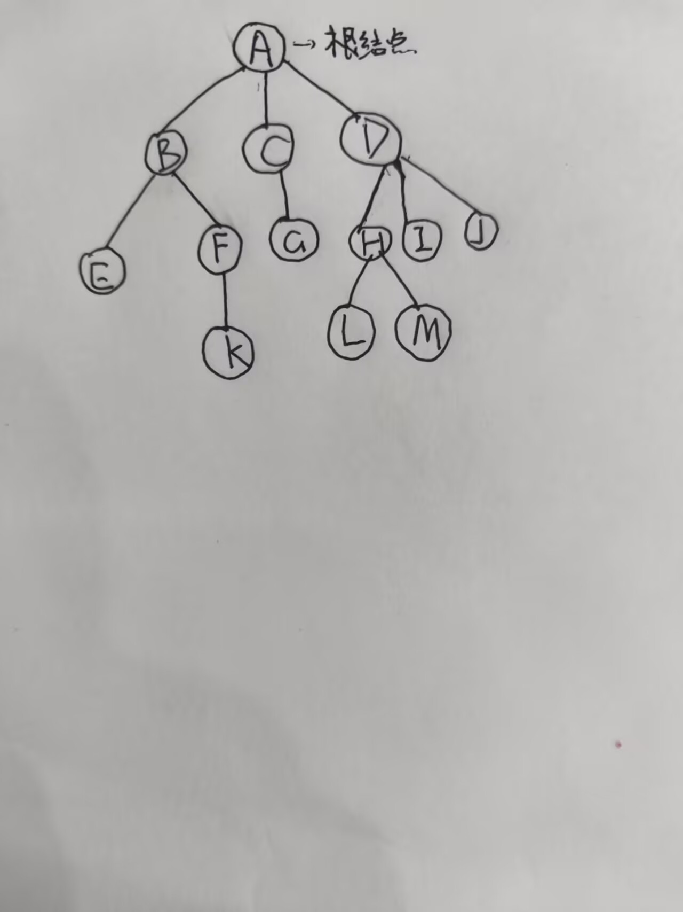
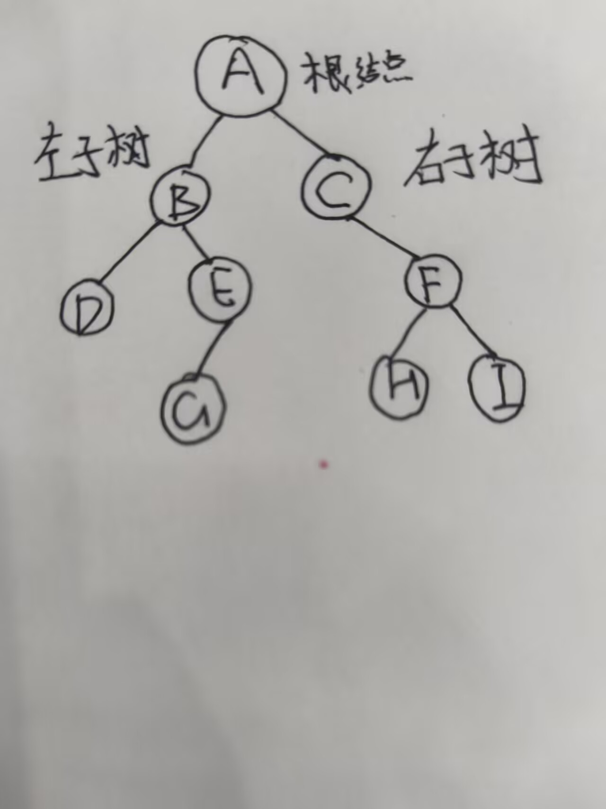
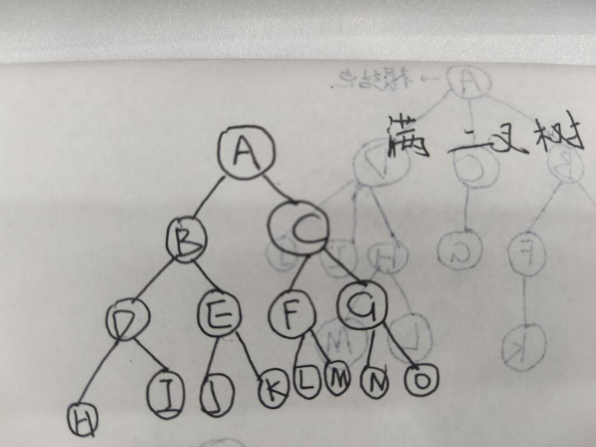
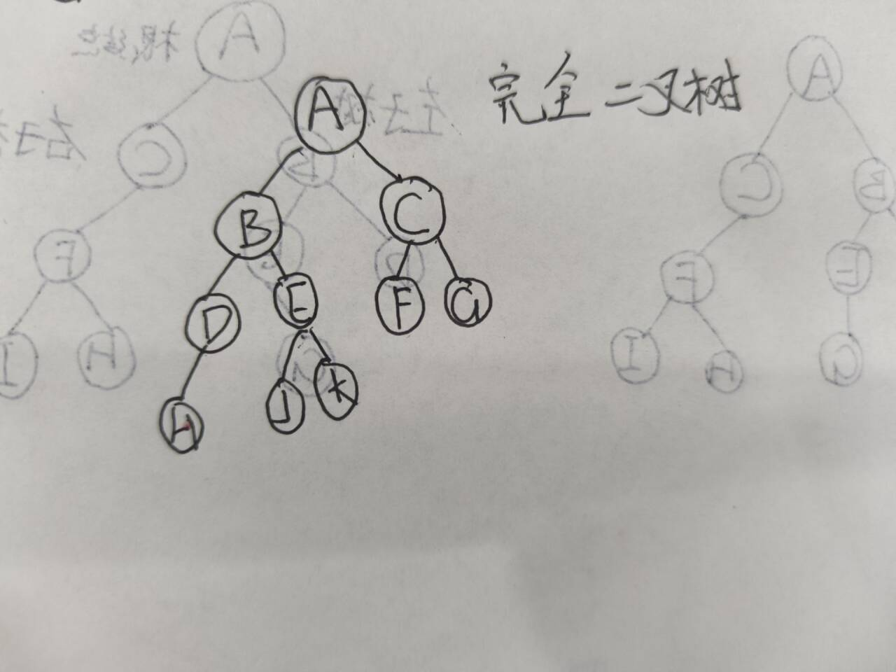
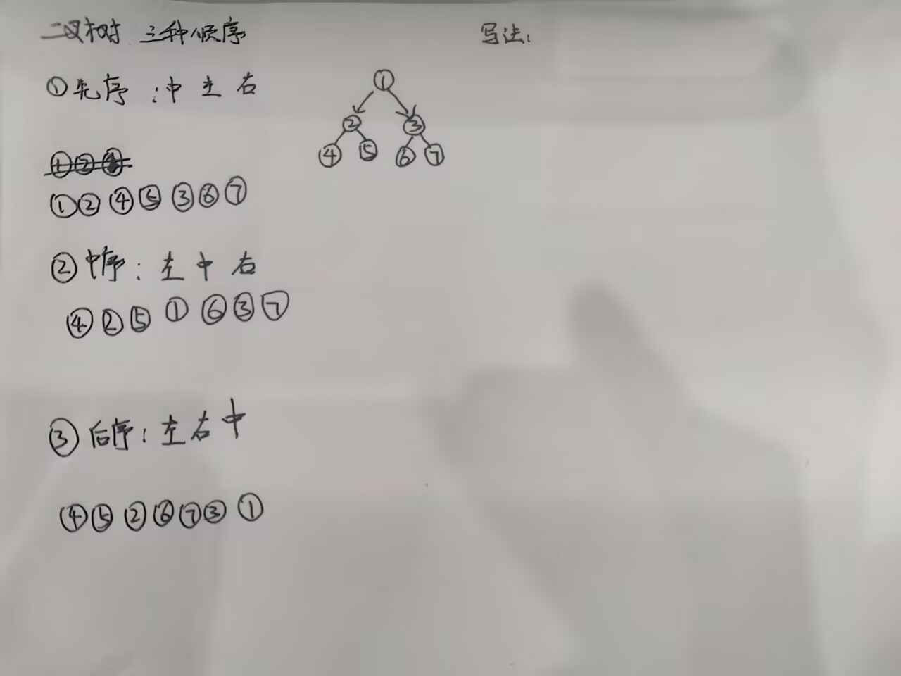
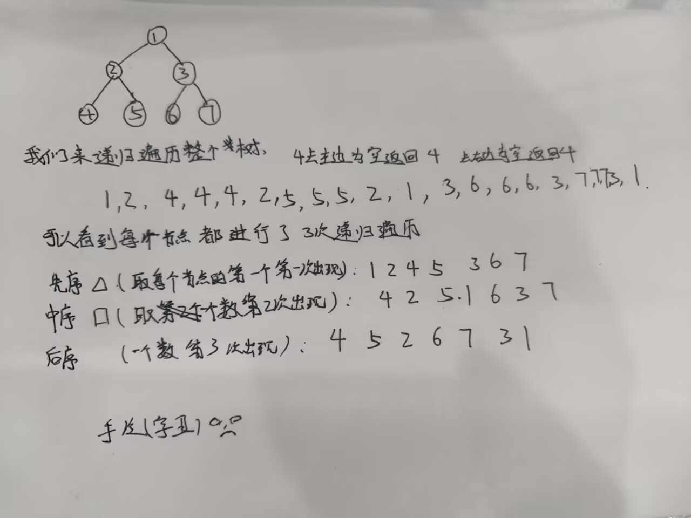

<h1 style="\\\*\\\*font-weight:bold; color:#222;\\\*\\\*">树：</h1>

在学习二叉树之前我们先了解一下树的基本概念。

树的定义：

n个节点构成的有限集合

n=0时，树为空树。

n>0时，树有且只有一个根结点。

<div style="text-align:center;">
</div>

每个子集也是树，被称为根结点的子树。

1.树的高度=树的深度=树的层数

2.结点的深度：他所在的层次

3.结点的高度：以他为根的子树的层数

4.结点的度：孩子的个数

5.叶结点：度为0的结点

6.分支结点：度大于0的结点

7.分支结点：度大于0的结点

树分为有序树和无序树。

各个节点的子树从左到右有次序，不能互换，称为有序树。否则称为无序树。

树的性质：

节点数n=边数+1=所有结点数之和+1

我们来了解二叉树。

二叉树：树中每个结点最多有两个分支的树。
<div style="text-align:center;">
</div>

下面我们认识一下两种特殊的二叉树。

1.满二叉树：每个结点都有两个子结点的二叉树。
<div style="text-align:center;">
</div>

满二叉树：所有分支结点都有两个子结点。所有叶结点都在最底层。只有度为0的结点和度为2的结点。

2.完全二叉树：每个结点都有两个子结点的二叉树。
<div style="text-align:center;">
</div>
完全二叉树：除了最后一层，其他层的结点都有两个子结点。最后一层的结点都从左到右连续排列。但是最后一层可以没有满。

我们接下来学习一下如何表示树：
<h3>二叉树的表示</h3>
我们一般用结构体+左右指针来表示二叉树。
```
struct TreeNode {
    int val;        // 节点的值
    TreeNode* left; // 左孩子
    TreeNode* right;// 右孩子
    TreeNode(int x) : val(x), left(NULL), right(NULL) {}
};
```
<b>或者我们用数组模拟二叉树。</b>
```
int val[N];   // 点的值
int left[N];  // 左儿子的编号
int right[N]; // 右儿子的编号
```
<h3>多叉树/一般树的表示</h3>
```
vector<int>g[N];
cin >> u >> v;
g[u].push_back(v);
```
<b>如果是一颗无向树，我们需要双向建边。</b>
```
g[u].push_back(v);
g[v].push_back(u);
```
<h3>带权树的表示</h3>
vector+pair
```
vector<pair<int,int>>g[N];
```
下面我们写一道简单的题二叉树的题目：
<h2>遍历二叉树</h2>
给你一个二叉树n个节点，后面n行第一个字符表示根结点，后面两个字符表示左子结点和右子结点。
我们用*表示空结点。<br>
请输出前序遍历的结果。

```cpp linenums="1" title="遍历二叉树.cpp"

#include<bits/stdc++.h>
using namespace std;
struct TreeNode{
	char left;
	char right;

}tree[300]; 
void pre(char u){
	if (u == '*')return;
	cout << u;
	pre(tree[u].left);
	pre(tree[u].right);
}
int main(){
	ios::sync_with_stdio(0);
	cin.tie(0);
	int n ;
	cin >> n;
	char root;
	for (int i = 0 ; i < n ;i++){
		char u , v , w ;
		cin >> u >> v >> w;
		if (i==0)root = u;
		tree[u].left = v;
		tree[u].right = w; 
	}
	pre(root);
	return 0;
}
```
这个就是二叉树的遍历
没错学图和树之前BFS和DFS是必备的算法。


### 二叉树的遍历：

## 分为三种情况：

# 1.先序遍历<br>
# 2.中序遍历<br>
# 3.后序遍历<br>


<div style="text-align:center;">
</div>

我们也是通过递归的方式来实现遍历：

二叉树初始化：

```
struct TreeNode {
    int val;
    TreeNode *left;
    TreeNode *right;
    treenode(int x){
        val = x;
        left = right = nullptr;
    }
};
```


```
// 先序遍历(java)
public static void preorder(TreeNode head){
	if (head == null)return;
	System.out.println(head.val);
	preorder(head.left);
	preorder(head.right);
}
//先序遍历(c++)
#include <iostream>

void preorder(TreeNode* head) {
    if (head == nullptr) return;
    std::cout << head->val << "\n"; // 使用 "\n" 比 std::endl 更快
    preorder(head->left);
    preorder(head->right);
}
```
```
// 中序遍历(java)
public static void inorder(TreeNode head){
	if (head == null)return;
	inorder(head.left);
	System.out.println(head.val);
	inorder(head.right);
}
//中序遍历(c++)
#include <iostream>

void inorder(TreeNode* head) {
    if (head == nullptr) return;
    inorder(head->left);
    std::cout << head->val << "\n";
    inorder(head->right);
}
```

```
// 后序遍历(java)
public static void postorder(TreeNode head){
	if (head == null)return;
	postorder(head.left);
	postorder(head.right);
	System.out.println(head.val);
}
//后序遍历(c++)
#include <iostream>

void postorder(TreeNode* head) {
    if (head == nullptr) return;
    postorder(head->left);
    postorder(head->right);
    std::cout << head->val << "\n";
}
```

```
#include <iostream>

// 假设 TreeNode 结构体已经定义好
struct TreeNode {
    int val;
    TreeNode *left;
    TreeNode *right;
    TreeNode(int x) : val(x), left(nullptr), right(nullptr) {}
};

void f(TreeNode* head) {
    // 如果节点为空，直接返回
    if (head == nullptr) return; 
    
    // ---------- 位置 1 ----------
    // 在这里写操作代码，就是【前序遍历】（根 -> 左 -> 右）
    // 例如：cout << head->val << " ";
    
    f(head->left);  // 递归遍历左子树
    
    // ---------- 位置 2 ----------
    // 在这里写操作代码，就是【中序遍历】（左 -> 根 -> 右）
    // 例如：cout << head->val << " ";
    
    f(head->right); // 【注意】这里原代码写成了 f(head,right)，应该是 f(head->right)
    
    // ---------- 位置 3 ----------
    // 在这里写操作代码，就是【后序遍历】（左 -> 右 -> 根）
    // 例如：cout << head->val << " ";
}
```
<div style="text-align:center;">
</div>


<!DOCTYPE html>
<html lang="zh-CN">
<head>
    <meta charset="UTF-8">
    <title>小 A 的二叉树先序遍历</title>
</head>
<body>

    <h1>小 A 的二叉树先序遍历</h1>

    <h2>题目描述</h2>
    <p>小 A 有一棵包含 n 个结点的二叉树，结点编号为 1 ~ n，其中 1 号结点是整棵树的根。</p>
    <p>小 A 会用以下方式把这棵二叉树的边告诉你：</p>
    <p>他会按任意顺序告诉你 n-1 条<strong>有向边</strong>。每条边以 <code>u v</code> 的形式给出，表示结点 u 是结点 v 的父亲。</p>
    <p><strong>特别地：</strong></p>
    <ol>
        <li>如果结点 u 只有一个孩子，那么这个孩子一定是它的<strong>左孩子</strong>。</li>
        <li>如果结点 u 有两个孩子，那么他告诉你的第一个孩子会被当作<strong>左孩子</strong>，第二个告诉你的孩子会被当作<strong>右孩子</strong>。你可以保证 u 不会有超过两个以上的孩子。</li>
        <li>保证不会告诉你重复的边，且所有的边最终能连成一棵以 1 为根的合法二叉树。</li>
    </ol>
    <p>现在，请你输出这棵二叉树的<strong>先序遍历</strong>序列。</p>

    <h2>输入格式</h2>
    <p>第一行包含一个整数 n，表示二叉树的结点个数。</p>
    <p>接下来 n-1 行，每行包含两个整数 u, v，表示结点 u 是结点 v 的父亲（即 v 是 u 的孩子）。</p>

    <h2>输出格式</h2>
    <p>输出一行，包含 n 个整数，表示这棵二叉树先序遍历的结点编号。两个整数之间用一个空格隔开。</p>

    <h2>样例 #1</h2>
    <h3>输入 #1</h3>
    <pre>
5
1 2
1 3
2 4
2 5</pre>
    <h3>输出 #1</h3>
    <pre>
1 2 4 5 3</pre>

    <h2>样例 #2</h2>
    <h3>输入 #2</h3>
    <pre>
4
2 4
3 5
1 2
1 3</pre>
    <h3>输出 #2</h3>
    <pre>
1 2 4 3 5</pre>

    <h2>数据范围与提示</h2>
    <ul>
        <li>对于 100% 的数据，保证 1 &le; n &le; 10<sup>5</sup>。</li>
        <li>保证每一个输入数据，都严格符合题目描述中“第一个孩子为左，第二个为右”的规则。</li>
    </ul>

</body>
</html>


```cpp title="小 A 的二叉树先序遍历"
#include<bits/stdc++.h>
using namespace std;
struct TreeNode{
	int val;
	TreeNode *left;
	TreeNode *right;
	TreeNode(int x) : val(x), left(nullptr), right(nullptr) {}
};
void dfs(TreeNode* head){
	if (head == nullptr) return;
	// 先序遍历
	std::cout << head->val << " ";
	dfs(head->left);
	dfs(head->right);
}
int main(){
	ios::sync_with_stdio(0);
	cin.tie(0);
	cout.tie(0);
	int n;
	cin >> n;
	vector<TreeNode*> nodes(n+1,nullptr);
	for (int i = 1; i < n -1 ; i++){
		int a , b;
		cin >> a >> b;
		if (nodes[a] == nullptr) nodes[a] = new TreeNode(a);
		if (nodes[b] == nullptr) nodes[b] = new TreeNode(b);
		if (nodes[a]->left == nullptr) nodes[a]->left = nodes[b];
		else nodes[a]->right = nodes[b];
	}
	if (n > 0 && nodes[1] != nullptr) dfs(nodes[1]);
	return 0;
}


```

TreeNode(int x) : val(x), left(nullptr), right(nullptr) {}<br>
也可以写成：
```
 treenode(int x){
        val = x;
        left = right = nullptr;
    }
```
解释：<br>
定义了一个构造函数，当你创建一个新的树节点（TreeNode）时，把传入的值 x 赋给节点本身的值 val，并且把它的左孩子 left 和右孩子 right 都默认设为空指针（nullptr）。

如果是中序遍历或者后序遍历呢？

其实我们只需要更改dfs里面cout<<head->val<<" ";的位置即可。

```
//中序遍历
void dfs(TreeNode* head){
    if (head == nullptr) return; 
    
    dfs(head->left);
    cout << head->val << " ";  // 【位置 2】左边全部走完了，再打印
    dfs(head->right);
}
```

```
//后序遍历
void dfs(TreeNode* head){
    if (head == nullptr) return; 
    
    dfs(head->left);
    dfs(head->right);
    cout << head->val << " ";  // 【位置 3】左右两边都走完了，最后打印
}
```

但是这些都是标准写法不是我们打比赛的时候会用的。（学了一下午给学长看成果被嘲笑了）

下面我们写一下竞赛用于建树的代码：

我们竞赛的时候图和树都是用邻接表存储的。

```cpp title="竞赛用于建树的代码"
#include <bits/stdc++.h>
using namespace std;

const int N = 2e5 + 10; // 根据题目数据范围修改
int n;
vector<int> adj[N]; // 存图/树
int sz[N];          // 树形DP常用的：存子树大小

// u: 当前节点, fa: 它的父亲节点
void dfs(int u, int fa) {
    sz[u] = 1; // 初始化子树大小包含自己
    
    // 遍历 u 的所有邻居
    for (int v : adj[u]) {
        if (v == fa) continue; // 遇到父亲就跳过（防止死循环走回头路）
        
        // 此时 v 一定是 u 的儿子！
        dfs(v, u);             // 递归处理儿子
        
        sz[u] += sz[v];        // 回溯时累加子树大小（这里写具体逻辑）
    }
}

void solve() {
    cin >> n;
    for (int i = 1; i <= n; i++) adj[i].clear(); // 多组数据必须清空 vector
    
    for (int i = 1; i < n; i++) {
        int u, v;
        cin >> u >> v;
        adj[u].push_back(v);
        adj[v].push_back(u); // 树是无向的，双向建边
    }
    
    dfs(1, 0); // 从 1 号节点开始，它的父亲是 0（虚拟节点）
}

int main() {
    ios::sync_with_stdio(0); cin.tie(0);
    int t; cin >> t;
    while (t--) solve();
    return 0;
}
```

```cpp title="竞赛用于建树的代码2"
const int N = 1e5 + 10;
const int M = 2 * N;
int head[N], next[M], to[M], cnt;
void add (int a, int b){
    to[cnt] = b;
    next[cnt] = head[a];
    head[a] = cnt++;
}
void dfs(int u, int fa){
    for (int i = head[u]; i != -1; i = next[i]){
        int v = to[i];
        if (v == fa) continue;//遇到父节点就跳过
        //只要不是父节点，那v就是u的子节点
        dfs(v, u);//继续往下找子节点
    }
}
int main(){
    int n;
    cin >> n;
    memset(head, -1, sizeof (head));
    cnt = 0;
    for (int i = 1; i < n; i++){
        int a, b;
        cin >> a >> b;
        add(a, b);
        add(b, a);
    }
    dfs(1, 0);
    return 0;
}
```
