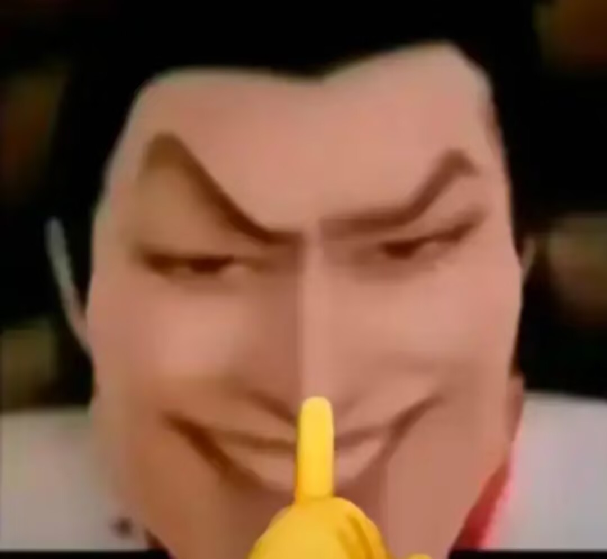

<h1>博弈论</h1>
<p>单独出一期博弈论</p>
这个博弈论是关于游戏的理论，它研究了在游戏过程中，两个或多个玩家之间的互动和决策。

<h2>巴什博弈</h2>
<div style="text-align:center;">
</div>


题干是这样的：

小喵和大狗在玩一个游戏，游戏规则如下：

现在有n个石头，小喵和大狗轮流从石头中取走1-m个石头，谁取走最后一个石头的人就是赢家。

小喵先取。

如果小喵赢了小喵会高兴输出：“老鼠洗完头”；

如果大狗赢了小喵会难过输出：“泥肘”；

这是一道博弈论问题。很经典的巴什博弈

如果n%(1+m)=0，那么后手赢。

如果n%(1+m)!=0，那么先手赢。

<div style="text-align:center;">
</div>


```cpp title="巴什博弈代码"
#include<bits/stdc++.h>
using namespace std;

int main()
{
    int n,m;
    cin>>n>>m;
    if(n%(1+m)==0)
    {
        cout<<"泥肘"<<endl;
    }
    else
    {
        cout<<"老鼠洗完头"<<endl;
    }
    return 0;
}
```
作者温馨提示：

题需慢慢写，心急则泥肘。

<div style="text-align:center;">
</div>

<h2>对称博弈</h2>

<p>这个是巴士博弈的进阶版，其实也比较好想
</p>

<p>有一个 1×n 的棋盘（一排 n 个格子，初始全为空）。两名玩家轮流在空位上放棋子，每个格子最多放一枚。轮到谁无法再放棋子，谁就输（另一方获胜）。双方都采取最优策略。输入一个正整数 n，判断先手是否必胜：先手必胜输出 First，否则输出 Second。</p>
<p>输入格式：一行一个正整数 n。</p>
<p>输出格式：一行一个字符串，First 或 Second。</p>
<p>样例输入：3</p>
<p>样例输出：First</p>
<p>样例输入：4</p>
<p>样例输出：Second</p>
<p>核心思路：这是典型的对称（镜像）策略博弈。当 n 为奇数时，先手先占正中间一格，之后每一步都镜像对手的落子，必胜；当 n 为偶数时，棋盘无中心格，后手镜像先手，先手必败。</p>

代码实现：
```cpp title="对称博弈代码"
#include <bits/stdc++.h>
using namespace std;
int main() {
    long long n;
    cin >> n;
    cout << (n % 2 == 1 ? "First" : "Second") << endl;
    return 0;
}
```