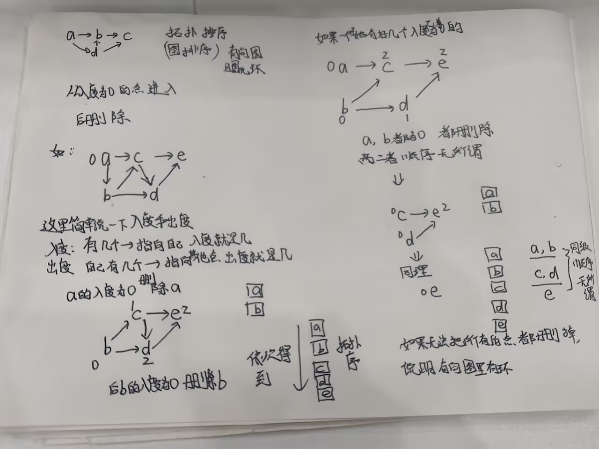

<h2>图</h2>

我们来看一下如何建图：

<h3>方法1：数组建图</h3>

比如说我们要表示这样一个图：
1->3 ， 2->4， 3->2
我们就可以建立一个4*4的矩阵，来表示这个图。
矩阵的第i行第j列的元素为1，表示从i到j有一条边。
矩阵的第i行第j列的元素为0，表示从i到j没有边。
```
 1 2 3 4
1[][][1][]
2[][][][1]
3[][1][][]
4[][][][]
```
这个是无权图。
如果我们遇到有权图，我们就可以在矩阵中存储边的权重。
也就是数组中加数组，来存储边的权重。
我们本来是这样表示无权图的：
```
vector<vector<int>> graph(4, vector<int>(4, 0));
```
现在有全图我们这样表示：
```
vector<vector<int[]>>graph(4, vector<int[]>());
```
代码实现：<br>
邻接表建图(vector)<br>
无权图：<br>
```cpp 
#include<bits/stdc++.h>
using namespace std;

int main(){
    ios::sync_with_stdio(0);
    cin.tie(0);
    cout.tie(0);
    int n  , m;
    cin >> n >> m;
    vector<vector<int>> graph(n+1, vector<int>(n+1, 0));
    for(int i = 0; i < m; i++){
        int u, v;
        cin >> u >> v;
        graph[u][v] = 1;
    }
    return 0;
}
```
//有权图
```
vector<vector<pair<int,int>>> g(n + 1);
for (int i = 0 ; i < m; i++){
    int u, v, w;
    cin >> u >> v >> w;
    g[u].push_back({v, w});
    //g[v].push_back({u, w});// 无向图再加 g[v].push_back({u, w})
    
}
```

# 图论基础：图的存储 + BFS / DFS 遍历
> 目标：能独立建图、写出 BFS/DFS 模板、算连通块、求无权最短路，并避开常见坑。
---
## 一、图的两种存法
设点数 `n`、边数 `m`（无向图存边时 `m` 要乘 2）。
### 1. 邻接矩阵 `g[n][n]`
```
g[u][v] = w;   // 有边记权值，无边记 INF / 0
```
| 项目 | 说明 |
|---|---|
| 空间 | `O(n²)`，n ≤ 1000 左右还行，n = 1e5 直接爆 |
| 查边 `(u,v)` | `O(1)` |
| 遍历 u 的邻居 | `O(n)` |
| 适用 | 稠密图、需要频繁判两点是否相邻、Floyd 类算法 |
### 2. 邻接表 `vector<vector<int>> g(n)`
```
g[u].push_back(v);          // 无向图再加 g[v].push_back(u)
```
| 项目 | 说明 |
|---|---|
| 空间 | `O(n + m)`，稀疏图首选 |
| 查边 `(u,v)` | `O(deg(u))`，一般够用 |
| 遍历 u 的邻居 | `O(deg(u))`，BFS/DFS 靠这个才快 |
| 适用 | 绝大多数题（BFS/DFS/最短路/拓扑排序） |
**结论：默认用邻接表；只有稠密图或要 O(1) 判边时才用矩阵。**
> C++ 进阶：边带权且要反复建图时用「链式前向星」（`head[]` + `to[]` + `w[]` + `nxt[]`），缓存友好；平时 `vector<vector<pair<int,int>>>` 就够。
---
## 二、BFS（广度优先搜索）
### 核心：队列 + 按层扩展
关键细节：**入队时就标记 visited**，不是出队时。否则同一个点会被多个邻居重复入队，复杂度退化。
### C++ 模板（求无权最短路）
```cpp
#include <bits/stdc++.h>
using namespace std;
vector<int> bfs(int s, const vector<vector<int>>& g) {
    int n = g.size();
    vector<int> dist(n, -1);      // -1 = 未访问，同时当 visited 用
    queue<int> q;
    dist[s] = 0;                  // 入队即标记
    q.push(s);
    while (!q.empty()) {
        int u = q.front(); q.pop();
        for (int v : g[u]) {
            if (dist[v] != -1) continue;   // 已访问
            dist[v] = dist[u] + 1;         // 无权图：层数 = 最短距离
            q.push(v);
        }
    }
    return dist;
}
```
### Python 模板
```python
from collections import deque
def bfs(s, g):
    n = len(g)
    dist = [-1] * n
    dist[s] = 0
    q = deque([s])
    while q:
        u = q.popleft()
        for v in g[u]:
            if dist[v] != -1:
                continue
            dist[v] = dist[u] + 1
            q.append(v)
    return dist
```
### 性质与用途
- 复杂度 `O(n + m)`（矩阵存图是 `O(n²)`）。
- 只适用于**边权相同（通常为 1）**的图：第一次到达就是最短。
- 队列里天然是「距离非降」的，所以可以按层处理（多源 BFS、层序输出）。
- 用途：无权最短路、连通块、二分图判定（按层染色）、多源扩散（如 01 矩阵）、0-1 BFS（边权只有 0/1 时改用双端队列 deque）。
### 多源 BFS 骨架
```cpp
queue<int> q;
for (int s : sources) { dist[s] = 0; q.push(s); }
// 之后和普通 BFS 一模一样
```
---
## 三、DFS（深度优先搜索）
### 核心：一条路走到黑，走不通回溯
### C++ 递归模板
```cpp
vector<int> vis(n, 0);
function<void(int)> dfs = [&](int u) {
    vis[u] = 1;                      // 进来就标记
    for (int v : g[u]) {
        if (!vis[v]) dfs(v);
    }
};
```
### 显式栈版本（防爆栈）
```cpp
vector<int> vis(n, 0);
stack<int> st;
st.push(s);
while (!st.empty()) {
    int u = st.top(); st.pop();
    if (vis[u]) continue;            // 出栈时判重
    vis[u] = 1;
    for (int v : g[u]) if (!vis[v]) st.push(v);
}
```
> 注意：显式栈的访问顺序和递归版**不一样**（邻居是反序压栈），如果题目要求按字典序输出遍历序列，用递归 + 邻接表排序更省事。
### 用途
- 连通块计数、判连通。
- 有向图判环：三色标记（0 未访问 / 1 在栈上 / 2 已完成），遇到「在栈上」的点就是环。
- 拓扑排序：DFS 后序取反。
- 割点、桥、强连通分量（Tarjan）的地基。
- 回溯搜索（排列组合、N 皇后、数独）—— DFS 的另一副面孔。
### 复杂度
`O(n + m)`；递归深度最坏 `O(n)`，n = 1e5 的链状图容易爆栈，改显式栈或加 `#pragma` / 迭代。
---
## 四、BFS vs DFS 对比
| 维度 | BFS | DFS |
|---|---|---|
| 数据结构 | 队列 queue | 栈 / 递归 |
| 扩展方式 | 一层一层 | 一条路到底 |
| 空间 | 最坏 `O(n)`（宽图队列大） | 最坏 `O(n)`（深图递归深） |
| 最短路 | 无权图可以 | 不行（不保证最短） |
| 环检测 | 可以（记录父节点） | 可以（三色） |
| 典型场景 | 最短路、层序、多源扩散 | 连通块、拓扑、Tarjan、回溯 |
**都能做**：遍历全图、判连通、数连通块。
**只能 BFS**：无权最短路。
**只能 DFS**：需要回溯 / 后序信息的（拓扑、强连通）。
---
## 五、六个必踩的坑
1. **图不连通**：只从 1 个点出发遍历不到全图，要外层 `for (i = 1..n) if (!vis[i]) ...`。
2. **visited 标记时机**：BFS 入队即标，DFS 进函数即标；拖到出队/返回才标会重复入队甚至死循环。
3. **无向图建边**：两个方向都要 push；有向图只 push 一个方向，别顺手写成双向。
4. **重边与自环**：对 BFS/DFS 结果无影响（visited 会挡掉），但算度数、判环、最短路时要留意。
5. **邻接表多组数据要清空**：`for (auto& e : g) e.clear();` 或重新 `assign(n+1, {})`。
6. **递归爆栈**：深链图 n = 2e5 用递归 DFS 会 RE，换显式栈。
---
## 六、手推示例
```
1 -- 2 -- 4
|    |
3    5
```
邻接表（按编号升序）：
```
1: 2 3
2: 1 4 5
3: 1
4: 2
5: 2
```
- BFS 从 1 出发：`1 → 2,3 → 4,5`，`dist = [0,1,1,2,2]`
- DFS 从 1 出发：`1 → 2 → 4 → 5 → 3`（递归，邻居升序）
---
## 七、练手题（按难度）
| 题目 | 考点 |
|---|---|
| 洛谷 P5318 查找文献 | BFS/DFS 模板，邻接表排序 |
| LeetCode 200 岛屿数量 | 网格图 + 连通块 |
| LeetCode 542 01 矩阵 | 多源 BFS |
| LeetCode 207 课程表 | 有向图判环 / 拓扑 |
| LeetCode 785 判断二分图 | BFS/DFS 染色 |
| LeetCode 127 单词接龙 | 隐式图 + BFS 最短路 |
---
## 八、一页速查
```cpp
// 建图
vector<vector<int>> g(n + 1);
for (int i = 0; i < m; i++) {
    int u, v; cin >> u >> v;
    g[u].push_back(v);
    g[v].push_back(u);   // 无向图
}
// 遍历全图（含不连通）
vector<int> vis(n + 1, 0);
for (int i = 1; i <= n; i++)
    if (!vis[i]) bfs(i, g);   // 或 dfs(i)
```

下面我们来写一道题：

<h2>追风赶月莫停留，平芜尽处是春山</h2>

<p>背景：你是一名侠客，想要在平芜之上追风赶月，寻找春山。
题目描述：
共有 n 个驿站（编号 1 到 n），驿站之间有 
m 条道路。每条道路都有一个“风景值”（距离）。
你从任意驿站出发，可以不断选择道路前进。但不能重复选择已经走过的驿站。
请计算，你在这趟旅程中，最多能积累多少风景值？
<br>
输入格式：<br>
第一行:n,m。 <br>
接下来 m 行，每行三个数
u,v,w。 <br>
输出格式：一个整数，最大风景值。
</p>

这道题是图的深搜。

```cpp title="追风赶月莫停留，平芜尽处是春山.cpp"
#include<bits/stdc++.h>
using namespace std;
int n , m;
const int N = 1005;
int g[N][N]={0};
int re = 0;
int res = 0;
bool vis[N];
void dfs(int st){
re = max(re,res);
	for (int i = 1 ; i <= n ;i++){
		if (!vis[i] && g[st][i]){
			vis[i] = 1;
			res += g[st][i];
			dfs(i);			
			res -= g[st][i]; 
			vis[i] = 0 ;
					
		}	
	}	
	return;
}
int main(){
	cin >> n >> m;
	for (int i = 1 ; i <=m ;i++){
		int a , b , c;
		cin >> a >> b >> c;
		g[a][b] = c;
		g[b][a] = c;		 
	}
	for (int i = 1 ; i <= n ;i++){
		vis[i] = 1;
		dfs(i);
		memset(vis, 0 , sizeof(vis));
	}
	cout << re;
	return 0; 
}
```


<p>
这里我们利用二维数组去图以及边的权值。因为图是无向的，所以每个边都要建两次。<br>
g[a][b] = 0:表示a到b没有边。<br>
g[a][b] = c:表示a到b有边，边权为c。<br>
初始时，所有点都没有访问过，所以vis[i] = 0。也就是bool默认为false。<br>
这里的res-=g[st][i]; 是为了回溯时，将当前点的边权减去，避免重复计算。<br>
然后vis[i] = 0 ; 是为了回溯时，将当前点的访问标记取消，避免重复访问。<br>
最后介绍一下memset函数。<br>
memset函数的作用是将内存中的数据全部设置为指定的值。<br>
在本题中，我们用memset函数将vis数组全部设置为0，表示所有点都没有访问过。
</p>

我们下面来一题用链表存储的图。
<h2>happy new year</h2>
<p>
众所周知，威龙是三角洲中最豪的干员，现在他一个喷气来到了总裁，但是总裁里面有n个星期五(野人)，你龙叔的14想喝血了，总裁里的野人之间是相互认识的他们凭借（happy new year）<s>踏平纽约</s>相互信任，现在，他们每个人都有一个编号，接下来m行表示野人之间的联系，后面一个整数k代表被14大四的野人，
如果一个野人被14大四，会改变野人之间的连通性，则输出“窝累铜泥丸”，否则输出“踏平纽约”即可。如果野人全部被大四则增加一行输出“我从来都不会输”。</p>

输入样例：

5 4
0 1
1 3
3 0
0 4
5
1 2 0 4 3

输出样例：

踏平纽约

踏平纽约

窝累铜泥丸

踏平纽约

踏平纽约

我从来都不会输

```cpp title="happy new year.cpp"
#include <iostream>
#include <vector>
#include <cstring>
using namespace std;

const int MAXN = 10005; // 假设野人最多 10000 个
vector<int> g[MAXN];    // 邻接表存野人之间的联系
bool dead[MAXN];        // 标记野人是否被大四
bool vis[MAXN];         // DFS 访问标记
int n, m, k;

// DFS 顺藤摸瓜，把所有没被大四且能走到的野人标记
void dfs(int u) {
    vis[u] = true;
    for (int v : g[u]) {
        if (!dead[v] && !vis[v]) {
            dfs(v);
        }
    }
}

// 统计当前剩下的野人分成了几个互不相交的团伙
int count_tribes() {
    memset(vis, 0, sizeof(vis));
    int cnt = 0;
    for (int i = 1; i <= n; i++) {
        // 如果野人还活着，且还没被访问过，说明发现了一个新团伙
        if (!dead[i] && !vis[i]) {
            cnt++;
            dfs(i);
        }
    }
    return cnt;
}

int main() {
    ios::sync_with_stdio(0);
    cin.tie(0);

    cin >> n >> m;
    for (int i = 0; i < m; i++) {
        int u, v;
        cin >> u >> v;
        g[u].push_back(v);
        g[v].push_back(u);
    }

    // 计算开局状态下的团伙数量
    int last_cnt = count_tribes();

    cin >> k;
    for (int i = 0; i < k; i++) {
        int u;
        cin >> u;
        
        // 14 动手，大四这个野人
        dead[u] = true;
        
        // 看看大四他之后，团伙数量变成了多少
        int cur_cnt = count_tribes();

        // 如果团伙数量变多了，说明野人之间的联系被切断，图裂开了
        if (cur_cnt > last_cnt) {
            cout << "窝累铜泥丸\n"; // Red Alert
        } else {
            cout << "踏平纽约\n";   // 没有改变连通性
        }
        
        // 更新团伙数量，用于下一次判断
        last_cnt = cur_cnt;
    }

    // 如果野人全部被大四
    if (k == n) {
        cout << "我从来都不会输\n";
    }

    return 0;
}
```

<h2>链式前向星存储方式</h2>

下面介绍一下链式前向星存储方式。
这个具体我弄到二叉树里面了，可以去看看。
```cpp title="链式前向星存储方式"
#include <bits/stdc++.h>
using namespace std;
typedef long long ll;

const int N = 1e5 + 10, M = 2 * N;
int h[N], t[M], n[M], w[M], cnt;
int dist[N];

void add(int a, int b, int c){
    t[cnt]   = b;
    w[cnt]   = c;
    n[cnt] = h[a];
    h[a]  = cnt++;
}

void dfs(int u, int fa, int d){
    dist[u] = d;
    for (int i = h[u]; i != -1; i = n[i]){
        int v = t[i];
        if (v == fa) continue;
        dfs(v, u, d + w[i]);
    }
}
int main(){
    ios::sync_with_stdio(0); 
	cin.tie(0);
    memset(h, -1, sizeof h);
    int n; 
	cin >> n;
    for (int i = 1; i < n; i++){
        int u, v, c; 
		cin >> u >> v >> c;
        add(u, v, c);
        add(v, u, c);
    }
    dfs(1, 0, 0);
    for (int i = 1; i <= n; i++) 
	cout << dist[i] << ' ';
    cout << '\n';
    return 0;
}

```
<h2>拓扑排序</h2>
下面介绍一下拓扑排序：

图片居中：
<div style="text-align:center;">
</div>


```cpp title="拓扑排序"
#include <bits/stdc++.h>
using namespace std;

const int N = 1e5 + 10;
const int M = 2 * N;

int h[N], t[M], nxt[M], cnt = 0; // 链式前向星
int in_deg[N];                   // 记录每个点的入度

void add(int a, int b) {
    t[cnt] = b;
    nxt[cnt] = h[a];
    h[a] = cnt++;
}

int main() {
    ios::sync_with_stdio(0); cin.tie(0);
    memset(h, -1, sizeof h);
    
    int n, m;
    cin >> n >> m; // n个点，m条有向边
    for (int i = 0; i < m; i++) {
        int u, v;
        cin >> u >> v;
        add(u, v);      // 加一条 u -> v 的有向边
        in_deg[v]++;    // v 的入度加 1
    }

    queue<int> q;
    // 1. 第一步：把所有入度为 0 的点放进队列
    for (int i = 1; i <= n; i++) {
        if (in_deg[i] == 0) {
            q.push(i);
        }
    }

    vector<int> topo_order; // 用来存最终的拓扑序列
    
    // 2. 第二步：不断取出队头，删掉它，并更新它指向的点的入度
    while (!q.empty()) {
        int u = q.front();
        q.pop();
        
        topo_order.push_back(u); // 把 u 加入我们的排序结果
        
        // 遍历 u 的所有出边
        for (int e = h[u]; e != -1; e = nxt[e]) {
            int v = t[e];
            in_deg[v]--;         // ★ 核心：把 v 的入度减 1（相当于删掉了 u 指向 v 的这条边）
            
            // 如果 v 的入度变成 0 了，说明它也可以被拿出来了
            if (in_deg[v] == 0) {
                q.push(v);
            }
        }
    }

    // 3. 第三步：检查是否有环（这正是你笔记右下角写的那句）
    if (topo_order.size() == n) {
        // 成功排完了所有点，无环
        for (int x : topo_order) cout << x << " ";
        cout << "\n";
    } else {
        // 没能排完所有点，说明图里有点一直进不去队列（入度一直 > 0），即存在环
        cout << "图中存在环，无法进行拓扑排序！" << endl;
    }

    return 0;
}
```

```cpp title="拓扑排序"

#include <bits/stdc++.h>
using namespace std;

const int N = 1e5 + 10;
const int M = 2 * N;
int h[N], nxt[M], t[M], cnt = 0;
int state[N]; // 0:未访问, 1:正在访问(递归栈中), 2:已访问完成
vector<int> topo;
bool has_cycle = false;

void add(int a, int b) {
    t[cnt] = b;
    nxt[cnt] = h[a];
    h[a] = cnt++;
}

void dfs(int u) {
    state[u] = 1; 
    
    // ★ 结束条件变成 i != -1
    for (int i = h[u]; i != -1; i = nxt[i]) {
        int v = t[i];
        
        if (state[v] == 1) {
            has_cycle = true;
            return;
        } else if (state[v] == 0) {
            dfs(v);
        }
    }
    
    state[u] = 2; 
    topo.push_back(u); 
}

int main() {
    ios::sync_with_stdio(0); cin.tie(0);
    
    // ★ 重要：h 数组初始化为 -1
    memset(h, -1, sizeof h);
    
    int n, m;
    cin >> n >> m;
    for (int i = 0; i < m; i++) {
        int u, v;
        cin >> u >> v;
        add(u, v); 
    }
    
    for (int i = 1; i <= n; i++) {
        if (state[i] == 0) dfs(i);
    }
    
    if (has_cycle) {
        cout << "有环\n";
    } else {
        reverse(topo.begin(), topo.end()); // 记得逆序
        for (int x : topo) cout << x << " ";
        cout << "\n";
    }
    return 0;
}
```

<!DOCTYPE html>
<html lang="zh-CN">
<head>
  <meta charset="UTF-8">
  <meta name="viewport" content="width=device-width, initial-scale=1">
  <title>家谱树（拓扑排序）</title>
</head>
<body>

  <h1>家谱树（拓扑排序）</h1>

  <h2>题目背景</h2>
  <p>
    一个家族人数很多，成员之间的辈分关系十分复杂。现在已知每个人有哪些后代，
    请你整理出一个合理的辈分顺序。
  </p>

  <h2>题目描述</h2>
  <p>
    给定 <var>N</var> 个人之间的后代关系。对于第 <var>i</var> 个人，会给出他的所有后代编号。
  </p>
  <p>
    请你输出一个人员排列，使得对于任意一对有直接或间接前后辈关系的人，
    <strong>后辈一定排在前辈的后面</strong>。
  </p>
  <p>
    换句话说，若 <var>u</var> 是 <var>v</var> 的前辈，则输出序列中 <var>u</var> 必须出现在
    <var>v</var> 之前。
  </p>
  <p>
    如果存在多种合法排列，输出其中任意一种即可。
  </p>

  <h2>输入格式</h2>
  <p>
    第一行包含一个整数 <var>N</var>，表示家族中的人数，满足
    <code>1 &le; N &le; 100</code>。
  </p>
  <p>
    接下来有 <var>N</var> 行。第 <var>i</var> 行描述第 <var>i</var> 个人的后代信息，
    包含若干个整数，表示这些编号的人是第 <var>i</var> 个人的后代。
  </p>
  <p>
    每行以整数 <code>0</code> 结束，表示该人的后代信息描述完毕。
  </p>

  <h2>输出格式</h2>
  <p>
    输出一行，包含 <var>N</var> 个整数，表示一个满足辈分先后关系的排列。
  </p>
  <p>
    如果存在多种答案，输出任意一种即可。
  </p>

  <h2>输入输出样例</h2>

  <h3>输入</h3>
  <pre><code>5
0
4 5 1 0
1 0
5 3 0
3 0</code></pre>

  <h3>输出</h3>
  <pre><code>2 4 5 3 1</code></pre>

  <h2>说明</h2>
  <p>对于样例，可以理解为：</p>
  <ul>
    <li>第 <code>2</code> 个人的后辈包括 <code>4, 5, 1</code>；</li>
    <li>第 <code>3</code> 个人的后辈包括 <code>1</code>；</li>
    <li>第 <code>4</code> 个人的后辈包括 <code>5, 3</code>；</li>
    <li>第 <code>5</code> 个人的后辈包括 <code>3</code>。</li>
  </ul>
  <p>
    输出序列 <code>2 4 5 3 1</code> 中，每个人的后辈都排在该人的后面，
    因此是一个合法答案。其他合法答案也可以被接受。
  </p>

</body>
</html>

```cpp title="家谱树.cpp"
#include<bits/stdc++.h>
using namespace std;
#define endl "\n"
const int N = 105;
const int M = N * N;
int h[N], nxt[M], t[M], cnt;
int d[N];
void add(int a, int b){
	t[cnt] = b;
	nxt[cnt] = h[a];
	h[a] = cnt++; 
}

int main(){
	ios::sync_with_stdio(0);
	cin.tie(0);
	int n;
	cin >> n;

	cnt = 0;
	memset(h, -1, sizeof(h));
	memset(d, 0, sizeof(d));
	for (int i = 1; i <= n; i++){
		int v;
		while(cin >> v && v != 0){
			add(i, v);
			d[v] ++;
		} 
	}
	queue<int> q;
	for (int i = 1; i <= n; i++){
		if(d[i] == 0)
		q.push(i);
	}
	vector<int>o;
	while (!q.empty()){
		int u = q.front();
		q.pop();
		o.push_back(u);
		for (int i = h[u]; i != -1; i = nxt[i]){
			int v = t[i];
			d[v]--;
			if (d[v] == 0){
				q.push(v);
			}
		}
	}
	if (o.size() == n){
		for (int x : o){
			cout << x << " ";
		}
		cout << endl;
	}else{
		cout << "0\n";
	}
	return 0;
}

```