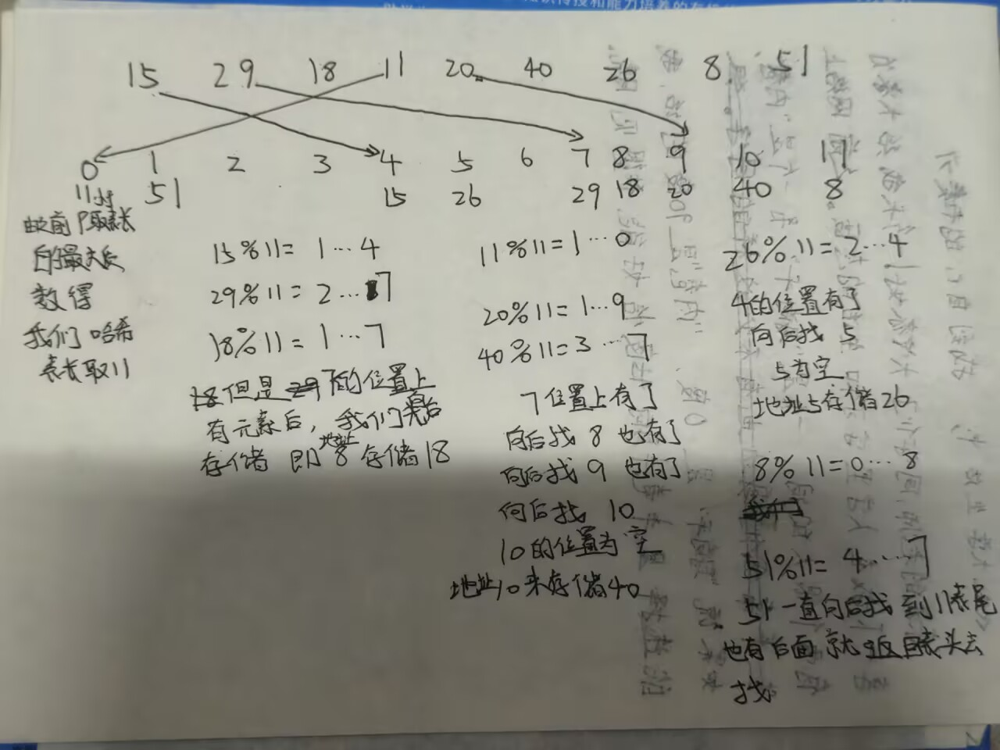
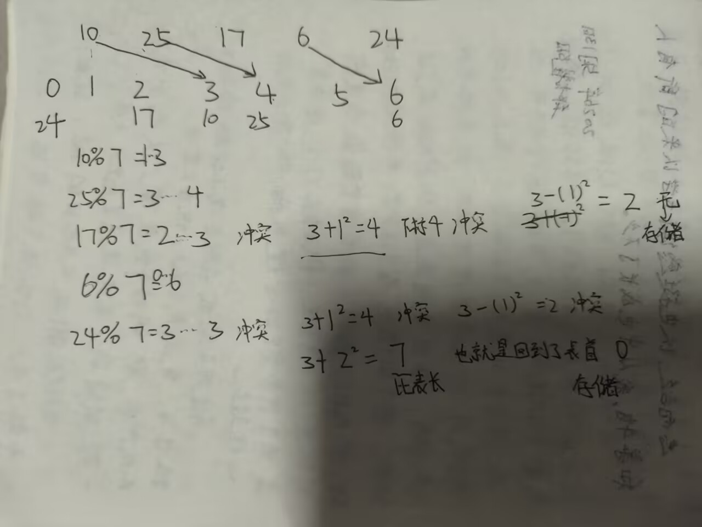
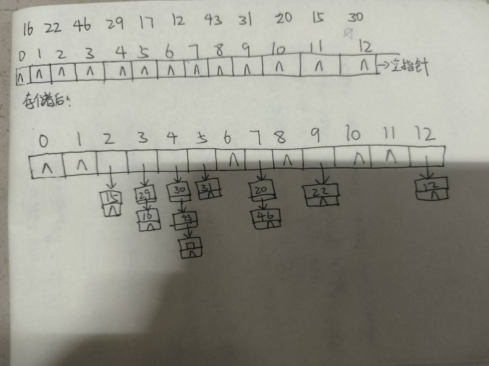

<h1 style="\\\*\\\*font-weight:bold; color:#222;\\\*\\\*">哈希查找</h1>
其实我很久之前就像写哈希查找了因为他其实好用也比较重要

我们首先了解一下哈希表的定义：

哈希表又称散列表，是一种基于键值对存储数据的数据结构。

如：
```
学号：姓名 ：           
 2     A
 3     B
 5     C
 1     D
 4     E
 0     F
```
我们现在要讲这些数据存储到哈希表中。

我们先讲一下直接地址法：

```
关键字（key）        【】【】【】              下标（地址）
                    【】【】【】
                      散列函数
                    【】【】【】
                    【】【】【】
```
比如说我们现在要存储100 101  102  103 104

我们现在要将这些数据存储到哈希表中。为了后续方便其他的一些操作我们让这些数和哈希表的下标对应起来。

此时我们可以通过散列函数将这些数和哈希表的下标对应起来。H(key)=key+100;

这时我们就可以将上面的数存储到哈希表中了。

```
0     1     2       3
100   101   102   103
```
但是我们在存储0 29 72 31 18 6 这些数的时候我们需要开到72个空间。中间大部分的空间浪费掉了。空间利用率是很低的。

下面我们换一种方法：

除留余数法：

H（key）=key%p;

p一般取小于等于表长的最大质数。

上面的我们就可以取p=7;

但是这里会出现一个问题：我们将数字存储在数组里面的时候，如果两个数字的余数相同，那么它们就会被存储到同一个位置。

```
关键字1：->      散列     ->      同一
关键字2：->      函数     ->      地址
```
我们称这种为同义词。

冲突会影响哈希表的效率。要尽可能地避免冲突。

解决冲突有两种方法：

1.开放定址法

2.拉链法

我们先说一下开放定址法：

开放定址法的思想就是：我们再找一个新的位置去存放冲突的元素。

有两种方法：

1.线性探测法

2.二次探测法

其实这两种都差不多

我们先了解一下线性探测法：

线性探测法的思想就是：我们从冲突的位置开始，向后探测，直到找到一个空的位置。表位的下一位置是表首。

直接上例子吧：

<div style="text-align:center;">
</div>

同理我们如果想去查找元素就要用相同的办法

如我要查找 8

我们先8%11=0……8

我们到下表为8的位置找发现为18不是向后找下标9为20还不是再找下标10为40还不是再找下标11为8。

最终找到。

如果找到的位置是空的代表元素不在哈希表中。

下面我们介绍二次探测法：

二次探测法的思想就是：我们从冲突的位置开始，向后探测，直到找到一个空的位置。表位的下一位置是表首。

他和线性探测法的区别就是：线性探测法是一个一个探测，二次探测法是跳着探测。

当然是有规则的探测一般是按照：+1^2  -1^2  +2^2  -2^2  +3^2  -3^2  ...

我们称之为跳跃式探测。

优点：可以缓解堆积的问题。

缺点：不一定能探测到所有散列表位置。

表长如果是某个4K+3的质数（k为正整数）那么一定可以探测到所有位置。

这里我们依旧上例子吧：

<div style="text-align:center;">
</div>

同理我们如果想去查找元素就要用相同的办法

提醒：如果我们用开放定址法去删除表中的元素，我们是不能直接删除的。；因为会影响后面的查找。

这时候就需要我们用一个特殊标志位去表示这个位置被删除了。一般使用NULL。

最后我们来介绍一下拉链法：

这个的思想就是把冲突的元素都放到一个链表中串起来。

每个哈希表的位置都包括一个头指针，相当于一个个的单链表。

依旧上例子吧：

<div style="text-align:center;">
</div>

这个就是线性表的性质先进后出。

遇到空指针就是查找失败。

拉链法可以直接删除元素。

上面只是哈希表和哈希表存储和查找的基本操作。

下面我们还是来一题吧：

```cpp title="哈希表"
#include<bits/stdc++.h>
using namespace std;
const int SIZE = 11;
const int EMPTY = -1;
const int DEL = -2;
int hashTable[SIZE];

void init() {
    for(int i = 0; i < SIZE; i++)
        hashTable[i] = EMPTY;
}

// 插入
bool insert(int key) {
    int addr = key % SIZE;
    for(int i = 0; i < SIZE; i++) {
        if(hashTable[addr] == EMPTY || hashTable[addr] == DEL) {
            hashTable[addr] = key;
            return true;
        }
        addr = (addr + 1) % SIZE;
    }
    return false; // 表满
}

// 查找，返回下标，失败返回-1
int search(int key) {
    int addr = key % SIZE;
    for(int i = 0; i < SIZE; i++) {
        if(hashTable[addr] == EMPTY) return -1;
        if(hashTable[addr] == key) return addr;
        addr = (addr + 1) % SIZE;
    }
    return -1;
}

// 删除：只打删除标记，不清空
bool remove(int key) {
    int pos = search(key);
    if(pos == -1) return false;
    hashTable[pos] = DEL;
    return true;
}

void printTable() {
    for(int i = 0; i < SIZE; i++)
        cout << "[" << i << "] = " << hashTable[i] << endl;
}

int main() {
    init();
    int arr[] = {20, 18, 29, 30, 42};
    int n = sizeof(arr)/sizeof(arr[0]);
    for(int i = 0; i < n; i++) insert(arr[i]);

    printTable();
    int pos = search(42);
    if(pos != -1) cout << "\n找到42，下标：" << pos << endl;
    remove(20);
    cout << "\n删除20后：" << endl;
    printTable();
    return 0;
}
```
下面我们介绍一下unordered_map,unordered_set。

这两个容器都是基于哈希表实现的。这两个容器映射的本质就是除留余数法

这两个容器处理冲突的方法就是拉链法。

unordered_set是一个无序的集合容器。

初始化：
```
unordered_set<int>s;
```
插入：
```
s.insert(100);
s.insert(101);
s.insert(101);//重复插入，自动忽略。
```
查询：
```
if(s.count(1)){}//存在返回1，不存在返回0。

if(s.find(1)!=s.end()){}//存在返回迭代器，不存在返回end()。
```
删除：
```
s.erase(1);
```
遍历：
```
for(int x:s){
    cout<<x<<endl;
}
```
unordered_map是一个无序的映射容器。

初始化：
```
unordered_map<int,int>mp;
```

去重+快速查找用unordered_set。

哈希映射（计数、统计）用unordered_map。

必须有序用set,map。

插入：insert

删除：erase

查询：count、find

大小：size()

清空：clear

遍历：
```
for(auto x:mp){
    cout<<x.first<<" "<<x.second<<endl;
}
```
<h2>鸭梨一只蓝色大肥鱼</h2>

<div style="text-align:center;">
</div>


<p>蓝色大肥鱼正在消耗你的token，现在给一个数n，后面n行一行给出一对数。</p>
<p>这两个数两两对应。</p>
<p>后面给出m行数，每行给出一对数。</p>
<p>如果这两个数对应，那么就输出“大肥鱼有用”，否则输出“鸭梨大肥鱼”。</p>


样例：
```
2
111111111 222222222
333333333 444444444
4
666666666 888888888
222222222 111111111
222222222 333333333
333333333 444444444
```
```
鸭梨大肥鱼
大肥鱼有用
鸭梨大肥鱼
大肥鱼有用
```

```cpp linenums="1" title="鸭梨一只蓝色大肥鱼"
#include<bits/stdc++.h>
using namespace std;

typedef long long ll;
int main(){
	int n;
	cin>>n;
	unordered_map<ll,ll>mp;
	 for(int i=0;i<n;i++){
	 	ll a,b;
	 	cin>>a>>b;
	 	mp[a]=b;
	 	mp[b]=a;
	 }
	 int m;
	 cin>>m;
	 while(m--){
	 	ll x,y;
	 	cin>>x>>y;
	 	if(mp.count(x) && mp[x]==y)
	 		cout<<"大肥鱼有用"<<endl; 
		 else 
		 cout<<"鸭梨大肥鱼"<<endl; 
	 }
	 return 0; 
}
```
这里面我们用哈希容器unordered_map来存储映射关系。

用mp[a]=b; mp[b]=a; 来存储映射关系。mp[键]=值。

mp.count(x)判断x是否存在。

https://www.luogu.com.cn/problem/P3405
```cpp title="s"
#include<bits/stdc++.h>
using namespace std;
typedef long long ll;
int main(){
	int n;
	cin >>n;
	int re = 0;
	unordered_map<string,ll>mp;
	for (int i =0;i < n;i++){
		string s1 , s2;
		cin >> s1 >> s2;
		string p = s1.substr(0,2);
		if (p==s2)continue;
		mp[p+s2]++;
	}
	ll ans= 0;
	for (auto &i:mp){
		string s3 = i.first;
		string s4 = s3.substr(2,2)+s3.substr(0,2);
		if (s3<s4 && mp.count(s4))
		ans+=i.second * mp[s4];
	}
	cout << ans <<endl;
	return 0;
}
```

<h2>干活的大肥鱼</h2>
你找了n只大肥鱼来干活，你需要给她们发token，于是你给她们每个鱼起了编号，一个编号对应一个鱼的名字，
现在你要给她们办理账户，但是大肥鱼笨笨的，她们都想拿token去换白饭于是就一窝蜂的将她们的信息放给你有的甚至不放心给你发了好几次信息。<br>
如果不存在大肥鱼的名字我们就给她办理一个账户然后输出她的编号；<br>
如果存在了大肥鱼的名字就只需要输出她的编号；<br>


这里我想补充一下vector的一个用法；<br>
也就是vector可以动态扩大，我们可以使用push_back()来添加元素。使其容量增加。<br>
如果知道大概大小可以初始化为0，然后直接通过下标++。<br>

```
vector<int> v; 
// 如果用 push_back 扩大：
v.push_back(0); 
v[0]++; // 变成 1

// 或者一开始就开好足够大的空间，全初始化为 0：
vector<int> cnt(100005, 0);
cnt[10]++; // 直接使用
```
放到这道题上面：
```cpp linenums="1" title="干活的大肥鱼"
#include <bits/stdc++.h>
using namespace std;

int main() {
	ios::sync_with_stdio(0);
	cin.tie(0);
	int q;
	cin >> q;
	vector<string>nums;
	while (q--){
		string s;
		cin >> s;
		bool find = false;
		for (int i = 0 ;i < nums.size(); i++){
			if (s==nums[i]){
				cout << i+1 <<"\n";
				find = true;
				break;
			}
		}
		if (!find){
			nums.push_back(s);
			cout<< nums.size()<<"\n";
		}	
	}
	
    return 0;
}
```
但是这样写时间复杂度太高了，我们可以在vector中用unordered_map来存储映射关系。
```cpp linenums="1" title="干活的大肥鱼"
#include <bits/stdc++.h>
using namespace std;

int main() {
    ios::sync_with_stdio(0);
    cin.tie(0);
 	int q;
 	cin >> q;
 	int next = 1;
 	unordered_map<string,int>mp;
 	while (q--){
 		string s;
 		cf (mp.find(s)==mp.end()){
 			mp[s] = next;
 			next in >> s;
 		i++;
		 }
		 cout << mp[s]<<"\n";
	 }
    return 0;
}
```

现在察觉我自己的哈希学的很差因此我现在要加强一下。

<h2>《星光学习平台 · 年度荣誉与奖励结算》</h2>

<p>题目描述:<br>
"星光学习平台"开设了一门《算法与数据结构》课程。学员完成全部学习后获得一个总评成绩（0~100 的整数）。平台规定：<br>

总评成绩 ≥ 60 才能获得结业证书；<br>

在此基础上发放学习基金：<br>

总评成绩落在 [G, 100] 区间：发放 50 元；<br>

总评成绩落在 [60, G) 区间：发放 20 元；<br>

平台还会把总评成绩前 K 名的学员列入年度"荣耀榜"。<br>

请你编写程序，完成两件事：<br>

统计平台一共发放了多少元学习基金；<br>

按规则输出荣耀榜学员的名次、账号、成绩。<br>

排名规则：<br>

按总评成绩非升序（从高到低）排列；<br>

成绩相同的学员名次并列；<br>

名次并列时，按账号的字典序升序输出；<br>

并列名次会占用后续名次的位置（例如两人并列第 3，则下一名是第 5）。<br>
</p>

<p>输入格式：<br>
第一行给出 3 个整数：<br>

N（1 ≤ N ≤ 10000）：学员总数；<br>

G（60 < G < 100）：学习基金等级分界线；<br>

K（1 ≤ K ≤ 100 且 K ≤ N）：进入荣耀榜的最低名次。<br>

接下来 N 行，每行给出：<br>

一个账号（长度不超过 15、不含空格的字符串）；<br>

一个总评成绩（0 ~ 100 的整数）。<br>

题目保证没有重复的账号。<br>
</p>

<p>输出格式：<br>
第一行：一个整数，表示发放的学习基金总面值（元）。<br>

随后若干行：按排名规则输出荣耀榜学员，<br>	
每个学员占一行，格式为：<br>
名次 账号 成绩<br>
</p>

```cpp linenums="1" title="星光学习平台 · 年度荣誉与奖励结算"
#include<bits/stdc++.h>
using namespace std;
typedef long long ll;
#define endl '\n'
int main(){
	ios::sync_with_stdio(0);
	cin.tie(0);
	int n, g, k;
	cin >> n >> g >> k;
	vector<pair<string,int>> v;
	v.reserve(n);
	int res = 0;
	for (int i = 0; i < n; i++){
		string s; int a;
		cin >> s >> a;
		v.emplace_back(s, a);                   
		if (a >= g && a <= 100)  res += 50;
		else if (a >= 60 && a < g) res += 20;
	}
	sort(v.begin(), v.end(), [](const auto& x, const auto& y){
		if (x.second != y.second)return x.second > y.second;
		return x.first < y.first;
	});
	cout << res << endl; 
	int r= 1;
	for (int i = 0; i < n; i++){
		if (i > 0 && v[i].second != v[i-1].second)
			r = i + 1;                        
		if (r > k) break;                     
		cout << r << " " << v[i].first <<" "<< v[i].second << endl;
	}
	return 0;
}
```
再来一道类似的题：

<article class="problem-statement">
    <h1 class="problem-title">A. 排名表</h1>
    
    <div class="problem-meta">
        <span class="time-limit">每次测试时间限制：2秒</span>
        <span class="memory-limit">内存限制：256兆字节</span>
    </div>

    <div class="problem-content">
        <p>又一场编程比赛结束了。你拿到了比赛的最终结果表。表里有以下数据：对于每支队伍，显示两个数字：解题数和总罚时。但是，没有任何队伍显示其最终名次。</p>
        
        <p>你非常清楚比较两支队伍结果的规则。假设队伍 a 解出了 <code>p<sub>a</sub></code> 道题，总罚时为 <code>t<sub>a</sub></code>；队伍 b 解出了 <code>p<sub>b</sub></code> 道题，总罚时为 <code>t<sub>b</sub></code>。如果队伍 a 解出的题更多，或者解出相同数量的题但总罚时更少，那么队伍 a 的最终排名就高于队伍 b。换句话说，如果 <code>p<sub>a</sub> &gt; p<sub>b</sub></code>，或者 <code>p<sub>a</sub> = p<sub>b</sub></code> 且 <code>t<sub>a</sub> &lt; t<sub>b</sub></code>，队伍 a 在最终结果表中的排名就高于队伍 b。</p>
        
        <p>规定：<strong>解题数相同且罚时相同的队伍，共享所有对应的名次。</strong>更正式地说，假设有一组 <code>x</code> 支队伍，他们的解题数相同且罚时相同。再假设有 <code>y</code> 支队伍的表现好于这组队伍。在这种情况下，该组中的所有队伍共享 <code>y+1, y+2, ..., y+x</code> 这些名次。表现差于这组队伍的其他队伍，在结果表中从第 <code>y+x+1</code> 名开始获得名次。</p>
        
        <p>你的任务是计算：给定列表中有多少支队伍共享了第 <code>k</code> 名。</p>
    </div>

    <h2 class="section-title">输入格式</h2>
    <div class="section-content">
        <p>第一行包含两个整数 <code>n</code> 和 <code>k</code>（<code>1 &le; k &le; n &le; 50</code>）。</p>
        <p>接下来 <code>n</code> 行描述队伍的信息：第 <code>i</code> 行包含两个整数 <code>p<sub>i</sub></code> 和 <code>t<sub>i</sub></code>（<code>1 &le; p<sub>i</sub>, t<sub>i</sub> &le; 50</code>）——分别是第 <code>i</code> 支队伍的解题数和总罚时。行内所有数字由空格分隔。</p>
    </div>

    <h2 class="section-title">输出格式</h2>
    <div class="section-content">
        <p>在唯一的一行中输出最终结果表中获得第 <code>k</code> 名的队伍数量。</p>
    </div>

    <h2 class="section-title">样例 1</h2>
    <div class="sample-container">
        <div class="sample-block">
            <div class="sample-title">输入</div>
            <pre class="sample-input"><code>7 2
4 10
4 10
4 10
3 20
2 1
2 1
1 10
</code></pre>
        </div>
        <div class="sample-block">
            <div class="sample-title">输出</div>
            <pre class="sample-output"><code>3
</code></pre>
        </div>
    </div>

    <h2 class="section-title">样例 2</h2>
    <div class="sample-container">
        <div class="sample-block">
            <div class="sample-title">输入</div>
            <pre class="sample-input"><code>5 4
3 1
3 1
5 3
3 1
3 1
</code></pre>
        </div>
        <div class="sample-block">
            <div class="sample-title">输出</div>
            <pre class="sample-output"><code>4
</code></pre>
        </div>
    </div>

    <h2 class="section-title">提示</h2>
    <div class="section-content">
        <p><strong>第一个样例的最终结果表如下：</strong></p>
        <ul>
            <li>第 1-3 名 —— 解出 4 题，罚时等于 10</li>
            <li>第 4 名 —— 解出 3 题，罚时等于 20</li>
            <li>第 5-6 名 —— 解出 2 题，罚时等于 1</li>
            <li>第 7 名 —— 解出 1 题，罚时等于 10</li>
        </ul>
        <p>该表显示，第二名由解出 4 题且罚时为 10 的队伍共享，共有 3 支这样的队伍。</p>

        <p><strong>第二个样例的最终结果表如下：</strong></p>
        <ul>
            <li>第 1 名 —— 解出 5 题，罚时等于 3</li>
            <li>第 2-5 名 —— 解出 3 题，罚时等于 1</li>
        </ul>
        <p>该表显示，第四名由解出 3 题且罚时为 1 的队伍共享，共有 4 支这样的队伍。</p>
    </div>
</article>

```cpp  title="排名表.cpp"
#include<bits/stdc++.h>
using namespace std;

#define endl "\n"
typedef long long ll;

int main(){
	ios::sync_with_stdio(0);
	cin.tie(0);
	int n, g, k;
	cin >> n >> g >> k;	
	int res = 0;
	vector<pair<string, int>>v;
	for (int i = 0; i < n; i++){
		string s;
		int a;
		cin >> s >> a;
		v.emplace_back(s, a);	
		if (a >= g && a <= 100)res+=50;
		if (a >= 60 && a < g)res+=20;
			
	}

	sort(v.begin(),v.end(), [](const auto& x, const auto& y){
		if(x.second != y.second)return x.second > y.second;
		return x.first > y.first;
	});
	cout << res << endl;
	for (int i = 0; i < k; i++){
		cout << i + 1 << " " << v[i].first << " " << v[i].second << endl;
	}
	return 0;
}
```
我们介绍一下emplace_back函数:

这个是c++11新增的函数，用于在vector容器的末尾构造一个元素，而不是直接使用push_back函数。
他和push_back函数的区别在于，他可以在构造元素时直接指定元素的类型，而push_back函数只能在构造元素时指定元素的值。所以可以理解为push_back的pro max版本。

这里面我们用if(x.second != y.second)return x.second > y.second;就是根据罚时排序，罚时相同的队伍，根据队伍名称排序。写if就是为了可以选择两个东西去进行排序。


<article class="problem-statement">
    <h1 class="problem-title">B. 预选赛</h1>
    
    <div class="problem-meta">
        <span class="time-limit">每次测试时间限制：1秒</span>
        <span class="memory-limit">内存限制：256兆字节</span>
    </div>

    <div class="problem-content">
        <p>很快，Berland 将举办学校团队编程奥林匹克竞赛。从 Berland 的 <code>m</code> 个地区中，每个地区将受邀派出一支两人队伍参加比赛。为了组建队伍，举行了预选赛，共有 <code>n</code> 名 Berland 学生参加。Berland 的每个地区至少有 2 名学生参加。每个预选赛参赛者的成绩是一个 0 到 800 之间（含）的整数。</p>
        
        <p>每个地区的队伍由该地区预选赛中成绩最好的两名成员组成（即队伍中的任何一人都不能被该地区未入选且得分更高的人替换）。某些地区的队伍可能无法唯一确定，也就是说，满足上述条件的队伍不止一支。在这种情况下，该地区需要举行加赛。如果两支队伍中至少有一名队员不同，则认为这两支队伍是不同的。数据保证每个地区至少有 2 名代表参赛。</p>
        
        <p>你的任务是，根据预选赛的成绩，确定每个地区的队伍，或者声明该地区需要加赛才能确定队伍。</p>
    </div>

    <h2 class="section-title">输入格式</h2>
    <div class="section-content">
        <p>第一行包含两个整数 <code>n</code> 和 <code>m</code>（<code>2 &le; n &le; 100,000</code>，<code>1 &le; m &le; 10,000</code>，<code>n &ge; 2m</code>）—— 预选赛参赛人数和 Berland 的地区数。</p>
        <p>接下来 <code>n</code> 行，每行按以下格式描述一名参赛者：姓氏（长度 1 到 10 个字符，由大小写英文字母组成）、地区编号（1 到 <code>m</code> 的整数）和得分（0 到 800 之间的整数）。</p>
        <p>保证所有参赛者的姓氏互不相同，且每个地区至少有两人参加。仅大小写不同的姓氏应视为不同。</p>
    </div>

    <h2 class="section-title">输出格式</h2>
    <div class="section-content">
        <p>输出 <code>m</code> 行。第 <code>i</code> 行输出第 <code>i</code> 个地区的队伍 —— 两名队伍成员的姓氏（任意顺序），如果该地区需要加赛，则输出一个字符 <code>"?"</code>（不含引号）。</p>
    </div>

    <h2 class="section-title">样例 1</h2>
    <div class="sample-container">
        <div class="sample-block">
            <div class="sample-title">输入</div>
            <pre class="sample-input"><code>5 2
Ivanov 1 763
Andreev 2 800
Petrov 1 595
Sidorov 1 790
Semenov 2 503
</code></pre>
        </div>
        <div class="sample-block">
            <div class="sample-title">输出</div>
            <pre class="sample-output"><code>Sidorov Ivanov
Andreev Semenov
</code></pre>
        </div>
    </div>

    <h2 class="section-title">样例 2</h2>
    <div class="sample-container">
        <div class="sample-block">
            <div class="sample-title">输入</div>
            <pre class="sample-input"><code>5 2
Ivanov 1 800
Andreev 2 763
Petrov 1 800
Sidorov 1 800
Semenov 2 503
</code></pre>
        </div>
        <div class="sample-block">
            <div class="sample-title">输出</div>
            <pre class="sample-output"><code>?
Andreev Semenov
</code></pre>
        </div>
    </div>

    <h2 class="section-title">提示</h2>
    <div class="section-content">
        <ul class="note-list">
            <li>在第一个样例中，每个地区的队伍都可以唯一确定。</li>
            <li>在第二个样例中，第 2 区的队伍可以唯一确定，而第 1 区可以组建三支队伍："Petrov"-"Sidorov"、"Ivanov"-"Sidorov"、"Ivanov"-"Petrov"，因此无法唯一确定一支队伍。</li>
        </ul>
    </div>
</article>

```cpp  title="预选赛.cpp"
#include<bits/stdc++.h>
using namespace std;

int main(){
    ios::sync_with_stdio(0);
    cin.tie(0); 
    int n, m;
    cin >> n >> m;
    vector<tuple<string, int, int>> v;
    v.reserve(n);
    
    for (int i = 0; i < n; i++){
        string s; int a, b;
        cin >> s >> a >> b;
        v.emplace_back(s, a, b);
    }
    sort(v.begin(), v.end(), [](const auto &x, const auto &y){      
        if (get<1>(x) != get<1>(y)) {
            return get<1>(x) < get<1>(y);
        }
        return get<2>(x) > get<2>(y);    
    });
 
    vector<string> first_name(m + 1);
    vector<string> second_name(m + 1);
    vector<int> second_score(m + 1, -1);
    vector<int> third_score(m + 1, -1);
    vector<int> cnt(m + 1, 0); 
    
    for (int i = 0; i < n; i++) {
        int region = get<1>(v[i]);
        int score = get<2>(v[i]);
        string name = get<0>(v[i]);
        
        cnt[region]++;
        if (cnt[region] == 1) {
            first_name[region] = name;
        } else if (cnt[region] == 2) {
            second_name[region] = name;
            second_score[region] = score;
        } else if (cnt[region] == 3) {
            third_score[region] = score;
        }
    }
  
    for (int i = 1; i <= m; i++) {
        if (cnt[i] >= 3 && second_score[i] == third_score[i]) {
            cout << "?" << '\n';
        } else {
            cout << first_name[i] << " " << second_name[i] << '\n';
        }
    }

    return 0;
}
```
这里介绍一下tuple函数:他是c++1引入的，可以理解为“可以装任意多个不同类型数据的超级pair”
pair只能装两个不同类型的数据，而tuple可以装任意多个不同类型的数据。

1. 定义与初始化

要使用 tuple，需要包含头文件 <tuple>（不过平时你用的 <bits/stdc++.h> 已经包含了）。

```
#include <tuple>

// 方式一：直接定义并赋值
tuple<string, int, int> t1("Ivanov", 1, 763); 

// 方式二：使用 make_tuple 自动推导类型
auto t2 = make_tuple("Andreev", 2, 800);

// 方式三：先声明，后赋值（不推荐，容易乱）
tuple<string, int, int> t3;
t3 = make_tuple("Petrov", 1, 595);

// 方式四：放进 vector 里（就像你在 659B 代码里写的那样）
vector<tuple<string, int, int>> v;
v.emplace_back("Sidorov", 1, 790); 
```

2. 访问元素：get<下标>()

这是 tuple 最核心的用法。注意：下标必须是编译期常量（也就是不能是变量），且从 0 开始。
```
auto t = make_tuple("Ivanov", 1, 763);

cout << get<0>(t) << endl; // 输出 "Ivanov"
cout << get<1>(t) << endl; // 输出 1
cout << get<2>(t) << endl; // 输出 763

// 修改元素的值
get<2>(t) = 800; // 把分数改成 800
```