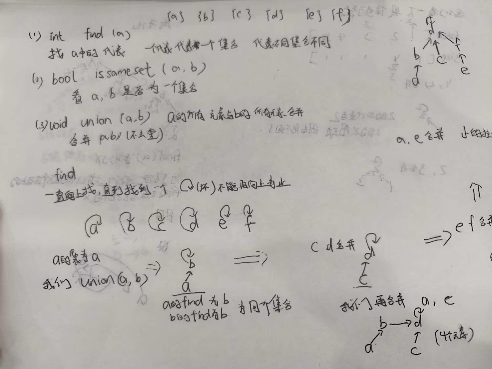
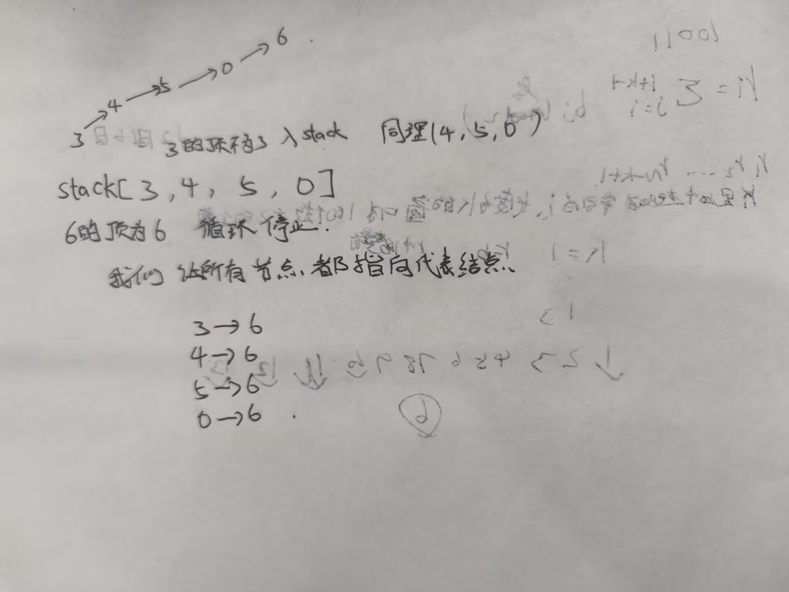
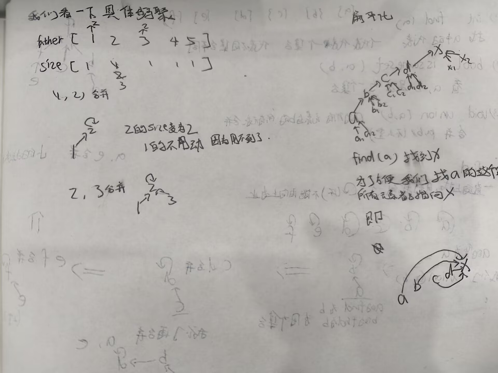
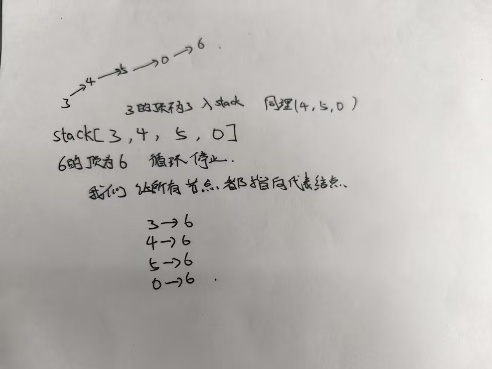

<h1>并查集</h1>
<p>并查集是一种非常强大的数据结构，它可以快速地合并和查询两个元素是否所属同一个集合。</p>

<div style="text-align:center;">
</div>


<div style="text-align:center;">
</div>


<div style="text-align:center;">
</div>
```
public class Code01_UnionFindNowCoder {
    public static int MAXN = 1000001;
    public static int[] father = new int[MAXN];
    public static int[] size = new int[MAXN];
    public static int[] stack = new int[MAXN];
    public static int n;
   1. public static void build(){
        for(int i=0;i<=n;i++){
            father[i]=i;//初始时每个节点都是自己的父节点，大小为1的集合
            size[i]=1;
        }
    }
    //i号节点，往上一直查找，找到代表节点返回！
   2. public static int find(int i){
        //沿途收集了几个节点（size）
        int size=0;
        while(i!=father[i]){
            stack[size++]=i;
            i=father[i];
        }
        //沿途结点收集好了，i已经跳到代表节点了，需要将沿途结点的父节点都指向代表节点！
        while(size>0){
            father[stack[--size]] = i;
        }
        return i;
    }
    public static boolean isSameSet(int x,int y){
        return find(x)==find(y);
    }
//合并两个集合  
    public static void union(int x,int y){
        int fx=find(x);
        int fy=find(y);
        if(fx!=fy){
            if(size[fx] >= size[fy]){
                size[fx] += size[fy];
                father[fy] = fx;
            }else{
             size[fy]+=size[fx];
            father[fx]=fy;
              
            }
            
        }
    }
}       
```  
2.可以用下面的图片表示：

<div style="text-align:center;">
</div>


<h2>群岛联通计划</h2>
题目描述:

某海域有 n 座岛屿，编号从 1 到 n。经过调查，目前已经建成了 m 座跨海大桥，每座桥直接连接了两座岛屿。

为了方便居民往来，政府希望最终任意两座岛屿之间都能通过已有或新建的桥梁互相到达。注意：不要求两座岛屿之间有一座直达的桥，只要经过若干座桥可以到达即可。

请你计算：最少还需要新建多少座跨海大桥？

注意：两座岛屿之间可能已经建有多座桥。

输入格式:
输入包含若干组测试数据。

每组测试数据的第一行给出两个用空格隔开的正整数 n 和 m，分别表示岛屿数量和已有桥梁数量。

接下来的 m 行，每行给出两个用空格隔开的正整数 u 和 v，表示岛屿 u 和岛屿 v 之间已经有一座桥直接相连。岛屿编号从 1 到 n。
输入数据的最后一行只有一个整数 0，表示测试数据结束。

输入：

```
4 2
1 3
4 3
3 3
1 2
1 3
2 3
5 2
1 2
3 5
999 0
0
```
输出：
```
1
0
2
998
```

代码实现：

```cpp linenums="1" title="群岛联通计划.cpp"
#include <bits/stdc++.h>
using namespace std;
const int N = 1005;
int fa[N];
void init(int n){
	for (int i = 1 ; i <= n ;i++){
		fa[i] = i;
	}
}
int find(int x){
	if (fa[x] == x)return x;
	return fa[x] = find(fa[x]);
}
void merge(int x , int  y){
	int fx = find(x);
	int fy = find(y);
	if (fx != fy){
		fa[fx] = fy;
	}
}
int main(){
	ios::sync_with_stdio(0);
	cin.tie(0);
	int n , m ;
	while (cin >> n && n != 0){
		cin >> m;
		init(n);
		for (int i = 0 ; i < m ; i++){
			int u , v;
			cin >> u >> v;
			merge(u,v);
		}
		int cnt = 0;
		for (int i = 1 ; i <= n ; i++){
			if (find(i) == i)cnt++;
		}
		cout << cnt - 1 << "\n";
	}	
	return 0;
}
```

我来解释一下代码：

我们最开始时，每个岛屿都是自己的父节点，大小为1的集合。
也就是写的init函数。

后面find函数是查找节点x的代表节点，也就是x所属的集合的代表节点。
find就是从x出发，沿着fa[x]一直查找，直到找到代表节点。返回代表节点。
我们假设现在并查集长这样:
```
1 -> 2 -> 3 -> 4
               ↑
              4 是根，fa[4] = 4
```
现在调用find(1)，
```
find(1)
  1 不是根，fa[1] = 2
  去找 find(2)
    find(2)
      2 不是根，fa[2] = 3
      去找 find(3)
        find(3)
          3 不是根，fa[3] = 4
          去找 find(4)
            find(4)
              4 是根，fa[4] == 4
              返回 4
          返回 4，同时 fa[3] = 4
      返回 4，同时 fa[2] = 4
  返回 4，同时 fa[1] = 4
```
最终返回4，并且将路径上的所有节点都被直接挂到4下面。

merge函数是建图，合并已有道路，合并两个集合，将x所属的集合合并到y所属的集合中。
通过find函数，我们可以知道x和y是否所属同一个集合。


我们再来写一题：

<h2>星港联通</h2>

<h2>题目背景</h2>
<p>某星际联盟在边境星域建立了若干星港，用于飞船补给和物资运输。然而一场陨石风暴摧毁了所有星港之间的航路，联盟必须逐步修复这些航路。</p>

<h2>题目描述</h2>
<p>已知边境星域共有 <code>N</code> 个星港，编号从 <code>1</code> 到 <code>N</code>，以及 <code>M</code> 条被摧毁的航路。每条航路是双向的，连接两个星港。</p>
<p>联盟派出了若干支工程队同时施工，并告诉你每条航路预计在时间 <code>t</code> 修复完成。航路一旦修复完成，飞船即可立即通过该航路往返两个星港。</p>
<p>请你计算：<strong>最早在哪个时刻，任意两个星港之间都能互相到达？</strong></p>
<p>注意：两个星港之间不一定需要直飞航路，只要经过若干条已修复的航路可以互相到达即可。</p>

<h2>输入格式</h2>
<p>第 <code>1</code> 行两个正整数 <code>N, M</code>，分别表示星港数量和航路数量。</p>
<p>下面 <code>M</code> 行，每行三个正整数 <code>x, y, t</code>，表示星港 <code>x</code> 与星港 <code>y</code> 之间的航路将在时刻 <code>t</code> 修复完成。</p>

<h2>输出格式</h2>
<p>输出一个整数：</p>
<ul>
  <li>如果存在最早时刻，使任意两个星港都能互相到达，输出该时刻；</li>
  <li>如果所有航路都修复完成后，仍存在两个星港无法互相到达，输出 <code>-1</code>。</li>
</ul>

<h2>输入输出样例 #1</h2>

<h3>输入 #1</h3>
<pre><code>4 4
1 2 6
1 3 4
1 4 5
4 2 3</code></pre>

<h3>输出 #1</h3>
<pre><code>5</code></pre>

<h2>说明/提示</h2>

<h3>样例解释</h3>
<p>按修复时间排序：</p>
<table>
  <thead>
    <tr><th>时刻</th><th>修复的航路</th></tr>
  </thead>
  <tbody>
    <tr><td>3</td><td>4 — 2</td></tr>
    <tr><td>4</td><td>1 — 3</td></tr>
    <tr><td>5</td><td>1 — 4</td></tr>
    <tr><td>6</td><td>1 — 2</td></tr>
  </tbody>
</table>
<ul>
  <li>时刻 3 后，<code>{4, 2}</code>、<code>{1}</code>、<code>{3}</code> 三个连通块；</li>
  <li>时刻 4 后，<code>{4, 2}</code>、<code>{1, 3}</code> 两个连通块；</li>
  <li>时刻 5 后，航路 <code>1—4</code> 修复，四个星港通过 <code>3—1—4—2</code> 全部连通。</li>
</ul>
<p>因此最早时刻为 <code>5</code>。</p>

<h3>数据规模与约定</h3>
<ul>
  <li><code>1 ≤ x, y ≤ N ≤ 10^3</code></li>
  <li><code>1 ≤ M, t ≤ 10^5</code></li>
</ul>

</body>


```cpp linenums="1" title="星港联通.cpp"
#include <bits/stdc++.h>
using namespace std;

const int N = 1010;
int fa[N];

void init(int n){
    for(int i = 1; i <= n; i++){
        fa[i] = i;
    }
}

int find(int x){
    if(fa[x] == x) return x;
    return fa[x] = find(fa[x]);   // 路径压缩
}

// 返回 true 表示成功合并了两个不同连通块
bool merge(int x, int y){
    int fx = find(x);
    int fy = find(y);
    if(fx == fy) return false;
    fa[fx] = fy;
    return true;
}

struct Edge{
    int u, v, t;
};

int main(){
    ios::sync_with_stdio(0);
    cin.tie(0);

    int n, m;
    cin >> n >> m;

    vector<Edge> edges(m);
    for(int i = 0; i < m; i++){
        cin >> edges[i].u >> edges[i].v >> edges[i].t;
    }

    // 按修复时间从小到大排序
    sort(edges.begin(), edges.end(), [](const Edge &a, const Edge &b){
        return a.t < b.t;
    });

    init(n);

    if(n == 1){
        cout << 0 << "\n";
        return 0;
    }

    int cnt = n;  // 连通块数量

    for(int i = 0; i < m; i++){
        if(merge(edges[i].u, edges[i].v)){
            cnt--;
            if(cnt == 1){
                cout << edges[i].t << "\n";
                return 0;
            }
        }
    }

    cout << -1 << "\n";
    return 0;
}

```
通过这几题我们可以发现，一些代码是通用的，我们可以将其提取出来，形成一个模板。
